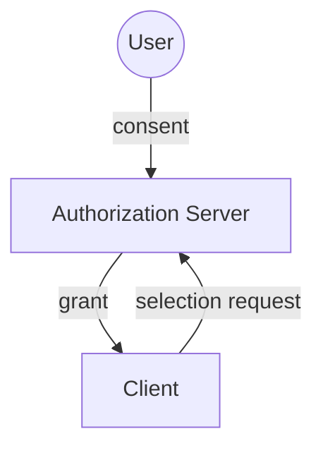
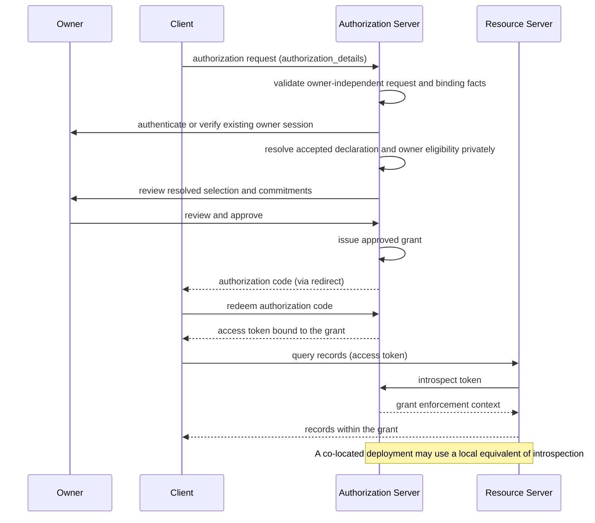
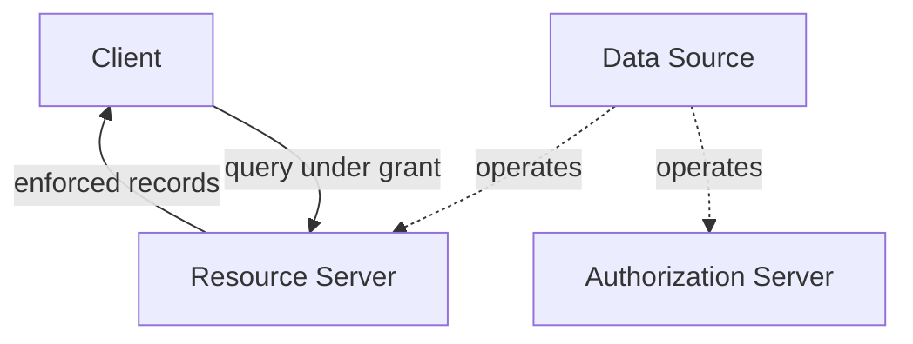
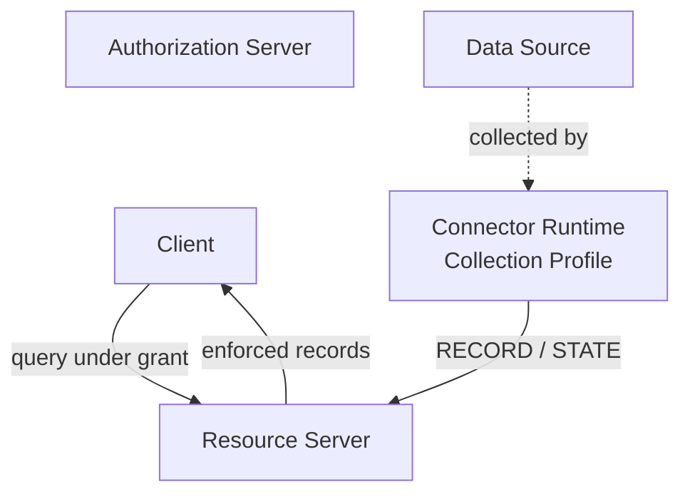

# Personal Data Portability Protocol (PDPP) v0.1.0

Status: Normative draft
Date: 2026-10-14

---

## 1. Introduction {#introduction}

PDPP is an authorization and disclosure protocol for personal data. It defines how a user authorizes an application to access specific data from a data source that holds their records, and how a resource server enforces that authorization.

The protocol specifies:

- A **record model** for representing personal data as flat relational streams
- A **selection request** format, the structured request for consent a client submits during authorization (RFC 9396 envelope)
- A **grant** object representing user-approved, parameterized consent
- A **source declaration** describing the consent, record, selection, and query
  surface exposed by either a connector-backed or provider-native source
- A **resource server interface** for serving records under grant enforcement

**Design axiom:** Source declarations define what can be requested. Grants define what was approved. These are separate concerns and must not be conflated.

Most source platforms do not yet expose a PDPP interface natively. Collection is the bridge for those sources: it brings their data into a resource server so the protocol's consent and enforcement layers can govern access to it. The informative [PDPP Collection Profile](spec-collection-profile) describes that bridge as builder guidance; it is not a conformance requirement. A connector conforms to PDPP by producing a source declaration valid under Section 5 and serving its data through a resource server conforming to Section 8. No particular collection method is required. The core protocol is useful without it: a resource server holding pre-collected data can serve that data under grant enforcement with no collection machinery involved, and data may also reach it via regulatory data exports, manual import, or platform-native APIs. The consent and enforcement layers defined in this specification (Sections 5-8) are agnostic to the collection method.

An implementation is PDPP-compliant for a role when it meets every requirement of this specification that applies to that role. Section 9 summarizes those requirements and does not narrow them. This specification does not depend on any specific network, token, ledger, infrastructure provider, hosted service, centralized registry lookup, or deployment of this repository. URI identifiers name sources, purposes, clients, and resources; they do not make the example registries in this document runtime dependencies. Consent integrity comes from the resolved grant and the exact source declaration snapshot retained by the authorization server.

### Interoperable core sections

Sections 4-8 define the protocol surfaces that implementations evaluate independently.

| Section | Governs | Other layers |
| --- | --- | --- |
| [Section 4: Record Model](#record-model) | Portable record envelopes, record evidence, stream identity, primary keys, blob references, resource references, stream semantics, and incremental-sync metadata. | Source collection, connector execution, and storage-engine choices. |
| [Section 5: Source Declaration](#source-declaration) | Common source identity, consent, record, selection, and query capabilities used by connector-backed and provider-native sources, and the conditions under which an authorization server accepts a declaration. | Connector acquisition and execution mechanics. |
| [Section 6: Selection Request](#selection-request) | What a client asks an authorization server to approve, plus declaration-backed validation and consent rendering before a grant is issued. | Product-specific consent flows, screen layouts, and hosted authorization-server deployments. |
| [Section 7: Grant](#grant) | The immutable consent artifact and the constraints a resource server enforces for a token-bound client. | Grant database schema, signed-token format, hosted registries, and deployment topology. |
| [Section 8: Resource Server Interface](#resource-server-interface) | The interoperable record-query and blob-fetch interface under grant enforcement, and the protected resource metadata a resource server publishes about itself. | Authorization-server deployment, storage backend, collection runtime, operator dashboard, and hosted service choices. |

### Relationship to existing standards

| Standard | Relationship |
|----------|-------------|
| [OAuth 2.0](https://www.rfc-editor.org/rfc/rfc6749) (RFC 6749) | PDPP is a profile of OAuth 2.0, carrying selection requests in RFC 9396 authorization_details. The grant is issued as the result of an OAuth authorization flow. |
| [RFC 9396](https://www.rfc-editor.org/rfc/rfc9396) (RAR) | PDPP uses the `authorization_details` envelope for selection requests. Core defines the `https://pdpp.dev/data-access` type URI; a companion profile can define others. |
| [RFC 6750](https://www.rfc-editor.org/rfc/rfc6750) (Bearer Token) | PDPP transports both owner tokens and client tokens as RFC 6750 Bearer Tokens on the wire. The resource server distinguishes token kind via `pdpp_token_kind` in the introspection response, not by token syntax. |
| [RFC 7662](https://www.rfc-editor.org/rfc/rfc7662) (Token Introspection) | PDPP uses authenticated RFC 7662 token introspection where the authorization server and resource server are separated, so the resource server can resolve grant-bound tokens. Co-located deployments may use a local equivalent. |
| [RFC 9728](https://www.rfc-editor.org/rfc/rfc9728) (Protected Resource Metadata) | PDPP resource servers publish RFC 9728 protected resource metadata, so a client discovers the authorization server, the query base, and the supported token kinds from the resource itself rather than from prior configuration. Core defines five `pdpp_`-prefixed additional members (Section 8): four always required, and `pdpp_freshness_granularity_seconds` required when client-token responses carry `freshness`. The extension profiles define `capabilities`. |
| [OAuth 2.0 Dynamic Client Registration](https://www.rfc-editor.org/rfc/rfc7591) (RFC 7591) | PDPP reuses the RFC 7591 client metadata vocabulary (`client_name`, `logo_uri`, `policy_uri`, and similar fields) for the consent display. A dynamic client registration endpoint is a deployment choice and is required only where deployments need it; Core functions without it. |
| [OpenID Connect Core 1.0](https://openid.net/specs/openid-connect-core-1_0.html) | PDPP reuses the `ui_locales` authorization request parameter (Section 3.1.2.1) and the RFC 8414 `ui_locales_supported` metadata member to choose the consent display language. Language tags follow [BCP 47](https://www.rfc-editor.org/info/bcp47), and the AS chooses a declaration text version with [RFC 4647](https://www.rfc-editor.org/rfc/rfc4647) Lookup (Section 6). |
| [Client ID Metadata Documents](https://datatracker.ietf.org/doc/draft-ietf-oauth-client-id-metadata-document/) (CIMD, IETF OAuth WG draft) | A client identifier that is itself an `https` URL the authorization server fetches to obtain RFC 7591-shaped client metadata, with no prior registration handshake. Control of the URL's domain is the trust root. CIMD is how deployed MCP clients present themselves: the MCP authorization specification revision 2025-11-25 states that authorization servers and clients SHOULD support CIMD and MAY support RFC 7591 dynamic client registration, which is retained for backward compatibility. Core treats a validated CIMD document as one source of validated binding metadata (Section 6) and its verified domain as a trust signal; the fetch and validation obligations belong to the OAuth binding rather than to Core. |
| [SMART on FHIR](https://hl7.org/fhir/smart-app-launch/) | Follows the domain-profile-over-OAuth pattern PDPP adopts: OAuth handles authorization, and the profile adds a domain data model, consent semantics, and a conformance regime. SMART on FHIR reached ubiquity through regulatory adoption of SMART-on-FHIR-patterned API requirements (the ONC Cures Act rule). |
| [UK Open Banking](https://www.openbanking.org.uk/standards/) | Also follows the domain-profile-over-OAuth pattern PDPP adopts: OAuth handles authorization, and the profile adds a domain data model, consent semantics, and a conformance regime. UK Open Banking reached ubiquity through the CMA's Open Banking mandate for the largest UK banks. |
| [UMA 2.0](https://docs.kantarainitiative.org/uma/wg/rec-oauth-uma-grant-2.0.html) (Kantara) | UMA is prior art for PDPP's user-managed, standing, revocable access model. PDPP applies that model to personal-data access through source declarations, grants, and enforcement by the resource server. |
| [GNAP](https://www.rfc-editor.org/rfc/rfc9635) (RFC 9635) | GNAP is an IETF authorization protocol that revisits OAuth-style delegation with a new protocol design. Several design decisions are directly relevant to PDPP: (1) interaction modes beyond browser redirects (relevant to nonstandard authorization interaction patterns); (2) request continuation for multi-step consent negotiation (relevant to optional streams); (3) key-bound grants instead of bearer tokens (stronger security for ongoing personal data access); (4) built-in grant management with revocation and rotation (relevant to `continuous` access mode). PDPP's entity-scoped `client_display` already follows GNAP's pattern of carrying client display metadata inline in the request. PDPP separates its core artifacts from authorization-protocol bindings. OAuth 2.0 and RFC 9396 define the v0.1 binding. Other bindings, including GNAP, may be specified as adoption warrants. For key-bound tokens specifically, DPoP (RFC 9449) offers an OAuth-native path to GNAP-style sender-constrained tokens and is a candidate optional hardening profile for v0.2. |
| [Solid](https://solidproject.org) | Solid takes the full re-architecture approach: personal data moves into user-controlled pods with RDF/Linked Data semantics, which requires source platforms to adopt the model or users to migrate off-platform. PDPP instead layers on existing OAuth infrastructure and bootstraps data supply through the Collection Profile, without requiring source platforms to adopt anything. |
| [ODRL](https://www.w3.org/TR/odrl-model/) (W3C Recommendation) | ODRL expresses permissions, prohibitions, and duties as machine-readable policies. PDPP does not use ODRL for authorization. The resource server enforces a PDPP grant on each read. A policy that travels with disclosed data cannot by itself guarantee enforcement after disclosure, the same limit Core states for `retention` (Section 11). |
| [DPV](https://w3id.org/dpv) (W3C Data Privacy Vocabularies and Controls Community Group) | DPV defines shared terms for purposes, legal bases, and processing. `purpose_code` has an extensible binding (Section 6), so a DPV purpose IRI can be used as a purpose code. PDPP keeps a small vocabulary of purposes, and Appendix A relates them to DPV 2.3 terms. DPV is a W3C Community Group report, not a W3C Standard. DPV treats model training as processing, and PDPP likewise carries AI training as a processing permission, not a purpose (Section 6). |
| [Data Transfer Project](https://github.com/dtinit/data-transfer-project) (DTI) | PDPP and DTI are complementary. The Data Transfer Project handles transfer mechanics, and DTI's stated position is that there is "no silver bullet" for portability: multiple approaches coexist. DTI's Data Trust Registry (post-pilot, 2026) addresses who is trusted: it vets services seeking access to platforms' portability interfaces so that platforms can rely on shared trust signals. PDPP addresses what was consented and how it is enforced (the grant and the resource server interface); a trust registry and PDPP's consent semantics compose rather than compete. The two protocols can chain. See Appendix B. |
| [Airbyte](https://airbyte.com) / [Singer](https://www.singer.io) | PDPP borrows the RECORD/STATE checkpoint pattern for incremental sync. This record and state-checkpoint lineage informs the Collection Profile companion specification; it appears here for reader orientation and is informative for Core. |
| [GDPR](https://eur-lex.europa.eu/eli/reg/2016/679/oj) | PDPP implements data minimization through stream and field selection. It also carries machine-readable purpose declarations (`purpose_code`) that support consent display, local policy, and implementation-defined audit or transparency mechanisms, and a separately approved processing permission for AI training (Section 6). The internal version history required for incremental sync may support implementations that choose to expose historical access features to users. Whether such exposure is required is outside the scope of this specification. This alignment is informative only and is not a required v0.1 capability. |
| [DMA](https://eur-lex.europa.eu/eli/reg/2022/1925/oj) | The `continuous` access mode enables ongoing portability aligned with the DMA's requirements. Article 6(9) requires effective portability with continuous and real-time access to the end user's data; PDPP's continuous grants and incremental sync map to that requirement. This alignment is informative only and is not a required v0.1 capability. |
| [EU Data Act](https://eur-lex.europa.eu/eli/reg/2023/2854/oj) (Regulation 2023/2854) | The Data Act's Article 5(1) flow, where a user directs a data holder to make data available to a third party, is the same triangle as PDPP's owner, source, and client. Article 2(12) defines the user as a natural or legal person, matching PDPP's subject-neutral owner. It applies from 12 September 2025, requires access by design for connected products placed on the market after 12 September 2026, and names no protocol. |

**Note:** The PDPP Collection Profile is one fulfillment mechanism. A conformance test suite for this specification is planned but is not defined in v0.1 (see Section 9).

#### Why a profile rather than a new authorization framework {#profile-not-framework}

PDPP is a data-portability profile, not a general authorization framework. It binds to OAuth 2.0 and RFC 9396 for v0.1 because that is what is deployed. On top of that binding it adds what neither UMA nor GNAP defines: a portable record model, purpose-bound durable grants, a declared collection and source layer, and a query surface with grant enforcement. UMA is prior art for the user-managed standing access model. A GNAP binding remains possible. The table above records both. Such a binding remains possible later without changing the record model, the grant, or the resource server interface, because none of those depend on the authorization protocol that produced the grant.

#### Relationship to sector-specific consent regimes {#sector-regimes}

**Note (non-normative).** PDPP is a floor, not a ceiling. A source already operating under a stricter or more specific consent regime — open banking, or a health regime built on FHIR — does not lose or weaken any obligation of that regime by also being reachable through PDPP. Where the two differ, the stricter requirement governs that source. Nothing in this specification authorizes a disclosure that the source's own regime forbids, and a PDPP grant is not a substitute for a consent that regime requires. This is a scoping statement rather than a conformance criterion: PDPP defines no test for which of two regimes is stricter, and conformance to this specification is assessed against this specification alone. Compatibility profiles that map a sector regime's consent vocabulary onto PDPP's are a possible future addition and are not defined in v0.1.

---

## 2. Terminology and Actors

### Actors

| Actor | Definition |
|-------|-----------|
| **User** | The person whose data is being accessed. Owns the data, approves grants, may revoke. Another person may approve on the user's behalf only as a representative (see [Representative approval](#representative-approval)). |
| **Client** | An application or AI agent requesting user data. Identified by `client_id`. In OAuth terms, this is the client. |
| **Data Source** | Any external system from which a user's data originates: a consumer platform, a SaaS application, a device, a local archive, a financial institution, or other system. |

The owner is the subject whose records the source holds. Typically this is a person; the protocol itself is subject-neutral, and an organization that authenticates as the account holder participates identically. For grant approval, the authorization server authenticates the subject or each authorized representative. A grant's `subject` identifies whose data it covers. Approval is attributed to the subject unless the grant records approval by a representative.

### Protocol roles

These roles may be co-located in a single deployment (e.g., a personal server acting as both authorization server and resource server) or separated. The spec defines the interfaces between roles, not the deployment topology.

| Role | Responsibility |
|------|---------------|
| **Authorization Server** | Issues and manages grants. Validates selection requests against retained source declaration snapshots. Tracks grant lifecycle (active, expired, revoked) and answers lifecycle queries from clients that hold data. |
| **Resource Server** | Stores records as flat relational streams. Serves records to clients filtered by grant parameters. |

The [PDPP Collection Profile](spec-collection-profile) defines a third role:

| Role | Responsibility |
|------|---------------|
| **Connector Runtime** | Runs connectors. Writes collected records to the resource server. Manages incremental sync state. |

In many deployments, a single **personal server** fills all three roles. The spec uses "personal server" when referring to a combined deployment, and the specific role name when the distinction matters.

**Note on the Authorization Server interface:** User-facing authorization interaction remains deployment-specific. Request resolution, the OAuth token result, and AS-to-RS token resolution are normative contracts. Core does not prescribe the consent screen layout or the owner's authentication method.

**Token resolution:** When the AS and RS are deployed separately, the AS-to-RS token-resolution contract is normative: the RS MUST authenticate to the RFC 7662 introspection endpoint and resolve the complete grant enforcement context from its response. The RS MUST enforce the request from that response and MUST NOT make a second AS lookup. For co-located deployments, a local equivalent (shared database or function call) is acceptable. Self-contained JWTs may be used as an optimization but MUST NOT be the sole revocation mechanism (see Section 10).

### Trust registry queries {#trust-registry-queries}

Core refers to a trust registry as a source of requester identity metadata and a positive trust signal at consent, as an external mechanism supporting retention accountability, and as a deferred concern. Core relies on two abstract queries: whether a client identifier is recognized and authorized, and whether a source declaration authority is accepted. Neither query is a wire protocol; an authorization server MAY answer locally or through a remote service.

A registry answer is an assertion that local authorization-server policy evaluates; it is not itself a decision. A conveyed answer identifies six things. It names the subject it concerns and the role, action, or scope the status qualifies. It carries the status itself, the governance framework under which the named issuer conferred it by URI, and the issuer or trust-anchor identifier. It bounds the answer with a validity window, as `valid_from` and `valid_until`. Without the subject and the issuer, an answer cannot be attributed or replayed against the right party; without the role or scope, a status does not say what the subject is authorized to do.

An authorization server records the trust signal it relied on — subject, role or scope, status, governance-framework URI, issuer or trust-anchor identifier, `valid_from`, `valid_until`, and the time of lookup — on its acceptance record or resulting grant. The lookup time matters because a status may be withdrawn later, and the record has to show what was true when the server relied on it.

Core does not define the registry, transport, recognition mechanism, or withdrawal propagation. A server that consults no registry remains conformant because registry answers inform local policy and never replace the owner's grant. ToIP's Trust Registry Query Protocol is an intended future profile binding, not a Core requirement.

### Data concepts {#data-concepts}

| Term | Definition |
|------|-----------|
| **Grant** | An immutable consent artifact specifying what data a client may access, under what constraints. |
| **Stream** | A named collection of records with a schema, primary key, and optional cursor field. Stream names are source-local (e.g., `messages`). The fully qualified identifier is an ordered pair `(source.id, stream_name)`, used in cross-source references and storage. Example: `("https://registry.pdpp.dev/connectors/spotify", "top_artists")`. |
| **Instance** | One connected account, device, or profile of the owner at a source, for example one of two Spotify accounts. A grant names instances by opaque handles (`instance_ids`). One handle names an instance in every stream of its source. Each stored record belongs to exactly one instance. |
| **Record** | A single data object within a stream. |
| **Connector** | A program that collects data from a data source, used when data is collected rather than served natively. One of possibly several producers of a source's streams. Defined in the Collection Profile. |
| **Source Declaration** | A source's versioned declaration of its identity, publisher, streams, schemas, consent surface, selection capabilities, and Resource Server query capabilities. It does not define connector acquisition or execution. |
| **Selection Request** | A client's request for specific data, expressed as RFC 9396 `authorization_details`. |
| **View** | An optional named field set a source declaration may define for a stream, composed from fields declared in the stream schema. When a client requests by view name, the resulting grant records the resolved field list, which is authoritative. Declared views are advisory; the authorization server is authoritative for views used in consent UI and issued grants. |
| **Processing permission** | Authority, carried in a grant, for an operation on disclosed data that read access alone does not authorize, such as AI training. See [Processing permissions](#processing-permissions). |
| **PDPP data** | Data obtained through PDPP, or data derived from it, including through successive transformations. Derivatives include labels, synthetic examples, embeddings, indexes, caches, and outputs generated using PDPP data. A model output is derived from an owner's PDPP data only when that data was an input to producing that output. Earlier use of an owner's data to train the model does not, by itself, make the output a derivative of that owner's data. |
| **Held data** | The PDPP data that a client, or a party acting for it, holds and that the client obtained under a given grant or derived from data so obtained. See [Held data after a grant ends](#held-data). |
| **Independent recipient** | A party other than the owner that receives PDPP data for an operation in which it does not act for the client under [Downstream holders](#downstream-holders). A party's role is determined for that operation; the same party can act for the client in another operation. |
| **Erasure instruction** | The owner's durable instruction that a client stop using and delete the held data of a grant. See [Erasure](#erasure). |

### Requirements Language {#requirements-language}

The key words "MUST", "MUST NOT", "REQUIRED", "SHALL", "SHALL NOT", "SHOULD", "SHOULD NOT", "RECOMMENDED", "NOT RECOMMENDED", "MAY", and "OPTIONAL" in this document are to be interpreted as described in BCP 14 [RFC 2119] [RFC 8174] when, and only when, they appear in all capitals, as shown here.

This document is normative except where content is explicitly marked as an example, a note, or otherwise non-normative.

This is the only normative document for PDPP Core v0.1 conformance. A profile imposes no requirement on an implementation that does not claim it. A future profile may define a separate named conformance claim only if its own status says so. Core can make support for a Core-defined value depend on such a claim: an implementation that supports a processing permission MUST conform to the permission's defining profile (Section 6). The [PDPP Collection Profile](spec-collection-profile) and [PDPP Source Declaration Discovery and Trust](spec-discovery-and-trust) are informative and define no conformance requirements of their own.

---

## 3. System Architecture

Every PDPP deployment shares the same authorization core: a user grants a client consent, and the authorization server issues a grant. The resource server that then serves records under that grant is not shown here; how it is populated and operated is deployment-specific (see below).



**Example (non-normative).** The diagram above shows the roles. The sequence below illustrates one authorization-code flow for one grant, followed by a client read in a deployment with a separate AS and RS. User-facing authorization flows remain deployment-specific (Section 2); [Section 8](#resource-server-interface) defines the token-resolution and grant-enforcement requirements.



**Example (non-normative).** An otherwise valid request names a source that the owner has not connected. The AS follows the same authentication entry path as when the source is connected. In authenticated review, the stream cannot be approved. If it is optional and another stream is approved, the grant omits it. If it is required or no stream remains, the client receives `access_denied` without a connection-status reason. A malformed `fields`/`view` combination still receives `invalid_authorization_details` independently of the owner's connections.

What differs between deployments is how the resource server that fulfills the grant is populated and operated. This is not a closed set: a resource server may hold pre-collected data with no collection machinery involved, or receive data via regulatory export, manual import, or platform-native APIs ([Section 1](#introduction)). The two examples below illustrate the ends of that spectrum; the [PDPP Collection Profile](spec-collection-profile) is one fulfillment mechanism, not the only one.

**Example A: source-native fulfillment.** The data source operates its own authorization and resource servers directly; there is no separate collection step.



**Example B: personal-server fulfillment.** A connector runtime, governed by the Collection Profile, collects data from the source and syncs it into a resource server the user controls.



**Core defines no ingest path.** Core specifies the authorization server, the resource server, and what passes between them and a client. It does not specify how records reach the resource server, and conformance to Core does not depend on any particular answer. Examples A and B are illustrations, not a classification: a resource server holding data placed there by regulatory export, manual import, a provider's own write path, or a mechanism not yet described is equally within Core. The [PDPP Collection Profile](spec-collection-profile) describes one such mechanism, connector collection, and describes it for builders rather than as a conformance requirement.

**On-behalf-of access is two ordinary grants, not one delegated grant.** At the upstream platform, the owner authorizes the personal server to read the owner's data. At the personal server, the owner separately authorizes a downstream client to read owner-held data. These are independent grants, each issued and revocable by the owner. A personal server MAY disclose owner-held data under the fresh downstream grant; it does not pass the platform grant or a downstream PDPP token to the other relationship.

PDPP therefore defines no delegated-grant, sub-grant, or grant-chaining construct, and none is needed to build this. The same shape is already how account aggregation works in deployed systems: an open banking aggregator holds the user's consent at each bank and its own consent from the user, rather than subdividing one authorization. Where a binding needs to exchange one credential for another across the two relationships, OAuth Token Exchange (RFC 8693) is the existing mechanism, and it is a concern of the binding rather than of Core.

Only live passthrough is bounded by the upstream grant: when the personal server does not hold a copy and reads from the platform to fulfill a downstream request, it MUST stay within the upstream grant. This limit does not constrain a fresh grant for owner-held data. A downstream PDPP token is never forwarded upstream.

**Token transfer is prohibited.** A recipient MUST NOT transfer its token or let an ungranted party exercise it.

A client's disclosure of held PDPP data to an independent recipient is governed by [Independent-recipient disclosure](#independent-recipient-disclosure). This is distinct from an RS serving owner-held data under a fresh grant to the receiving client, as described above.

A different topology — the owner running their own authorization server in front of a platform's data, so that the platform holds the data but the owner's server decides who may read it — is not introduced by this specification. It is the arrangement UMA describes, it is not the arrangement above, and it is recorded as deferred rather than left ambiguous.

### Protocol layering

PDPP separates three concerns that other systems conflate:

1. **Authorization**: the user's consent about what is disclosed, to whom, and under what constraints. This is the grant. It is the portable core of PDPP.

2. **Disclosure**: the records the resource server returns given a valid grant. This is the resource server query API.

3. **Collection**: how data gets into the resource server in the first place. This is the Collection Profile. It is one answer to this question; pre-loaded data, manual imports, and other mechanisms are equally valid.

The grant and query API are the normative core. Collection is a companion mechanism.

**Ingest and sync-state are outside Core.** The core protocol defines the query API (disclosure) and grant semantics. The Collection Profile defines connector collection. A profile that defines an ingest or write interface also defines its endpoints, its errors, and any sync-state interface it uses.

---

## 4. Record Model {#record-model}

**Note:** This section defines portable record envelopes, record evidence, stream identity, primary keys, blob references, resource references, stream semantics, and incremental-sync metadata. Source collection, connector execution, and storage-engine choices are out of scope for this document (see the [PDPP Collection Profile](spec-collection-profile)).

Personal data is represented as flat relational streams. This enables streaming, pagination, incremental sync, and compatibility with DTI canonical data models.

### Streams

A stream is a named collection of records with a consistent schema. Examples: `playlists`, `messages`, `sleep_sessions`. A stream's shape (its fields and schema) is declared in the source declaration; see [Section 5: Source Declaration](#source-declaration).

### Stream semantics

Each stream has one of two semantic types:

| Semantics | Meaning | Examples | Resource server behavior |
|-----------|---------|----------|------------------------|
| `append_only` | Records are immutable events. New records are added; existing records are never modified. | messages, transactions, play_events, workouts | Insert new records only. Equal-data duplicates are idempotent; differing data is a conflict (see below). Explicit deletion is permitted. |
| `mutable_state` | Records represent current state of an entity. Records may be updated or deleted. | profile, settings, playlist_items, follow_lists | Upsert by primary key. Resource server maintains version history for incremental sync. |

**Re-emitted append-only records:** A valid `op: upsert` RECORD in an `append_only` stream is a duplicate when a record with the same canonical key is already stored for the same source, stream and instance. The record identity rule applies before duplicate handling. The resource server MUST leave the stored record, including its `emitted_at`, unchanged, and MUST NOT create a version or a change-history event. Equal `data` is an idempotent retry. Differing `data` is a conflict: a profile-defined ingest or write interface that receives one MUST report the conflict to the producer and SHOULD make it visible to the owner. Equality compares `data` as JSON values, not the new envelope's `emitted_at`: object member order and whitespace do not matter, and numbers compare by numeric value. A duplicate produces no `changes_since` result; the existing record still appears in a session that starts from `beginning`. This rule does not block `op: delete` or owner deletion; those removals produce tombstones under [Incremental sync](#incremental-sync). A source that updates existing records declares the stream `mutable_state`.

Approximately 95% of personal data by volume is `append_only`. The remaining 5% is `mutable_state`. Mutable state records (profiles, preferences, relationships) are often the highest-value context for AI agents.

An authorization server MUST reject a declaration containing an unrecognized `streams[].semantics` value. A resource server MUST NOT interpret an unrecognized stream semantic as `append_only` or `mutable_state`. A later version can add semantic types; an implementation that predates one does not apply the wrong write and sync behavior to it.

### Full records and disclosed projections

A stream schema describes a full record before disclosure projection. For a client token, the StreamGrant's `required_fields` is the frozen consent floor defined in Sections 5 through 7. For a client-token read, the RS MUST include those fields whenever it returns that record's `data` and the stored record version has a value for them. A required field without a stored value stays absent. A tombstone carries no `data` and follows the tombstone shape defined in this section.

The RS MUST construct disclosed `data` from only the top-level members permitted by the grant and the request-time field selection. Missing authorized optional members remain absent. The RS MUST NOT insert nulls or fabricated values for withheld members. A client MUST NOT validate a projected `data` object as though it were the full stream record.

Envelope identifiers remain part of the record contract. The AS MUST disclose this fact during owner review. Withholding an identifier from `data` does not hide a matching identifier in the envelope. If envelope disclosure is unacceptable, the AS MUST omit an optional stream or refuse issuance for a required stream.

An RS unable to serve a requested projection without changing the meaning of the disclosed data MUST refuse that read with HTTP 403 `disclosure_unavailable`. It MUST NOT repair the projection by disclosing unauthorized fields.

### Incremental sync {#incremental-sync}

Every stream supports incremental sync. The resource server maintains internal change history for it: the order in which it ingested and changed records, version history for `mutable_state` streams, and enough deletion information to emit tombstones. This is an implementation detail: the protocol surface is a standard cursor-based query that returns the changes since a given token (see [Section 8](#resource-server-interface)). The change history is not exposed as a separate stream.

A `changes_since` token is a position in the resource server's ingestion and change order, not a `cursor_field` value. A `next_changes_since` token MUST NOT reveal a readable position or time. Token equality or ordering MUST NOT signal a change that is not visible to the grant, or to the owner session's effective scope, including after a session that returns nothing. One way to meet this is to make each issued token distinct and opaque, for example by encrypting it with fresh randomness. A page cursor MUST NOT reveal a readable position, time, or field value either. An `append_only` record that arrives late with an earlier `cursor_field` value, such as a play from yesterday ingested today, therefore appears in the next session.

A client that has previously synced a stream queries for changes by passing its last `next_changes_since` token. The resource server returns every record not visible at h0 and visible at h1, within the client's grant-authorized field projection. For a record visible at both horizons, it returns the record only if its grant-authorized projection changed or the previous session withheld it, or redacted a reference in it, after a deletion (see the pagination rule in Section 8).

This design ensures that a client authorized for fields A and B cannot infer that field C changed, even if C was modified after the client's last sync. The response is a function of the grant, not of the full record state.

This promise covers field values, not membership. Under a time-bounded or resource-filtered grant, the client can see which records are visible. A change to a hidden time field can move a record into or out of that set. Repeated full listings reveal the same change, so no grant of this kind can hide it.

**Snapshot model:** `changes_since` returns the full current state of every record not visible at h0 and visible at h1, and of every record visible at both whose grant-authorized projection changed, plus tombstones. It also returns each record that the previous session withheld, or in which it redacted a reference, after a deletion (see the pagination rule below, and Cross-stream references in Section 4). It does not return field-level diffs. The client receives a complete record object for any record that changed.

**Visibility:** A record is *visible* at a horizon if it exists at that horizon and passes every restriction of the query context at that horizon. For a client token, these are the grant's stream, `instance_ids`, `resources`, and `time_constraint`. For an owner token, they are the owner scope and any request filter. Within a stream, a record is identified by its instance and its canonical key (see RECORD envelope, Record identity below). A `changes_since` session from horizon h0 to horizon h1 returns:

| At h0 | At h1 | Result |
|---|---|---|
| not visible | visible | the record, projected as of h1 |
| visible | visible | the record, projected as of h1, only if its projection changed or the previous session withheld it, or redacted a reference in it, after a deletion |
| visible | not visible (deleted, moved out of the time window, or excluded for another reason) | one tombstone |
| not visible | not visible | nothing |

The session compares only the two horizons. The resource server MUST emit a tombstone for each record visible at h0 and not visible at h1. It MUST NOT emit a tombstone for any other record. This includes a record that was never visible under the query context and a record that was visible only between h0 and h1.

Visibility at h0 uses the record's version at h0. For a deleted record, the h0 version establishes visibility at h0, and deletion evidence establishes only the fact and time of the deletion; the `data` of the delete directive is never used. The resource server MUST retain the state needed to determine visibility at every unexpired horizon. If it cannot determine that state, it MUST fail the session with 410 `cursor_expired`.

**Sync guarantee:** With these rules, two conforming resource servers that hold the same records produce the same synced copy. The guarantee covers only a copy that starts at `beginning` and is updated by later `changes_since` sessions. A client that also keeps records from other reads, such as a get by ID between sessions, reconciles them itself; a get by ID returns 404 once the record is not visible. A client MUST treat a tombstone for a record it does not hold as a no-op.

**Starting a sync:** A client starts incremental sync with `changes_since=beginning`. `beginning` stands for an empty horizon at which no record is visible, so the first session returns every visible record and no tombstones. It is not a retained snapshot: it never expires, and it is bound to a grant and query context only when a request uses it. After a completed `changes_since=beginning` session, the client MUST replace its copy of the stream synchronized under that grant and query context with that session's result. This applies to every restart, not only a restart after `cursor_expired`. Sync state and the sync guarantee are per grant: the replacement does not reach records that the client holds under another grant.

**Cursor expiry:** Resource servers MAY expire historical change data after a retention period. A `changes_since` token is valid while the resource server still holds the change history back to and including its horizon. If a client's token has expired, the resource server MUST return HTTP 410 Gone with error code `cursor_expired`. The client MUST start again from `beginning`.

**Two distinct cursor spaces:** `cursor`/`next_cursor` are pagination tokens within a single query execution; `changes_since`/`next_changes_since` are incremental sync tokens across sessions. A client MUST NOT use a `next_cursor` value as a `changes_since` parameter; they are different token spaces and will produce a protocol error if confused. The terminal page of a `changes_since` result MUST include a `next_changes_since` field. A non-terminal page MUST NOT include it, because the resource server never issues a token for pages it has not delivered. Paginating an incremental sync: pass `changes_since` on the first request, follow `next_cursor` for subsequent pages within that session, then store `next_changes_since` from the terminal page for the next session.

**Tombstones:** For a client token, a tombstone is exactly:

```json
{
  "object": "record",
  "id": "canonical-key-string",
  "instance_id": "inst_K4wq8Rn2",
  "stream": "playlists",
  "deleted": true
}
```

A client tombstone has no `data`, `deleted_at`, or `emitted_at`. It tells the client only that a record visible at the previous horizon is not visible now. It does not reveal whether the record was deleted, when the change happened, or any field value.

For an owner token, a tombstone also carries `removal`, and for a deletion `deleted_at` and `emitted_at`:

```json
{
  "object": "record",
  "id": "canonical-key-string",
  "instance_id": "inst_Zp5rT2mA",
  "stream": "playlists",
  "deleted": true,
  "removal": "deleted",
  "deleted_at": "2026-04-01T10:00:00Z",
  "emitted_at": "2026-04-01T10:00:01Z"
}
```

`removal` is `deleted` when the record was deleted, and `left_query` when the record still exists but no longer passes the owner's query context, for example a range filter. `deleted_at` and `emitted_at` are present only when `removal` is `deleted`. The owner owns the data, so the reason is not hidden from them.

Tombstones use the same `object: "record"` envelope as regular response records, with `deleted: true`. The `id` field is the canonical key string (see RECORD envelope, Compound key encoding below), and `instance_id` names the record's instance.

A tombstone signals that a record left the client's view of the stream. For subset or derived streams this means membership removal; it does not assert that the source record was deleted. See [Derived subset streams](#predicate-based-grant-scoping) (Section 12) for the non-normative discussion of this stream shape.

`deleted_at` represents the time the record was deleted in the source system, if known; otherwise the time the RS processed the deletion directive.

**Non-normative note (GDPR Article 15):** The version history maintained internally by the resource server to support `mutable_state` incremental sync may support implementations that choose to expose historical access features to users. Whether such exposure is required is outside the scope of this specification. This alignment is non-normative and is not a required v0.1 capability.

### Split rule

When modeling data from a source, apply this rule:

- **Separate stream** if: has its own stable ID, unbounded cardinality, changes independently, or consumers query it independently.
- **Nested within a record** if: small, bounded, and only meaningful as part of the parent.

Example: `conversations` and `messages` are separate streams (messages are unbounded, have their own IDs, change independently). A message's `content_blocks` array can be nested (bounded, only meaningful within the message).

This is a common data modeling judgment call. The rule above is a guide, not a formula; declaration publishers exercise discretion.

### The RECORD envelope

RECORD is the universal data envelope. It is used in the Collection Profile and is the canonical shape for records stored in the resource server.

```json
{
  "stream": "messages",
  "key": "msg_abc123",
  "data": {
    "id": "msg_abc123",
    "conversation_id": "conv_xyz",
    "role": "user",
    "content": "What is the weather like?",
    "source_created_at": "2026-03-28T15:00:00Z"
  },
  "emitted_at": "2026-03-28T15:01:00Z"
}
```

| Field | Type | Required | Description |
|-------|------|----------|-------------|
| `stream` | string | yes | Stream name |
| `key` | string or string[] | yes | Primary key value. Array for compound keys; order matches the SourceDeclaration `primary_key`. |
| `data` | object | yes | Record payload conforming to the stream schema. For `op: delete`, `data` MUST contain every primary-key field, matching `key`; other schema-required fields MAY be absent. |
| `emitted_at` | ISO 8601 | yes | When the record was emitted by its producer (processing time, not source time). |
| `op` | enum | no | `upsert` (default) or `delete`. This field is a directive to the resource server and is not stored as part of the record data. |

**Compound key encoding:** When `primary_key` has multiple fields, `key` is an array of values in the order declared by the SourceDeclaration `primary_key`. The canonical string form of a compound key is the [RFC 8785](https://www.rfc-editor.org/rfc/rfc8785) (JSON Canonicalization Scheme) serialization of the ordered array of string key components (e.g., `["user_123","2026-04-01"]`). Minification alone does not make the form unique, because a JSON string can escape the same character in more than one way. Each primary-key component MUST be serialized as a string in the canonical encoding. Non-string primary-key field values (e.g., integers, dates) MUST be converted to their string representation before encoding. Within JSON, `resources[]` entries and response record `id` values carry the canonical key string without percent-encoding, and the AS and RS MUST NOT percent-decode them. The AS MUST reject a `resources[]` entry that is not in canonical form. A URL path parameter carries the canonical key string percent-encoded for HTTP, and the RS decodes it exactly once before it compares keys. The `resource_ref.record_id` field retains native `string | string[]` type.

**Record identity:** For any record, the values of the `data` fields named by the stream's `primary_key` MUST match the values in the `key` envelope field (in order). A resource server or profile-defined write interface MUST reject a record before storage when those values disagree. The profile that defines the interface defines the error.

A resource server stores each record under exactly one instance. The canonical key is unique only within one instance of a stream: two instances can hold records with the same key, for example the same playlist in two accounts. Within a stream, a record is therefore identified by its `instance_id` and its canonical key. Core defines no ingest path, so it does not define how a record is assigned to an instance.

**Response records:** A query response serves each record as an object with `object: "record"`, `id` (the canonical key string), `instance_id`, `stream`, `data`, and `emitted_at`. A tombstone uses the same object with `deleted: true` (see Tombstones above). `instance_id` is the opaque handle of the record's instance, and every served record and tombstone carries it. For a client token, it is the handle that the grant lists for that instance. For an owner token, it is the owner's handle for that instance, and every owner-token response uses the same value. A client MUST identify a record within a stream by its `instance_id` and `id` together.

### Record evidence {#record-evidence}

A record that the resource server serves (Section 8) MAY carry an `evidence` member. Evidence lets a client check who produced or served record values, and that the values did not change after that. The member is an array of evidence items. An empty array has the same meaning as no member. Core defines the item shape and the rules below. Core defines no proof mechanism: a profile defines each evidence `type`, and v0.1 defines none (Section 12). The RECORD envelope above carries no evidence. How evidence reaches the resource server is outside Core.

| Member | Type | Required | Description |
|---|---|---|---|
| `type` | string | yes | Absolute URI that identifies the evidence type. The profile for the type defines `proof`, how to verify it, and the form of `attester.id`. |
| `attester` | object | yes | The party that makes the claim. `role` (string, required) is the kind of party. `id` (string, required) identifies the party. |
| `covers` | string[] | yes | Non-empty. Each entry is an [RFC 6901](https://www.rfc-editor.org/rfc/rfc6901) JSON Pointer, relative to the record's `data`, to a field that the item verifies. In v0.1 each pointer has exactly one segment, such as `/amount`, and names a field present in the served `data`. |
| `id` | string | no | Identifies the item within the array. Unique in the array. MUST NOT be an absolute URI. |
| `refs` | string[] | no | Other evidence that the item points to. Each entry is the `id` of another item in the same array, or an absolute URI that serves as an identifier. The proof MUST cover `refs`. |
| `proof` | any JSON value | yes | Content defined by the type, including any key reference and any profile extension. Opaque to Core. |

An evidence item is closed in v0.1: it has only the members above, and a profile puts any extension inside `proof`. A resource server MUST NOT add a member to an item.

Core defines three `attester.role` values. The set is open, and a profile can define more roles.

| Role | Claim |
|---|---|
| `source` | It held the record and issued these values. |
| `collector` | It derived these values from source data that it received, for example as a connector runtime that normalizes that data. A collector claim depends on trust in the collector and is not a source claim. |
| `resource_server` | It served these values. |

**Record binding.** The verification procedure that a profile defines MUST bind the claim to the record context as served to this caller. For both client-token and owner-token reads, that context includes the authorization server's issuer identifier, the source identity, the record's `instance_id`, the stream, and the canonical record key.

For a client-token read, the source identity is the grant's `source.id`. The context also includes the grant's `client.client_id` and `subject.id`. The latter is pairwise, or the identifier the owner chose to disclose to this client under [Pairwise identifiers](#pairwise-identifiers). The instance handle is the value served to that client. For an owner-token read, the source identity and subject identifier are those to which the owner token is scoped, in the form the profile defines. The context includes that subject identifier and the `instance_id` served to the owner.

The verification procedure MUST distinguish owner-token and client-token contexts. It MUST authenticate each identifier together with its namespace. Covering primary-key fields or namespace-local identifier strings alone does not bind an item to a record.

A binding MAY be composed. The attester binds its own identifier for the record, and a `resource_server` item maps that identifier to this caller's record context. The mapping item's `refs` MUST name the attester's item, and its proof MUST authenticate the complete referenced item and the attester's record identifier. The profile for the mapping type defines how the referenced item is encoded for that authentication and how a client verifies it. A client infers source provenance from a composed binding only after it verifies the whole chain and trusts the mapping attester. If a client cannot verify a binding, directly or through a composed chain, the item attests only detached field values, and the client MUST NOT infer from it where the record came from.

**Presence asserts nothing.** An item is a claim for the client to check. The client verifies the item under the profile for its type, or treats it as absent. Core defines no member that states that an item is verified, and a client MUST NOT treat delivery as verification. An item that the client ignores, cannot verify, or finds invalid supplies no verified claim. A client's own policy MAY reject or quarantine a record when evidence it requires is absent or invalid. The client decides whether to trust the attester.

**References.** A resource server MUST NOT deliver an item whose local `refs` entries do not all name items delivered in the same array. A client treats a local entry that names no delivered item as a reference to an absent item. An absolute URI in `refs` is an identifier only. The no-widening rule applies to the URI and to everything that a client can obtain through it. A client MUST NOT retrieve the URI unless the profile defines retrieval, access control, and integrity binding for it.

**Effective projection.** The effective projection is the set of fields that the response serves for the record. For a client token, the granted field set is the StreamGrant's `fields`, and the required field set is its `required_fields`. When a record request supplies `fields`, the RS MUST serve only the intersection of the requested and granted fields, together with the required field set. When the request omits `fields`, the RS MUST use the granted field set. The RS MUST apply this effective projection to record `data` and to record evidence. For an owner token, it is the read's effective `fields` or resolved `view` projection plus the schema-required fields, or the whole record when the read names neither. The effective projection governs evidence as it governs `data`. v0.1 defines no request member or query parameter that asks for evidence or suppresses it. A resource server delivers evidence on an owner-token read only for a type whose profile supports owner reads.

For a client-token read, the RS MUST NOT add a field outside the granted field set. A required field that has no value in the stored record version remains absent from that record's `data`, with the meaning that this section gives to an absent field. The RS MUST NOT fabricate its value.

These projection rules do not change record eligibility under `changes_since`. The RS MUST continue to determine client-token eligibility using the grant-authorized projection defined in [Incremental sync](#incremental-sync). The RS MUST preserve the grant and request-field bindings of page cursors and sync tokens.

**No widening.** Evidence MUST NOT reveal anything outside the effective projection. It MUST NOT reveal a value, field name, or subject identifier other than one already disclosed to this caller. It MUST NOT reveal any fact about hidden data, such as whether a hidden value changed or how many hidden fields or records exist. The rule covers every signal that evidence gives: whether an item is present or absent, how many items there are, the bytes of each item, and how these change between reads. For example, a cleartext subject identifier, a signature over bytes that include a hidden field, an unsalted hash of a hidden value, and a digest count that shows how many fields are hidden all widen the disclosure. A grant could authorize a hidden-dependent signal expressly, but no v0.1 grant does.

A resource server MAY decide per record whether to deliver an item only when that decision is independent of hidden data. Otherwise, the profile defines a uniform fallback, such as delivering the type for every record in the stream or for none.

**Delivery.** A resource server MUST NOT deliver an evidence item unless all of these conditions are true:

1. The resource server implements the item's type, including the verification and disclosure rules of its profile.
2. The resource server has checked that the proof is valid over the served values of the covered fields, in the canonical form that the profile defines. It has also checked that the proof authenticates the item's `type`, the `attester` identity and role, and each `covers` pointer together with the served value it names. A profile's verification procedure MUST authenticate all of these, and clients MUST check them.
3. The item's record binding verifies for this caller, directly or through a composed chain.
4. The resource server has checked that the item satisfies the no-widening rule for this response.

A resource server MUST NOT pass through an item that it cannot check, and MUST NOT mark an item as verified or unverified. These checks do not make the attester trusted: that decision stays with the client. A resource server that implements no evidence type delivers no evidence and still conforms.

A tombstone carries no `evidence`. Evidence is not part of the effective projection: a change in evidence alone does not make a record eligible in a `changes_since` session.

**Profiles.** An evidence profile MUST define:

- the canonical form that its proof covers;
- how it meets the no-widening rule across reads, for example by reusing an item while the canonical covered values and the binding context are unchanged, and by replacing or omitting the item when validity, expiry, or revocation requires it;
- any structure shared across records, such as a signed tree head, and how that structure meets the no-widening rule;
- how it prevents clients from linking the same subject or record beyond what the served data already reveals;
- whether and how an item discloses raw inputs of a derived field without widening the disclosure;
- whether it can cover a `blob_ref` or `resource_ref` field, which the resource server rewrites at read time;
- its holder binding and validity semantics, such as expiry and revocation;
- whether it supports owner reads.

**Unknown types and roles.** A client MUST ignore an item whose `type` it does not implement or whose `attester.role` it does not recognize.

Example (non-normative). The type URI is a placeholder that PDPP does not define.

```json
{
  "object": "record",
  "id": "t1",
  "instance_id": "inst_Zp5rT2mA",
  "stream": "transactions",
  "data": {
    "id": "t1",
    "amount": "-42.10",
    "posted_at": "2026-09-01"
  },
  "emitted_at": "2026-09-02T08:00:00Z",
  "evidence": [
    {
      "type": "https://example.org/evidence/detached-jws",
      "id": "e1",
      "attester": { "role": "resource_server", "id": "https://rs.example" },
      "covers": ["/id", "/amount", "/posted_at"],
      "proof": { "jws": "eyJhbGciOiJFUzI1NiIsImtpZCI6InJzMSJ9..c2ln" }
    }
  ]
}
```

**Absent and null fields:** A response's field projection is the effective returned field set. For a client token, it is the granted fields narrowed by any accepted `fields` parameter, together with the grant's `required_fields`. For an owner token, it is the effective `fields` or resolved `view` projection, or all fields when neither is supplied, with the stream's schema-required fields. This response projection is distinct from the grant-authorized projection used to determine client `changes_since` eligibility. In a returned record (not a tombstone), omission of a top-level `data` field inside that projection means that the record version the response returns has no value for that field. Omission of a field outside that projection says nothing about stored values. A present JSON `null` is a stored null, allowed only where the stream schema allows it. Neither omission nor `null` establishes the source's current state, and neither relaxes the stream's schema-required fields. A client applies each returned record as a replacement of its copy within the same projection, not as a partial-update instruction.

**Partial updates:** For `mutable_state` streams, a profile MAY define partial-update instructions, distinct from RECORD snapshots, that name the fields they set or remove and leave all other stored fields unchanged. Applying an instruction MUST atomically produce a record that satisfies the stream schema and the record identity rule above. Reads, time constraints, version history and `changes_since` continue to operate on the resulting complete record snapshots and tombstones under the rules of this specification; a partial-update instruction is never served as a record. Core defines no partial-update syntax. A profile MUST NOT use a partial-update instruction to modify an existing `append_only` record.

### Timestamps

Two timestamp concepts appear in records:

- **`emitted_at`**: when the producer emitted the record. Always present on the RECORD envelope. Producer-generated.
- **Source timestamps**: when the event occurred or the resource was created or modified on the source platform. These are fields within `data`, declared in the stream schema. The spec reserves two standard field names: `source_created_at` and `source_updated_at`. Connector authors SHOULD use these names when the platform provides them, rather than inventing platform-specific names.

### Foreign keys

Streams reference each other via foreign key fields in `data`:

```json
{
  "stream": "conversations",
  "key": "conv_xyz",
  "data": {
    "id": "conv_xyz",
    "title": "Weather chat",
    "source_created_at": "2026-03-28T14:00:00Z"
  }
}
{
  "stream": "messages",
  "key": "msg_abc123",
  "data": {
    "id": "msg_abc123",
    "conversation_id": "conv_xyz",
    "content": "...",
    "source_created_at": "2026-03-28T15:00:00Z"
  }
}
```

The SourceDeclaration declares `primary_key` per stream. Foreign key relationships are declared in its `relationships` field (see [Section 5](#source-declaration)). A foreign key refers to a record in the same instance.

### Binary data (blob_ref)

Binary data (photos, videos, audio, documents) is not inlined in records. The record contains metadata and a `blob_ref`:

```json
{
  "stream": "media",
  "key": "media_123",
  "data": {
    "id": "media_123",
    "caption": "Sunset",
    "media_type": "image",
    "source_created_at": "2026-03-28T10:00:00Z",
    "blob_ref": {
      "blob_id": "blob_media_123",
      "mime_type": "image/jpeg",
      "size_bytes": 2048000,
      "sha256": "a1b2c3..."
    }
  }
}
```

`mime_type` MUST be a valid IANA media type (see [IANA Media Types](https://www.iana.org/assignments/media-types/)). Record producers emit `blob_ref` without a `fetch_url`. The resource server injects `fetch_url` at read time when serving records via the query API. A `blob_id` is unique only within one instance, so the `fetch_url` carries the blob's `instance_id` (see Get a blob in Section 8).

### Cross-stream references (resource_ref)

When a record references a record in a different stream on the same resource server, use a `resource_ref`. This is a within-subject, within-server pointer. Cross-user or cross-server references are out of scope in v0.1.

```json
{
  "stream": "tag_assignments",
  "key": "assign_1",
  "data": {
    "tag_id": "tag_sunset",
    "target": {
      "source_id": "https://registry.pdpp.dev/connectors/instagram",
      "stream": "media",
      "record_id": "media_123"
    }
  }
}
```

A record producer emits `resource_ref` without `instance_id`. When `source_id` is the referencing record's source, the target is in the referencing record's instance. Core does not define how to resolve the target instance of a reference to another source (Section 12).

At read time, in the same way that it adds `fetch_url` to a `blob_ref`, the resource server serves each `resource_ref` in one of two forms. It serves the resolved form, the reference with `instance_id` added, only when the target is in the referencing record's source and is authorized under the requesting token. For a client token, the target MUST pass every constraint of the same grant for the target stream: instance, `resources`, time constraint, and field access to the target's key. For an owner token, the target MUST fall within its subject, source, connection, and operation scope; no client grant is required or synthesized. The value is the target instance's handle, chosen as for response records. Otherwise it serves the redacted form, which has exactly `source_id`, `stream`, and `redacted: true`, and no `record_id` or `instance_id`:

```json
{
  "source_id": "https://registry.pdpp.dev/connectors/instagram",
  "stream": "media",
  "redacted": true
}
```

For a client token, the token may read the target's instance only when the grant lists that instance's handle for the target stream. In v0.1, the resource server serves every reference to another source in the redacted form. The redacted form replaces the reference in place, and the resource server never drops the field that holds it, even when the stream schema requires `record_id` inside that field. No other form is served. A client MUST accept a redacted form wherever a `resource_ref` can appear, and MUST treat it as a reference that it cannot follow.

For `changes_since`, the comparison projection includes each `resource_ref` in the fields used to determine eligibility, after resolution or redaction. The RS MUST evaluate each reference and its target at each horizon where the referring record is visible. It MUST return the referring record when this projection changes, even if the referring record's stored fields do not. All pages resolve references against h1; an ordinary target edit after the first page affects only the next session. If a target is deleted after the first page, later pages MUST redact references to it. The RS MUST record each referring record that the session serves with a reference redacted for this reason. The next session under the same grant and query context MUST return each such record that is visible at its horizon, projected as of that horizon, even if its projection is the same at both horizons. For an owner token, the same grant means the same subject and effective owner scope. This is an exception to the projection-change rule in [Incremental sync](#incremental-sync). Such a record that is not visible at the next horizon follows the tombstone rules. The RS MUST retain the target, dependency, and redaction history needed for this evaluation, or return 410 `cursor_expired`.

---

## 5. Source Declaration {#source-declaration}

**Note:** This section defines the common source surface used by Core, and the conditions under which an authorization server accepts a source declaration. Connector acquisition and execution behavior, including runtime bindings, setup, interaction, refresh, and collection state, is defined by the optional [PDPP Collection Profile](spec-collection-profile). The mechanics of discovering and retrieving a declaration are described in the informative [PDPP Source Declaration Discovery and Trust](spec-discovery-and-trust) document, which defines no requirements of its own.

Each source publishes a `SourceDeclaration` describing its identity, publisher, consent surface, record semantics, selection capabilities, and Resource Server query capabilities. Connector-backed and provider-native sources use the same Core shape. The declaration defines what can be consented to. The resolved grant defines what was approved.

### Example: one stream, from declaration to grant

The following example follows one stream, `top_artists`, from declaration through the request and consent to the issued grant.

**The declaration.** The source declares the stream, its consent-screen text, and its time field (excerpt; `views` and `query` omitted):

```json
{
  "name": "top_artists",
  "description": "Most-listened artists over time",
  "display": {
    "label": "Your top artists",
    "detail": "Artist names, genres, and popularity scores. No listening timestamps or play counts."
  },
  "semantics": "mutable_state",
  "schema": { "..." : "..." },
  "primary_key": ["id"],
  "cursor_field": "source_updated_at",
  "consent_time_field": "source_updated_at",
  "selection": { "fields": true, "resources": false }
}
```

The full declaration below gives the omitted schema: `source_updated_at` is a string with format `date-time`, and `id` and `name` are required. The requested field list already includes both required fields, so resolution adds no fields.

**The request.** A client asks for this stream in its selection request ([Section 6](#selection-request)) with `fields: ["id", "name", "genres", "popularity", "source_updated_at"]`, `instance_ids: ["inst_K4wq8Rn2"]`, and `time_range: { since: "2025-09-28T00:00:00Z" }`. `selection.fields: true` allows the field list, and `consent_time_field` makes the stream time-range-capable.

**The consent screen.** The authorization server shows the declaration's label and detail, the requested fields, and the bound stated as inclusive, for example "artists updated at or after 00:00 UTC on 28 September 2025" (see [consent_time_field](#consent-time-field)). It also states that `id` and `name` remain in every record the client receives. The owner approves or declines the request.

**The resulting grant.** After the owner approves, the grant's `StreamGrant` entry for this stream freezes the resolved fields, the required-field subset, and time bound:

```json
{
  "name": "top_artists",
  "instance_ids": ["inst_K4wq8Rn2"],
  "fields": ["id", "name", "genres", "popularity", "source_updated_at"],
  "required_fields": ["id", "name"],
  "time_constraint": {
    "field": "source_updated_at",
    "type": "date-time",
    "since": "2025-09-28T00:00:00Z"
  }
}
```

**A sparse read.** A later client-token request for one granted field still returns the frozen required fields:

```text
GET /v1/streams/top_artists/records?fields=genres

Grant fields: id, name, genres, popularity, source_updated_at
Grant required_fields: id, name
Returned data members, when present: id, name, genres
Excluded optional data members: popularity, source_updated_at
```

If `genres` is absent from a record, it stays absent. `id` and `name` are returned whenever the stored record has a value for them; a missing value stays absent. A stored `null` for `name` is returned as `null` where the schema permits it; the RS never fabricates a value.

[Section 7](#grant) has the full grant, including this exact stream entry, in its first example.

### SourceDeclaration structure

```json
{
  "protocol_version": "0.1.0",
  "source": {
    "kind": "connector",
    "id": "https://registry.pdpp.dev/connectors/spotify"
  },
  "declaration_version": "2026-08-11",
  "publisher": {
    "id": "https://registry.pdpp.dev/"
  },
  "display": {
    "name": "Spotify"
  },
  "selection_presets": [
    {
      "id": "listening_history",
      "label": "Listening history",
      "streams": [
        { "name": "top_artists", "view": "basic" },
        { "name": "play_events", "fields": ["*"] }
      ]
    }
  ],
  "streams": [
    {
      "name": "top_artists",
      "description": "Most-listened artists over time",
      "display": {
        "label": "Your top artists",
        "detail": "Artist names, genres, and popularity scores. No listening timestamps or play counts."
      },
      "semantics": "mutable_state",
      "schema": {
        "$schema": "https://json-schema.org/draft/2020-12/schema",
        "type": "object",
        "properties": {
          "id": { "type": "string" },
          "name": { "type": "string" },
          "genres": { "type": "array", "items": { "type": "string" } },
          "popularity": { "type": "integer" },
          "source_updated_at": { "type": "string", "format": "date-time" }
        },
        "required": ["id", "name"]
      },
      "primary_key": ["id"],
      "cursor_field": "source_updated_at",
      "consent_time_field": "source_updated_at",
      "selection": {
        "fields": true,
        "resources": false
      },
      "query": {
        "range_filters": {
          "source_updated_at": ["gte", "gt", "lte", "lt"]
        }
      },
      "views": [
        {
          "id": "basic",
          "label": "Artist names and genres",
          "fields": ["id", "name", "genres"]
        },
        {
          "id": "full",
          "label": "Full artist data",
          "fields": ["id", "name", "genres", "popularity", "source_updated_at"]
        }
      ]
    },
    {
      "name": "play_events",
      "description": "Individual track play events",
      "semantics": "append_only",
      "schema": {
        "$schema": "https://json-schema.org/draft/2020-12/schema",
        "type": "object",
        "properties": {
          "id": { "type": "string" },
          "track_id": { "type": "string" },
          "played_at": { "type": "string", "format": "date-time" },
          "duration_ms": { "type": "integer" }
        },
        "required": ["id", "track_id", "played_at"]
      },
      "primary_key": ["id"],
      "cursor_field": "played_at",
      "consent_time_field": "played_at",
      "selection": {
        "fields": true,
        "resources": false
      }
    }
  ],
  "extensions": {}
}
```

### SourceDeclaration fields

| Field | Description |
|-------|-------------|
| `protocol_version` | Version of the PDPP SourceDeclaration schema. This contract requires exactly `0.1.0`. |
| `source` | Exactly `{ kind, id }`. `kind` is `connector`, `provider_native`, or a provenance class that a profile defines; `id` is the absolute URI authorization identity for the source's data surface. |
| `declaration_version` | Opaque, non-empty revision identifier for this source declaration. It is not the connector software version and has no implied ordering. |
| `publisher.id` | Absolute URI identifying the declaration publisher. It is an attribution claim, not an authenticated identity. The authorization server MUST treat `publisher.id` as authenticated only where an accepted channel or configured mapping binds that publisher to the declaration; absent that binding it MUST NOT support source acceptance, redirect policy, attribution, or any other trust decision. |
| `display.name` | Human-readable source name for consent UIs. It is display metadata, not source identity. It is a localizable display value (see [Display text languages](#display-text-languages)). |
| `display.default_language` | Optional BCP 47 language tag. It states the language of every plain-string display value in the declaration. It is REQUIRED when any display value is a language map. See [Display text languages](#display-text-languages). |
| `selection_presets` | Optional preset selections. Each preset has `id`, a localizable `label`, and `streams`. The authorization server expands a selected preset into explicit stream terms before issuing a grant. |
| `streams[].name` | Unique non-empty stream name, source-local. `*` is request-only and is not a declaration stream name. |
| `streams[].description` | Optional short human-readable summary of the stream's contents (e.g., "Most-listened artists over time"). The AS can show it in place of a missing `display.label`; see `streams[].display` for the consent-surface metadata. It is a localizable display value. |
| `streams[].display` | Optional consent-surface metadata. See [Stream display metadata](#stream-display). |
| `streams[].semantics` | `append_only` or `mutable_state`. |
| `streams[].schema` | JSON Schema for the record's `data` field. `primary_key` and `cursor_field` MUST reference fields declared here. |
| `streams[].primary_key` | Fields that uniquely identify a record within one instance of the stream (see Record identity in Section 4). |
| `streams[].cursor_field` | Field used for logical record ordering in ordinary list reads. `changes_since` uses a separate RS change-order position, not `cursor_field`. List reads sort by `(cursor_field, instance_id, primary_key)`, with null or absent cursor values sorting after present values. A cursor is an opaque token the server issues, encoding a logical sort position in the stream. |
| `streams[].consent_time_field` | The temporal consent boundary: the field against which `time_range` is evaluated. Absent means `time_range` is not applicable to this stream. MUST reference a top-level field declared in the schema with format `date` or `date-time` (see [consent_time_field](#consent-time-field)). |
| `streams[].consent_time_content_may_exceed` | Optional boolean, default `false`. `true` means a record can contain data from outside its own `consent_time_field` value. The AS MUST reject a non-boolean value. See [consent_time_field](#consent-time-field). |
| `streams[].selection` | Which selection parameters this stream supports (`fields`, `resources`). Time-range capability is derived from `consent_time_field` presence; absent means not time-range-capable. The AS MUST reject grants that request `time_range` on a stream without a `consent_time_field`, or that request an unsupported selection parameter. The `fields: ["*"]` marker is always supported. |
| `streams[].views` | Named field projections the declaration publisher suggests. Advisory; the AS is authoritative. Each view has `id`, a localizable `label`, and `fields` (top-level field names only). |
| `streams[].relationships` | Declared foreign key relationships to other streams. Structural graph metadata only; does not by itself make a relation expandable in the read API. Expandability is declared separately as a query capability; see [`expand[]`](#list-records). |
| `streams[].query` | Stream-specific query capability declaration. `range_filters` declares range-queryable fields and operators. `expand` declares expandable relations and per-relation limits. `search` and `aggregations` preserve source-neutral capability declarations used by companion query profiles; their operation semantics and conformance are not defined by Core. |
| `extensions` | Optional object keyed by absolute profile URI. Core preserves or ignores an unknown extension value and does not parse it. An operation that explicitly invokes an unsupported profile is rejected. An extension cannot redefine or weaken Core semantics. |

The public SourceDeclaration JSON Schema declares JSON Schema 2020-12. Each `streams[].schema` uses that dialect when `$schema` is absent. If `$schema` is present, it MUST equal `https://json-schema.org/draft/2020-12/schema`. This dialect choice does not by itself guarantee identical validator behavior. The AS MUST meta-validate each embedded stream schema before accepting the declaration. Embedded `$ref` and `$dynamicRef` values MUST be local fragment references. A declaration MUST NOT make consent interpretation depend on a mutable remote schema.

For field selection in this version, a stream's schema-required fields are the names in the root `required` array of `streams[].schema`. An absent array defines an empty set. The AS MUST reject a declaration whose root `required` array names a field not declared in the root `properties` object.

Requiredness inside a nested schema, a referenced schema, a conditional, or another schema applicator does not add a field to this consent floor. A publisher MUST list a top-level field in the root `required` array if the field must be included in every disclosed record. These rules define disclosure selection, not full-record JSON Schema validation.

`source.id` is the authorization identity. In a retained declaration or grant, `source.kind` records the provenance class that the AS accepted from its declaration authority. It is not authorization equality, a runtime type, or a Collection Profile claim, and it never selects serving or acquisition runtime.
A connector declaration with no Collection extension remains valid Core input.
The declaration never contains owner-specific account or instance handles.
Those appear on each stream in the selection request and resolved grant.

### Stream display metadata {#stream-display}

Streams MAY include a `display` object with human-readable metadata for the consent UI. This metadata is authored by the accepted declaration publisher, not the requesting client.

| Field | Type | Description |
|-------|------|-------------|
| `display.label` | string or language map | Short human-readable name shown in the consent card (e.g., "Who you follow"). If absent, the AS SHOULD display `streams[].description` or fall back to the stream name. |
| `display.detail` | string or language map | Consent-oriented description of what data is included and, where relevant, what is excluded (e.g., "Usernames and account IDs of accounts you follow. No DMs, profile details, or follower lists."). If absent, the AS MAY generate a description from the stream schema, or display no detail. |
| `display.fields` | object | Optional per-field consent text, keyed by top-level field name. Each key MUST name a top-level field declared in `streams[].schema`, and the AS MUST reject a declaration with any other key. Each entry has an optional `label` (short consent name for the field) and an optional `meaning` (what the value records, for example "The day Oura assigns, in your local time"). Each is a string or language map. Where an entry or member is absent, the AS uses its own wording. |

**Authorship principle:** `display.label`, `display.detail`, and `display.fields` describe the data itself, not the requester's purpose. They are attributed to the accepted declaration publisher. The requesting client MUST NOT override or supplement these descriptions in the selection request. Publisher attribution is authenticated only under the conditions in [SourceDeclaration fields](#source-declaration).

```json
{
  "name": "following_accounts",
  "description": "Accounts the user follows",
  "display": {
    "label": "Who you follow",
    "detail": "Usernames and account IDs of accounts you follow. No DMs, profile details, or follower lists."
  },
  "semantics": "mutable_state",
  "schema": { "..." : "..." }
}
```

### Display text languages {#display-text-languages}

A localizable display value is declaration-authored text that the AS can render to the owner: `display.name`, `selection_presets[].label`, `streams[].description`, `streams[].display.label`, `streams[].display.detail`, the `label` and `meaning` of each `streams[].display.fields` entry, and `streams[].views[].label`. Each is a plain string or a language map. A language map is a JSON object with one version of the same text per language, keyed by BCP 47 language tag ([RFC 5646](https://www.rfc-editor.org/rfc/rfc5646)):

```json
{
  "display": { "name": "Instagram", "default_language": "en" },
  "streams": [
    {
      "name": "following_accounts",
      "display": {
        "label": { "en": "Who you follow", "es": "A quién sigues" },
        "detail": {
          "en": "Usernames and account IDs of accounts you follow.",
          "es": "Nombres de usuario e ID de las cuentas que sigues."
        }
      }
    }
  ]
}
```

Each key of a language map MUST be a well-formed BCP 47 language tag. Keys MUST be unique when compared without regard to case. Each value MUST be a non-empty string, and a map MUST have at least one entry. The publisher MUST make every version of one value state the same meaning: a language map carries translations, not different descriptions. A publisher SHOULD include a key with only a primary language subtag, such as `es`, so that a regional preference such as `es-MX` finds it.

A plain string stays valid. Its language is `display.default_language` when that member is present. Otherwise the declaration does not state its language, and the AS MUST NOT assume one. When any display value is a language map, `display.default_language` MUST be present, and every language map MUST have a key that matches it without regard to case. The AS MUST reject a declaration that breaks a structural or language-tag rule in this section. It MAY reject a declaration whose versions it detects do not state the same meaning. Adding or changing a language version changes the declaration's parsed content, so it needs a new `declaration_version` (see [Declaration acceptance](#declaration-acceptance)).

Annotations inside `streams[].schema`, such as `title` and `description`, are JSON Schema keywords. They stay strings, as the JSON Schema 2020-12 meta-schema requires, and they are not localizable display values. A publisher gives localizable consent text for a field in `streams[].display.fields`.

[Display language](#display-language) in Section 6 states which version the AS renders and how the final approval artifact records it.

### consent_time_field {#consent-time-field}

The `consent_time_field` is the field on each record that the resource server evaluates `time_range` against. It represents the stream's temporal consent boundary: when the user consents to "data from the last 6 months," the `consent_time_field` is the field that determines whether a given record falls within that window.

The `consent_time_field` may be the same field as `cursor_field`, but they serve different purposes and MUST be declared separately:

- `cursor_field` orders ordinary list reads; `changes_since` uses a separate RS change-order position.
- `consent_time_field` governs consent-time filtering (which records fall within the authorized time window).

For many `append_only` streams, both fields will be the same (e.g., `played_at` for play events). For some `mutable_state` streams they may differ. A playlists stream might use `source_updated_at` as the `cursor_field`, to order list reads by recent change, but `source_created_at` as the `consent_time_field`. The user's consent to "playlists from the last 6 months" most naturally means playlists they created in that period, not playlists they edited.

**Field type:** A `consent_time_field` MUST be a top-level field whose schema declares format `date` (RFC 3339 `full-date`) or `date-time` (RFC 3339 `date-time`, which always has an offset). Every non-null value is a string in that format. The schema MAY allow null. A field of any other type, such as an epoch integer or a timestamp without an offset, is not eligible. The AS MUST reject a declaration that names an ineligible `consent_time_field`; a publisher may omit the field to offer the stream without time-range selection. A producer that has only such a value can emit an RFC 3339 sibling field and declare that field instead, keeping the original.

**Period and summary records:** An ordinary record, such as an event or an observation at one instant or on one day, is matched by the single value of its `consent_time_field`. Some records contain data from outside their own time value, for example a budget month, a billing cycle, a statement, or a coverage receipt. A stream whose records can do this MUST declare `consent_time_content_may_exceed: true`. For a time-bounded grant on such a stream, the AS MUST tell the owner that matched records can contain data from outside the bounds, and say what the matched value is. The AS MUST NOT present such a grant as limited to data inside the bounds. Aligning bounds to whole periods does not remove this duty, because a period record can carry figures from earlier periods. A declaration SHOULD put summary records, such as coverage receipts, in their own stream.

**Rendering:** The `consent_time_field` MUST be rendered in human-readable consent UX, with the declared meaning of the field. The declared meaning is the field's `meaning` in `streams[].display.fields` when present; otherwise the AS states the meaning in its own words. A grant with `time_range: { since: "2026-01-01T00:00:00Z" }` on the `playlists` stream should be presented as "playlists created at or after 00:00 UTC on 1 January 2026," not just "playlists in time_range." The AS MAY use any language and phrasing that conveys the meaning. For a time-bounded stream:

- The AS MAY show a relative label, such as "last 90 days", only if the AS has verified that the label is true for that stream's exact bounds. Otherwise it omits the label.
- For a `date` field, the consent text MUST state whose day the value is, as the field's declared meaning describes it: for example "the day Oura assigns, in your local time" or "the budget date you entered in YNAB". If the declaration does not say how the source assigns dates, the consent text says "the date the source records" and claims nothing more.
- A `continuous` grant with `since` and no `until` MUST be described as covering records since that bound, including new records as they arrive. It MUST NOT be described as a rolling window.
- For a `continuous` grant, the AS MUST tell the owner that the client can see records leave the window when their time values change (see [Time constraint semantics](#time-constraint-semantics)).
- If the field's schema allows null, the AS SHOULD tell the owner that records without a value are not included.

Streams that cannot define a stable `consent_time_field` simply omit it. The absence of `consent_time_field` is the normative signal that the stream does not support time-range filtering.

### Relationships

```json
{
  "name": "conversations",
  "relationships": [
    {
      "name": "messages",
      "stream": "messages",
      "foreign_key": "conversation_id",
      "cardinality": "has_many"
    }
  ]
}
```

| Field | Description |
|-------|-------------|
| `name` | Relation name (used in `expand[]` on the query API). |
| `stream` | The related stream name. |
| `foreign_key` | The field on the related stream that references this stream's primary key in the same instance. |
| `cardinality` | `has_many` or `has_one`. |

### Views {#views}

Views are named field projections that the authorization server may define for a stream, composed from fields declared in the stream schema. Views are the unit of consent when a client requests access by view name rather than by explicit field list. A view names a field set within a single stream, while a selection preset expands to stream-level selections at request scope.

Declaration publishers MAY suggest views. These suggestions are advisory. The authorization server is authoritative for views used in consent UI and issued grants. The AS MUST NOT define a view that includes fields absent from the retained SourceDeclaration schema for the relevant stream.

**View evolution:** Grants are bound to the resolved field set at issuance time: `fields` in the `StreamGrant` is authoritative, not the view name. View evolution (adding new fields to a view) never silently widens existing grants. Re-consent is required before a client can access new fields, even if those fields are subsequently added to a named view the client already has a grant for.

**Authority and registry:** Views defined under `pdpp.dev` URI namespaces are controlled by PDPP maintainers via a public change process. Implementations MUST treat unrecognized view URIs as opaque identifiers.

**Note:** Canonical view naming conventions (standard view names with consistent semantics across connectors) are intentionally deferred. The protocol reserves this space; naming conventions will be informed by implementation experience.

### Versioning and snapshots

`declaration_version` is an opaque exact revision identifier. Core does not assign semantic-version ordering or compatibility meaning to it. A connector software release can leave the declaration unchanged, and a declaration can change without a connector release.

The authorization server retains the exact declaration snapshot used to validate the request and render consent. It uses that same snapshot for narrowing, issuance, and retained consent evidence. The issued grant records the declaration revision and every resolved authorization fact. A version label alone is not a snapshot.

Adding a field, view, stream, or capability to a later declaration never widens an existing grant. Removing or changing a currently served capability may make a request technically unsupported, but it does not reinterpret what the user approved. The Resource Server enforces the resolved grant without a current declaration lookup. Current serving metadata may only route, describe current capabilities, narrow, or reject.

### Declaration acceptance {#declaration-acceptance}

An authorization server accepts a source declaration only through explicit owner or operator onboarding, an installed catalog, an accepted registry entry, or explicit local provisioning. A client MUST NOT introduce a new source authority or declaration URI during authorization.

For a `provider_native` source, `source.id` MUST be identical to the protected-resource identifier the authorization server has already accepted for that resource. The authorization server MUST reject any mismatch before consent or grant issuance. This check depends only on the AS's own resource configuration, not on protected owner state ([Authorization privacy boundary](#authorization-privacy)).

`publisher.id` is an unauthenticated claim unless an accepted channel or configured mapping binds that publisher to the declaration. Without such a binding, the authorization server MUST NOT rely on `publisher.id` for source acceptance, attribution, redirect policy, or any other trust decision.

An accepted revision is keyed by its accepted authority binding, `source.id`, and `declaration_version`. Different parsed content under an accepted key is equivocation: the authorization server MUST reject it and retain the previously accepted content, and MUST NOT infer ordering or freshness from `declaration_version`.

When retrieving a declaration, the authorization server MUST use HTTPS without ambient credentials. It MUST validate every redirect target and the final URL against its accepted declaration pointer and network policy. It MUST reject a declaration that requires automatic retrieval of a remote schema, and MUST fail closed when any check fails.

The address check is bound to the connection, not to the URL. The authorization server MUST validate the destination address against its network policy immediately before each connection attempt, including each redirect hop. It MUST connect only to an address from that validated result. An address accepted for an earlier attempt does not authorize a later resolution. The declaration location is not the source identity. Section 10 states the retrieval limits an authorization server sets by local judgment.

Declaration display values, in every language version, are untrusted input. An authorization server MUST render declaration display values safely for the output context, by context-appropriate escaping, by sanitization, or by any construction that guarantees the value cannot be interpreted as markup, script, or a control sequence in that context. The requirement is on the outcome; this specification does not mandate one technique. Client-authored values are also untrusted input: `client_display` members, resolved client metadata, `purpose_description`, and `client_claims`. The AS MUST render them safely under the same requirement. Current declaration capabilities MUST NOT widen an issued grant.

---

## 6. Selection Request {#selection-request}

**Note:** This section defines what a client asks an authorization server to approve, plus declaration-backed validation and consent rendering before a grant is issued. Product-specific consent flows, screen layouts, and hosted authorization-server deployments are out of scope for this document.

A client requests specific personal data by including `authorization_details` in an OAuth 2.0 authorization request, following RFC 9396.

The selection fields, validation rules, and detail-specific consent rules in this section apply to authorization details of type `https://pdpp.dev/data-access`. The AS selects the type definition before it validates each object. A companion profile that defines another type defines that type's fields, validation, and detail-specific consent rules; Core selection fields such as `streams` and `selection_preset` are not required for it. Members of the authorization request outside `authorization_details`, such as `client_display`, keep the meaning this section gives them. As RFC 9396 Section 5 requires, the AS MUST reject an authorization request with `invalid_authorization_details` when any object has a type the AS does not support or is invalid under its type's definition.

```json
{
  "response_type": "code",
  "client_id": "music_recommendations",
  "redirect_uri": "https://app.example.com/callback",
  "scope": "openid",
  "ui_locales": "es-MX es en",
  "client_display": {
    "name": "Concert Finder",
    "uri": "https://concertfinder.example.com",
    "logo_uri": "https://concertfinder.example.com/logo.png",
    "policy_uri": "https://concertfinder.example.com/privacy",
    "tos_uri": "https://concertfinder.example.com/terms"
  },
  "authorization_details": [
    {
      "type": "https://pdpp.dev/data-access",
      "source": { "id": "https://registry.pdpp.dev/connectors/spotify" },
      "purpose_code": "https://pdpp.dev/purpose/personalization",
      "purpose_description": "Recommend concerts based on your listening history",
      "access_mode": "single_use",
      "streams": [
        {
          "name": "top_artists",
          "necessity": "required",
          "fields": ["id", "name", "genres", "popularity", "source_updated_at"],
          "instance_ids": ["inst_K4wq8Rn2"],
          "time_range": { "since": "2025-09-28T00:00:00Z" }
        },
        {
          "name": "play_events",
          "necessity": "optional",
          "fields": ["*"]
        }
      ],
      "client_claims": {
        "commitments": ["Data used only for concert recommendations"]
      }
    }
  ]
}
```

### Client display metadata {#client-display}

The top-level `client_display` object carries inline client display metadata for the requesting application. PDPP reuses the human-readable client metadata model from OAuth 2.0 Dynamic Client Registration (RFC 7591 Section 2.2), but transports it inline in the authorization request rather than requiring a dynamic client registration endpoint.

Inside `client_display`, PDPP drops the `client_` prefix from `client_name` and `client_uri` because the enclosing object is already client-scoped. The metadata model is otherwise aligned with RFC 7591.

| Field | Type | Required | Status | Description |
|-------|------|----------|--------|-------------|
| `client_display.name` | string | yes | Inline client metadata | Inline equivalent of RFC 7591 `client_name`. Human-readable application name. |
| `client_display.uri` | URI | no | Inline client metadata | Inline equivalent of RFC 7591 `client_uri`. The client's homepage. |
| `client_display.logo_uri` | URI | no | Inline client metadata | RFC 7591 `logo_uri`. URL to a square image representing the client. |
| `client_display.policy_uri` | URI | no | Inline client metadata | RFC 7591 `policy_uri`. URL for the client's privacy policy. |
| `client_display.tos_uri` | URI | no | Inline client metadata | RFC 7591 `tos_uri`. URL for the client's terms of service. |

`client_display` is entity-scoped: it describes the client, not a specific authorization request. It appears at the top level of the authorization request, outside `authorization_details`.

`client_display` is an inline carrier, not necessarily the AS's final rendered identity record. The AS MAY replace or augment inline values with locally registered metadata, validated binding metadata, validated software-statement metadata, or trust-registry metadata.

**Validated binding metadata** is client metadata the AS obtained and verified through the mechanism that binds the client to the authorization protocol in use, rather than metadata the client asserted inline in this request. Under the OAuth binding it is the metadata a client ID metadata document or a dynamic registration record supplies, after the binding's own validation succeeded. Core does not define how a binding validates it; Core defines only that validated binding metadata outranks inline `client_display`, because the AS checked it and the client did not merely assert it.

**URL-hosted client identity.** A client ID metadata document is *valid* for this rule when three conditions hold. It is syntactically valid per the client ID metadata document specification the OAuth binding names. The authorization server retrieved it over HTTPS from the `client_id` URL itself. And the `client_id` inside the document is identical to the URL it was retrieved from — the check that stops a document from claiming to be a different client.

Two obligations follow, and they are separate. The *interoperability* obligation: a conforming authorization server MUST NOT reject a valid client ID metadata document solely because the client is not preregistered. The *local-authority* obligation, which the first does not weaken: the server MAY still deny authorization, rate-limit the client, or require a registry-derived trust or admission result, under local policy and for any reason other than the absence of preregistration. A conformance test therefore exercises two distinct outcomes — an unregistered valid document that is accepted as an identity, and a policy denial that is not a rejection of the identity form.

For PDPP Core v0.1 interoperability, a conforming authorization server MUST accept a valid URL-hosted client identity unless local policy denies authorization.

**Metadata resolution and rendering obligations:**

1. The AS MUST resolve requester identity metadata from the best available source. Source precedence is local registration or trust-registry metadata, then validated software-statement metadata if supported, then validated binding metadata, then inline `client_display`, then `client_id` fallback.
2. If the resolved metadata contains a display name, the AS MUST display it to the user during consent. If no display name is available, the AS MUST display `client_id` as the requester identity.
3. If the resolved metadata contains `policy_uri` or `tos_uri`, the AS SHOULD present each during consent. If it issues a grant, the corresponding field in `client.client_display` MUST contain the exact URI presented as text or as a link target; a URI not presented MUST be omitted from that field. A recorded URI identifies the target presented during consent; it does not preserve the linked document's contents.
4. If the server has a positive trust signal for the client (e.g., verified domain control, trust registry membership), it MUST render that status distinctly (e.g., a "verified" badge). If it has no positive trust signal, it MUST treat the client as unverified and SHOULD display an "unverified app" indicator.
5. **Domain control as a trust signal.** The binding may identify a client by a URL that client controls. Where the AS both retrieved that client's metadata from that URL over HTTPS and confirmed the retrieved document identifies the same client, the AS has verified that the client controls that domain. The AS MAY treat verified domain control as a positive trust signal under obligation 4, and when it does it MUST name the verified domain rather than assert an unqualified verification (for example "Verified domain: example.com", not "Verified app"). Domain control establishes only that the operator of that domain published this client's metadata. It is not an assertion about the client's conduct, its data practices, or any review by the AS operator, and the AS MUST NOT present it as one.
6. The AS MUST treat `logo_uri` as untrusted content until it has been accepted under local policy. It MUST NOT fetch and render a client-supplied remote logo in the consent UI unless the client is verified or the asset has been proxied, cached, and approved under local policy. For unverified clients, the AS SHOULD generate a monogram from the resolved display name.
7. If neither resolved metadata nor inline `client_display` provides a display name, the consent UI SHOULD clearly indicate that the client has not provided display metadata.

### Pre-registered public client discovery {#pre-registered-public-clients}

An authorization server MAY support clients that are public and pre-registered by the deployment rather than dynamically registered. Dynamic public-client self-registration is the preferred discoverable path when `registration_endpoint` is advertised. When AS metadata advertises `pre_registered_public` in `pdpp_registration_modes_supported`, the reference publishes `pdpp_pre_registered_public_clients` so agents and third-party clients can discover usable fallback or example `client_id` values without an out-of-band walkthrough.

Each `pdpp_pre_registered_public_clients` entry contains `client_id`, `client_name`, and `token_endpoint_auth_method`. These entries are public client metadata, not authority to access data. The user grant remains the authorization boundary, and the field MUST NOT contain secrets, access tokens, owner-scoped clients, dynamically registered clients, or private registration state.

### Client claims {#client-claims}

The optional `client_claims` object within each `authorization_details` entry carries client-authored, non-enforceable statements about the specific authorization being requested. These are request-scoped, not entity-scoped: a client may make different commitments for different authorization requests.

| Field | Type | Required | Status | Description |
|-------|------|----------|--------|-------------|
| `client_claims.commitments` | string[] | no | Attributed client claim | Free-text policy commitments relevant to this request (e.g., "Data used only for this study"). |

**Trust boundary:** Client claims are self-asserted and unverifiable by the server. The AS MUST render `client_claims` content separately from protocol-enforced grant terms and MUST attribute it to the client (e.g., "[client name] says:"). The AS MUST NOT render client claims in the same visual register as protocol-enforced grant terms, structured policy declarations, or declaration-authored data descriptions.

If rendered on the final owner review surface, `client_claims` MUST be normalized and bound exactly, with client attribution, into the immutable final approval artifact and review revision. Retained consent evidence MUST preserve that binding. They are material consent context, not grant rights. They remain outside authorization equality, the resolved grant, introspection rights, and RS enforcement.

**Relationship to `purpose_description`:** `purpose_description` is a first-class request field describing what the authorization is for. It is part of the authorization semantics the user reviews. `client_claims.commitments` are supplementary promises that are not reducible to structured protocol fields. Both are client-authored, but `purpose_description` is the primary purpose statement while `commitments` are additional assurances.

**Commitments that ARE machine-readable:** Structured grant fields (e.g., `retention.max_duration`, `access_mode`) SHOULD be rendered by the AS as server-generated display text (e.g., "Deleted within 90 days", "Ongoing access until you revoke it"). Clients SHOULD NOT duplicate machine-readable constraints as free-text commitments. If a commitment duplicates a structured field, the structured field is authoritative.

### Semantic classes and consent-surface rendering

PDPP uses three primary semantic classes across selection requests and grants:

- **Protocol-enforced constraints:** Values the AS and/or RS actually validate or enforce, such as stream selection, field projection, `time_range`, `resources`, `access_mode`, and the closed `processing_permissions` set.
- **Structured policy declarations:** Machine-readable statements that matter for consent, local policy, and implementation-defined audit or transparency mechanisms, but are not generally self-enforcing at the protocol layer. In v0.1 this includes `purpose_code`, `purpose_description`, and `retention`. None of them confers a processing permission.
- **Attributed client claims:** Client-authored statements that may matter to the user but are not protocol facts. In v0.1 this is `client_claims`.

`client_display` is a separate category: requester identity metadata used to identify who is asking, not a grant constraint. Inline values may be client-asserted, but the AS renders them under its own resolution and trust policy.

PDPP does not standardize consent screen layout, visual design, or copywriting. It does normatively constrain semantic rendering. A conformant AS MUST preserve the distinction between protocol-enforced terms, structured policy declarations, declaration-authored data descriptions, and client-authored claims. It MUST NOT flatten these categories into a single undifferentiated consent surface.

### Display language {#display-language}

The optional `ui_locales` authorization request parameter lists the owner's preferred languages for the user interface, as OpenID Connect Core 1.0 Section 3.1.2.1 defines it: a space-separated list of BCP 47 language tags, most preferred first. Like `client_display`, it appears at the top level of the authorization request, outside `authorization_details`. It is a hint. The AS MUST NOT reject a request solely because a requested language is unsupported. The AS ignores each tag it cannot parse. Other request validation still applies. `ui_locales` chooses among the versions that the declaration publisher supplied. It does not add or change declaration text, and it is not part of the grant.

An AS that supports `ui_locales` SHOULD publish `ui_locales_supported` in its RFC 8414 metadata, listing the languages of its user interface. The display languages of a declaration are the keys of its language maps.

For each language map it renders (see [Display text languages](#display-text-languages)), the AS MUST choose one version:

1. Form a language priority list. A language preference the owner set at the AS comes first, when one exists. The parseable `ui_locales` tags come next, in request order. The list contains nothing else.
2. Apply the RFC 4647 Section 3.4 Lookup scheme to that list over the map's keys. Lookup shortens each tag from the end until a key matches, so `es-MX` matches an `es` key.
3. If no key matches, or the list is empty, use the version whose key matches `display.default_language` without regard to case.

The AS SHOULD use the same priority list to choose the language of its own consent-surface text. The AS SHOULD isolate the direction of each display value and each client-authored value it renders, for example with `dir="auto"` in HTML, or between U+2068 FIRST STRONG ISOLATE and U+2069 POP DIRECTIONAL ISOLATE in plain text. Core defines no direction metadata. Section 7 states how the final approval artifact binds each chosen version.

### Request-level parameters

| Parameter | Type | Required | Status | Description |
|-----------|------|----------|--------|-------------|
| `source` | object | yes | Protocol-enforced | Source binding. `id` is required and is the stable absolute URI authorization identity for the data surface. A request carries `id` alone: provenance is derived by the authorization server from the accepted declaration, not asserted by the client. |
| `purpose_code` | URI | yes | Structured policy declaration | Machine-readable purpose (absolute URI). `purpose_code` identifies the requested data-use purpose; clients SHOULD NOT substitute an agreement or terms-document identifier for it. The binding is extensible: a client SHOULD use a PDPP purpose from Appendix A when one is semantically adequate for the use. Otherwise it MAY use any absolute URI, for example a DPV purpose, and MUST then send a `purpose_description` that the owner can understand. The AS MUST support syntactically valid absolute-URI purpose codes, including codes outside Appendix A, subject to the detail-validation requirements below and local policy. The AS MUST reject a detail whose code is outside Appendix A and that lacks a non-empty `purpose_description`, with `invalid_authorization_details` in the OAuth/RAR binding, and MUST display that description. It MUST NOT reject a complete detail solely because its purpose code is unrecognized. Consent properties associated with Appendix A purposes are advisory, not protocol-enforced. A purpose code never confers a processing permission. |
| `purpose_description` | string | required for codes outside Appendix A | Structured policy declaration | Human-readable purpose, displayed to the user during consent. Clients SHOULD provide this field for Appendix A codes, and MUST provide a non-empty description that the owner can understand for any other code. When present, the AS MUST display it. For Appendix A codes, the AS MAY display the Appendix A description when `purpose_description` is absent. A detail that carries the AI training permission MUST include it ([AI training consent](#ai-training-consent)). |
| `access_mode` | enum | yes | Protocol-enforced | `single_use` or `continuous`. See [Section 7](#grant). |
| `processing_permissions` | string[] | no | Protocol-enforced at issuance time | Unique absolute-URI processing-permission identifiers. Absent or empty requests no processing permission. See [Processing permissions](#processing-permissions). |
| `retention` | object | no | Structured policy declaration | Requested retention constraints: `{ max_duration, on_expiry }`. |
| `streams` | StreamRequest[] | yes (unless `selection_preset` is used) | Protocol-enforced | Requested streams with per-stream parameters. |
| `selection_preset` | string | no | Protocol-enforced at issuance time | Reference to a SourceDeclaration preset, as an alternative to explicit streams. |
| `client_claims` | object | no | Attributed client claim | Client-authored, non-enforceable claims about this request. See [Client claims](#client-claims). |

**Unknown members.** As RFC 9396 Section 5 requires, the AS MUST reject a detail that carries a member that neither Core nor a profile the AS supports defines for that detail type. The OAuth/RAR binding returns `invalid_authorization_details`. The AS MUST NOT ignore the member. A future control contract therefore cannot be issued by an AS that does not implement it.

#### Source kinds {#source-kinds}

These are the two provenance classes Core defines. An authorization server derives the class and carries it forward. They are defined here because this is where a reader meets the source binding, not because a client sends one.

| `source.kind` | Meaning |
|---|---|
| `"connector"` | The declaration authority represents a connector-backed source. `source.id` is its public source URI, not a local package name, connector key, storage namespace, account identifier, or runtime binding. A connector declaration remains Core-valid without Collection Profile data. |
| `"provider_native"` | The declaration authority represents the provider's own PDPP data surface. `source.id` is normally the OAuth protected-resource identifier for that surface, not merely the provider's legal-entity URI. |

A selection request does not carry `source.kind`. The authorization server derives the provenance class from the declaration it accepted for `source.id`, and records it in consent evidence and any issued grant, where a client reads it back through introspection. A client whose policy depends on provenance therefore reads it from the issued grant rather than asserting an expectation in the request; Section 9 states that as a client requirement. The OAuth/RAR binding returns RFC 9396 `invalid_authorization_details` for invalid authorization details.

An authorization server MUST reject a declaration containing an unrecognized `source.kind`. A resource server MUST NOT interpret an unrecognized grant `source.kind` as a known provenance class. A client that reads an unrecognized `source.kind` in a grant MUST NOT treat it as either known value; it MAY reject the grant as unsupported. A later version or a profile can add a provenance class. An authorization server recognizes a profile-defined class only when it implements that profile. An implementation that does not recognize a class does not misread it as a known one. The values `connector` and `provider_native` are reserved for Core. A class that a PDPP-published profile defines MAY be a short name. A PDPP-published profile is one that the PDPP maintainers publish through the public change process for `pdpp.dev` vocabularies, and the maintainers keep its short names unique across those profiles. Any other profile-defined class MUST be an absolute URI that the profile's publisher controls, so that classes from different profiles do not collide. Implementations compare `source.kind` values exactly.

#### Processing permissions {#processing-permissions}

A processing permission authorizes an operation on disclosed data that read access alone does not authorize. A selection request and a grant carry processing permissions in `processing_permissions`, a set of unique absolute-URI identifiers. Absent or empty means no processing permission. An issued grant carries the member only when the set is non-empty. `processing_permissions` is a Core field, not an extension. A purpose code, `purpose_description`, `client_claims`, `retention`, or extension never confers a processing permission.

Independent-recipient disclosure is an operation that requires a covering processing permission ([Independent-recipient disclosure](#independent-recipient-disclosure)). This version defines no processing permission for that operation. A purpose code or purpose description does not authorize it.

Each identifier has one defining specification, which states the operation the permission covers and how a recipient maintains and exercises the authority. Core defines one identifier:

| Identifier | Operation | Defining specification | Status |
|---|---|---|---|
| `https://pdpp.dev/processing/ai_training` | [AI training](#ai-training) | PDPP AI Training Profile (forthcoming) | Reserved and unsupported until that profile is published and its registration is approved |

**Closed issuance.** The AS MUST reject a detail whose `processing_permissions` is not an array of absolute URIs, or contains a duplicate, unknown, or unsupported value. The OAuth/RAR binding returns RFC 9396 `invalid_authorization_details`. The AS MUST NOT ignore, substitute, or narrow such a value, and MUST NOT issue an ordinary grant in place of the detail.

**Example.** Until the AI Training Profile is registered, every AS receives this detail as unsupported:

```json
{
  "type": "https://pdpp.dev/data-access",
  "source": { "id": "https://registry.pdpp.dev/connectors/spotify" },
  "purpose_code": "https://pdpp.dev/purpose/personalization",
  "purpose_description": "Train an on-device model that ranks concerts for Concert Finder",
  "access_mode": "single_use",
  "processing_permissions": ["https://pdpp.dev/processing/ai_training"],
  "streams": [{ "name": "play_events", "fields": ["*"] }]
}
```

The AS returns `invalid_authorization_details`. It issues no training grant and no ordinary grant in its place.

**Discovery.** An AS lists the permissions it supports in `pdpp_processing_permissions_supported`, an array member of its [RFC 8414](https://www.rfc-editor.org/rfc/rfc8414) authorization-server metadata. Absent or empty means the AS supports none. An AS MUST NOT advertise or grant a permission unless it implements the permission's complete defining contract. A client MUST NOT request a permission that the AS does not advertise.

**Registration.** Only this specification, or a profile registered under a Specification Required policy ([RFC 8126](https://www.rfc-editor.org/rfc/rfc8126) Section 4.6), defines a processing permission. A registration gives the identifier, its stable semantics, and exactly one defining profile and version, and the decision to approve it is publicly recorded. A client, deployment, or extension cannot define a processing permission. The registered defining profile and version are an immutable normative reference for the permission identifier. Registry maintainers MUST NOT replace that reference with a different profile or version. A grant retains the authority and owner protections of that registered version, including for subsequent issuance or renewal of processing authority. Publishing a later profile version does not change this binding. A profile revision MUST NOT widen that authority or reduce those protections. Publishing a revision MUST NOT retroactively invalidate previously issued processing authority or make conduct permitted by the bound version non-conformant. An AS MAY issue shorter-lived or more restricted processing authority when the bound version permits it. Binding grants to a different defining profile or version requires a new permission identifier and fresh owner approval.

**Registration test.** A registration MUST identify every result of the permitted operation that survives the [erasure](#erasure) duty. Where such a result may retain or reveal an owner's data, the defining profile MUST bound cessation of the operation to at most 1 hour. That bound runs from the end of the grant, or from the effective time of an erasure instruction covering the operation's inputs. It MUST hold without delivery of any message to the client, and over the whole execution interval of the operation. A check made once when work starts does not meet it. The defining profile MUST also make every issuance of processing authority depend on the continued eligibility of each acquisition copy the authority covers: no effective erasure instruction covers the copy, and the client may still hold and process it. When an advance instruction has a known future effective time, no processing authority for the covered copy may outlast that time. To make this check possible, the defining profile MUST make each processing credential name the acquisition grants whose held data it covers, and MUST make the processor refuse an input acquired under any grant the credential does not name. A credential that names no acquisition grant covers only data acquired under its own grant.

For a permission that covers independent-recipient disclosure, the defining profile MUST specify the recipients or recipient classes the owner approves. It MUST specify the data and disclosure operations that approval covers. It MUST define the receiving parties' obligations and the evidence of their acceptance. It MUST define which effects of withdrawal and erasure reach those parties. It MUST identify any copy or result that remains usable after those effects. It MUST require the AS to show the owner those limits before approval.

This paragraph does not waive the existing registration test or its cessation bound.

**Consent and evidence.** A client MUST request a processing permission in its own detail, separate from any detail for ordinary access, even for the same source and purpose. The owner MUST select that detail by a distinct affirmative action, even when it is the only detail. The AS MUST NOT present it as selected by default. The owner MUST be able to approve every other detail while declining it, and the AS MUST NOT make approval of another detail depend on it. The AS MUST render each permission as a distinct, labeled term, not as part of the purpose.

The owner approves or declines the detail as a whole. The AS MUST NOT issue its grant without its permissions, and MUST NOT add a permission to a detail that did not request it. Approval of ordinary access never confers a processing permission. The final approval artifact, review revision, retained consent evidence, issued grant, token result, and introspection result MUST carry the exact permission set. If the set changes after review, including by removal, the AS MUST reject approval and require a new review.

#### AI training {#ai-training}

`https://pdpp.dev/processing/ai_training` covers AI training. AI training means using data to fit or select the learned parameters or stored examples of a machine-learning model, generative or not, wherever the model runs, including on-device personalization and federated updates. It includes fine-tuning, distillation, reinforcement learning, and evaluation used to select a model, checkpoint, or hyperparameters. Fitting a model whose learned state is its stored examples, such as a nearest-neighbour classifier, is AI training. Those stored examples remain copies of PDPP data and are not learned parameters: the [erasure](#erasure) duty reaches them. Inference, retrieval, embedding generation with fixed parameters, building an index that a fixed model looks up, and measurement that never informs model selection are not AI training. Computing statistics, ranking by a fixed formula, and setting thresholds by hand are not AI training. For example, recommending concerts from a listening history with a fixed model is not AI training; fitting a per-owner recommendation model to that history is. This permission governs clients acting under grants. It does not limit what the owner does with data the owner exports.

A PDPP input is [PDPP data](#data-concepts) used as an input. Its derivatives, and the model-output boundary, follow that definition. Removing identifiers from PDPP data, aggregating it, or declaring it anonymous does not end its status as a PDPP input for this rule. An exclusion from the erasure duty never permits AI training.

A client MUST NOT use a PDPP input for AI training unless it has valid processing authority under the permission's defining profile for every contributing PDPP input. For data obtained through PDPP, a grant carrying `https://pdpp.dev/processing/ai_training` MUST cover the originating subject, source, stream, instance, fields, resources, and time constraint. The client MUST establish that coverage using authenticated issuer, subject, and client bindings; matching identifier strings alone is insufficient. For derived data, the coverage requirement applies recursively to every contributing PDPP input, subject to the model-output boundary above. Different grants MAY cover different contributing inputs. The acquisition grant need not be the training grant. If the client cannot establish coverage and valid authority for every contributing PDPP input, it MUST NOT use the input for AI training. Purpose codes, ordinary grants, and retention commitments never confer this authority. Every recipient or subprocessor to which a client passes PDPP inputs MUST observe the same restriction, and the client MUST impose it on them. An operator of an AS or RS MUST NOT use owner data that it holds in that role for AI training, except under a training grant issued to it as a client. This restriction is PDPP policy, independent of a recipient's lawful basis and of statutory rights.

The PDPP AI Training Profile (forthcoming) defines how a training recipient maintains and exercises this authority. It defines the cessation bound for AI training, within the [registration test](#processing-permissions), and that bound applies wherever training runs. Until that profile is published and its registration as the defining profile is approved, the identifier is reserved. Every AS MUST treat it as unsupported: it MUST NOT advertise it and MUST reject a request that carries it. No grant can then carry it, so no client or operator holds AI training authority.

Earlier drafts expressed AI training as the purpose code `https://pdpp.dev/purpose/ai_training`. A grant that carries that code confers no AI training authority. Training requires a fresh grant that carries this permission.

#### AI training consent {#ai-training-consent}

A detail that carries the AI training permission MUST include a non-empty `purpose_description` that identifies the type of model, its functions, and the service or recipient it serves. The AS MUST reject such a detail without one, with `invalid_authorization_details` in the OAuth/RAR binding. The AS MUST label the detail as AI training on the approval surface. These rules add to [Consent and evidence](#processing-permissions) and to the final owner approval that every grant needs (Section 7). An AS MUST include `expires_at` in every grant carrying the AI training permission. The expiry MUST be later than `issued_at`. The AS MUST include that expiry in final owner review and bind it into the approval artifact and retained consent evidence.

The approval surface for an AI training detail MUST state that learned parameters produced under valid processing authority may be kept and used for the reviewed purpose after the grant ends or the owner requests erasure. It MUST also state that stored examples remain subject to erasure and retention duties. It MUST NOT claim that keeping learned parameters is exempt from applicable law or from an order to restrict, retrain, or destroy the model. It MUST NOT claim that the model is anonymous, that withdrawal or erasure removes the owner's data from learned parameters, or that erasing the training data removes all personal information from the model.

### Stream selection parameters

Per-stream, within the `streams` array. `name` and exactly one of a non-empty `fields` list or a `view` are required; the other fields are optional.

| Parameter | Type | Status | Description |
|-----------|------|--------|-------------|
| `name` | string | Protocol-enforced | Stream name, or `*` for all streams (resolved at consent time against the retained SourceDeclaration). |
| `necessity` | enum | Consent-flow control at issuance time | `optional` (default) or `required`. Optional streams are presented as user choices during consent. The AS MUST omit a declined optional stream from the grant and MUST retain a `required` stream or refuse issuance. If no stream remains, the AS MUST refuse issuance with `access_denied`. |
| `instance_ids` | string[] | Protocol-enforced | Optional opaque owner-instance handles for this stream. A handle is scoped to issuer, subject, and client, is unique across sources, names one instance in every stream of its source, and is pairwise (see [Pairwise identifiers](#pairwise-identifiers)). Omission never means fan-in (reading across more than one connected instance of the same source). The AS resolves exactly one eligible handle or requires an explicit owner choice. |
| `time_range.since` | RFC 3339 `full-date` or `date-time` | Protocol-enforced | Earliest data to include (inclusive, >=), evaluated against the stream's `consent_time_field`. Its type matches the field's format. |
| `time_range.until` | RFC 3339 `full-date` or `date-time` | Protocol-enforced | Latest data to include (exclusive, <), evaluated against the stream's `consent_time_field`. Its type matches the field's format. A hard cap: applies to future resources as well as past ones. |
| `view` | string | Protocol-enforced at issuance time | Named view defined by the authorization server. Mutually exclusive with `fields` in a request; both MUST NOT be present simultaneously. The OAuth/RAR binding maps a request with both to RFC 9396 `invalid_authorization_details`. |
| `fields` | string[] | Protocol-enforced | Field allowlist. `["*"]` requests all permitted fields; `*` MUST then be the only element. Schema-required fields are always included regardless of this list, and the AS freezes them in the grant as `required_fields`. In v0.1, restricted to top-level field names only. Mutually exclusive with `view`. |
| `minimum` | object | Issuance condition | Optional `{ fields, time_range }` authorization minimum. See [Request resolution](#request-resolution). Not a data-availability or completeness guarantee. |
| `resources` | string[] | Protocol-enforced | Specific record IDs to authorize. Values are canonical key strings, as Compound key encoding in Section 4 defines: a plain string for a simple key. The AS validates arity and type against the retained declaration's `primary_key` at grant issuance. A failure of this check that depends on a declaration accepted only for the owner follows [Authorization privacy boundary](#authorization-privacy). The RS filters by exact primary-key match. In v0.1 a stream with `resources` covers exactly one instance. The AS MUST reject a request that has `resources` and more than one `instance_ids` entry for the stream; the OAuth/RAR binding returns RFC 9396 `invalid_authorization_details`. |

The AS MUST resolve each retained stream's schema-required field set from the retained declaration snapshot before final owner review. The AS MUST include that set in the resolved `fields` allowlist. The AS MUST record that set as `required_fields` in the issued StreamGrant. The AS MUST NOT derive `required_fields` from `minimum.fields`, stream `necessity`, current records, or a later declaration revision.

The AS MUST show which fields will remain in every client record projection. The AS MUST bind the exact `required_fields` set into the final approval artifact and review revision. The AS MUST retain that binding in the consent evidence.

**Note on `fields`:** A record missing its schema-required fields is not a valid record of that stream, so a stream's required fields are its per-stream consent floor. The rules above freeze that floor into the grant as `required_fields` (Section 7).

The resolved selection MUST contain at least one field for each retained stream.

**Note on `time_range`:** `time_range` is only valid for streams that declare a `consent_time_field`. The authorization server MUST reject selection requests that specify `time_range` on a stream without that field. A failure of this check that depends on a declaration accepted only for the owner follows [Authorization privacy boundary](#authorization-privacy). Its presence in the retained declaration is the authoritative signal that a stream is time-range-capable.

**Time range bounds:** Each bound MUST have the type of the stream's `consent_time_field`: a `full-date` for a `date` field, and a `date-time` for a `date-time` field. A `time_range` MUST contain `since`, `until`, or both. The AS MUST reject a `time_range` with no bound, a bound of the wrong type, a bound that is not valid under [Time constraint semantics](#time-constraint-semantics), or a `since` that is not before `until`. The OAuth/RAR binding returns RFC 9396 `invalid_authorization_details`, as for other invalid details; `error_description` MAY name the failed check. A failure of this check that depends on a declaration accepted only for the owner follows [Authorization privacy boundary](#authorization-privacy). The AS MUST NOT convert or round a bound. A client reads each field's format from the declaration and sends bounds of that type per stream.

**Note on wildcards:** `"streams": [{ "name": "*", "fields": ["*"] }]` requests all streams declared by the source. This is resolved against the retained snapshot and frozen as an explicit list in the grant. A stream that a later declaration adds is not part of the grant. If the wildcard request includes `instance_ids`, the AS applies the requested handles to every expanded stream and verifies that each handle is eligible for that stream. If it omits `instance_ids`, the usual exactly-one eligible instance rule applies to every expanded stream.

A wildcard entry MUST be the only entry in `streams`. Otherwise stream names MUST be unique within the request.

**Note on `streams` vs `selection_preset`:** Exactly one is required. Source validation fails if both or neither are present. The OAuth/RAR binding maps this failure to RFC 9396 `invalid_authorization_details`.

**Defaults:** Each stream request, including each stream in a selection preset, MUST carry either `fields` or `view`. There is no implicit "all fields" default: a client that wants every permitted field sends `fields: ["*"]`, which the AS resolves against the retained snapshot. The marker is valid even when the stream declares `selection.fields: false`. The OAuth/RAR binding maps a stream request with neither `fields` nor `view` to RFC 9396 `invalid_authorization_details`. Omitting `necessity` means `optional`. Omitting `time_range` asks for no temporal constraint. Omitting `instance_ids` never asks for fan-in. The issued grant contains explicit non-empty `fields` and `instance_ids`. Clients SHOULD request only the data they need (see [Section 11, Data Minimization](#data-minimization)).

### Authorization privacy boundary {#authorization-privacy}

For authorization requests, protected owner state includes the owner's connected sources and instances, their eligibility, private source-declaration acceptance, and owner-specific authorization conditions. A client identifier, identity hint, source identifier, or instance handle does not authenticate the owner.

Before authenticating the owner, the AS MUST NOT make an externally observable authorization-processing result depend on protected owner state. For representative approval, the AS MUST verify the representative's authority before applying owner-dependent resolution or showing subject-specific information, as [Representative approval](#representative-approval) requires.

The AS MAY validate request syntax, client identity, redirect and resource bindings, and owner-independent capabilities before owner authentication. The AS MUST preserve the errors required by the authorization binding for those failures. The AS MUST NOT redirect to an invalid redirect URI.

The AS MUST defer a validation or resolution step when its result depends on protected owner state. The AS MUST perform that step within the authenticated owner's review interaction. This includes source acceptance held privately for the owner and the existence or eligibility of requested instance handles. The AS MUST NOT treat the absence of an eligible owner source or instance as malformed authorization details.

For Core data-access details, request validity is determined from request structure and owner-independent capabilities. A syntactically valid selection that cannot be satisfied under a privately accepted declaration is an owner-dependent eligibility failure, not malformed authorization details. The AS MUST NOT return a client-visible declaration-dependent validation error for an unapproved source or stream. It MAY explain the failure within authenticated owner review. The `invalid_authorization_details` error remains for public invalidity, such as unknown members, invalid value grammar, and unsupported public capabilities.

An AS that uses public source capabilities for early validation MUST determine those capabilities independently of the owner's private connections and eligibility. The AS MUST NOT derive a public capability response from protected owner state. The AS MUST NOT retrieve or accept a new declaration authority merely because an authorization request names it.

The AS MUST treat an otherwise valid stream that has no eligible instance as unapproved. The AS MAY omit that stream only when it is optional. The AS MUST refuse the detail when a required stream cannot be retained. The AS MUST apply the existing required-stream and authorization-minimum rules before issuance.

The AS MAY explain an owner-dependent failure to the authenticated owner within the protected review interaction. The AS MUST NOT disclose that explanation to the client without authorization for that disclosure. The AS MUST report an authorization refusal caused by source or instance ineligibility as `access_denied` in the OAuth binding. The AS MUST NOT distinguish that refusal from owner refusal by its client-visible response. This rule does not change `invalid_authorization_details` for malformed or unsupported details, or an error that this specification defines for a specific authorization-details type. A type-specific error remains subject to this boundary's no-inventory and observable-equivalence requirements.

The AS MUST NOT treat owner authentication alone as authorization to disclose unapproved source or instance inventory to the client. The AS MUST limit a successful client result to the approved result defined in [Client-visible authorization result](#authorization-result). When a private validation failure requires owner interaction, the AS MUST NOT release an owner-dependent terminal result to the client before that interaction concludes.

The AS MUST apply this boundary at every supported authorization entry point, including pushed authorization requests and noninteractive requests. Client authentication at a pushed authorization endpoint MUST NOT substitute for owner authentication. Acceptance of a pushed request MUST NOT assert that an owner can approve it. The AS MUST use the pushed-request binding's validation and response rules without returning an owner-interaction error at that endpoint.

When a noninteractive request cannot proceed without owner authentication or review, the AS MUST use an error permitted by that binding for the missing interaction. The AS MUST NOT choose that error according to source or instance eligibility. A valid existing owner session MAY satisfy owner authentication. An identity hint MUST NOT satisfy it.

For requests that differ only in protected owner state, the AS MUST use equivalent pre-authentication status, response structure, redirects, headers, and transaction-state behavior. The AS MUST prevent systematic differences in processing time from revealing that state. The AS MUST apply the same requirement to client-visible eligibility denials after authenticated review. Required request correlation values and unpredictable transaction values MAY differ when they do not reveal protected owner state.

The AS MUST apply this boundary before it resolves owner-specific source or instance eligibility for final owner review (Section 7). A failed or stale eligibility check MUST remain within authenticated review until that interaction concludes. The AS MUST NOT expose the failed instance or the reason for its ineligibility in the client result.

These requirements do not replace authentication-protocol requirements or the authorization binding's client, redirect, request-integrity, and abuse protections.

### Request resolution {#request-resolution}

The AS MUST expand presets, views, and wildcards against the retained declaration before applying owner choices. It MUST resolve the request into explicit grant constraints before final approval. It MUST preserve the client identity associated with the authorization request.

#### Limits and owner choices

Explicit requested instances, resources, and time bounds are upper limits. For fields, the upper limit is the field ceiling: the stream's expanded requested fields together with its schema-required fields. The AS MUST compute the ceiling before owner narrowing and minimum checks. The AS MUST NOT resolve outside those limits. Each stream names non-empty `fields`, a `view`, or `fields: ["*"]`; there is no implicit field selection. An omitted time range remains unbounded. Omitted instance handles retain the exactly-one-or-owner-choice rule.

The schema-required fields here are the set that the AS freezes as the stream's `required_fields`; the AS MUST use that same set for the field ceiling, owner narrowing, and grant issuance. The AS MAY let the owner remove optional streams and narrow retained streams, but not below a stream's schema-required fields. The AS MUST NOT infer a client requirement from a schema-required property. It MUST retain each required stream or refuse the authorization. Narrowing a required stream does not itself constitute refusal if its explicit minimum remains satisfied.

The AS MUST refuse issuance when the owner approves no streams. It MUST NOT add another source, stream, instance, field, or resource to compensate for a refused selection. A different proposal requires a new authorization request or an explicitly defined owner-selection binding.

An AS MAY present bundles, contextual choices, or detailed controls. It MUST show the resolved disclosure and commitments before final approval. It MUST NOT present optional selections as compulsory. Core does not require a separate toggle for each selector.

#### Explicit authorization minima

The AS MUST recognize only `fields` and `time_range` inside `minimum`. It MUST reject empty minimum objects, unknown minimum members, duplicate field names, and fields outside the stream's field ceiling. A failure of this check that depends on a declaration accepted only for the owner follows [Authorization privacy boundary](#authorization-privacy). A supplied `minimum.fields` MUST be a non-empty array of declared top-level field names.

For a retained stream, the AS MUST include every `minimum.fields` member in the resolved field selection. The AS MUST NOT treat a schema's `required` array as `minimum.fields`. For an optional stream, failure to satisfy its minimum permits omission of that whole stream, not a weaker retained stream.

A supplied `minimum.time_range` MUST contain both `since` and `until`. Each bound MUST have the type of the stream's retained `consent_time_field` and MUST be valid under [Time constraint semantics](#time-constraint-semantics). `since` MUST be before `until`. The AS MUST NOT convert or round a bound. The AS MUST reject a minimum window outside the requested time window or on a stream without `consent_time_field`. A failure of this check that depends on a declaration accepted only for the owner follows [Authorization privacy boundary](#authorization-privacy). It MUST resolve a retained stream to a time window containing the entire minimum window.

For these checks, an absent resolved lower bound means negative infinity and an absent upper bound means positive infinity. Comparisons follow [Time constraint semantics](#time-constraint-semantics): calendar order for `date` values and exact instant order for `date-time` values, never string order. Boundaries retain the inclusive-lower, exclusive-upper semantics of `time_range`.

The AS MUST refuse issuance if an owner-approved required stream cannot meet its minimum. The OAuth binding MUST report this refusal as `access_denied`. Malformed or unsupported authorization details, judged under [Authorization privacy boundary](#authorization-privacy), instead produce `invalid_authorization_details`. Error descriptions MUST NOT reveal unapproved source, instance, record, or field existence.

An authorization minimum describes permission, not the presence, freshness, completeness, or suitability of records. The AS MUST NOT require records to exist to satisfy an authorization minimum. A client MUST evaluate application sufficiency separately. Core does not define arbitrary predicates over records as issuance conditions.

The AS MUST distinguish validation of a minimum's syntax and declared capability from satisfaction of that minimum by the owner's approved selection. The AS MUST apply [Authorization privacy boundary](#authorization-privacy) to each check. The AS MUST NOT test record presence, collection status, or data completeness to decide whether the minimum is satisfied.

#### Recipient commitments and approval {#recipient-commitments}

The AS MUST NOT interpret narrower access as recipient acceptance of a new purpose or retention obligation. It MUST resolve purpose and retention from the current request or applicable recipient-authorized standing terms before owner approval. It MUST retain the evidence identifying those terms and their version with the consent evidence.

An AS MUST NOT treat a capability advertisement or owner-authored condition alone as recipient acceptance. When an owner condition is not covered by recipient authority, the AS MUST refuse issuance or obtain recipient acceptance before presenting the revised final approval. No particular acceptance transport is required by Core.

Core represents these commitments through its existing purpose and retention fields. It does not define additional terms fields or a general agreement object. An AS MUST NOT claim that an unrepresented owner condition is a Core grant constraint. A companion that adds recipient obligations MUST define their result representation and acceptance evidence.

The AS MUST NOT change `access_mode` merely as a consequence of narrowing data. The AS MAY choose grant expiry under its existing policy. Grant lifetime and record time scope remain separate.

The AS MUST include the resolved purpose in final owner review. It MUST include that purpose in the grant. If retention is specified, the AS MUST include it in final owner review. It MUST include that retention in the grant. If grant expiry is specified, the AS MUST include it in final owner review. It MUST include that expiry in the grant. The AS MUST include any processing permissions in final owner review and in the grant, as [Processing permissions](#processing-permissions) defines.

The AS MUST state during final owner review that ordinary access does not authorize the client to disclose PDPP data to an independent recipient. The AS MUST distinguish that restriction from processing by parties acting for the client under [Downstream holders](#downstream-holders). The AS MUST NOT describe this client duty as technical prevention of onward disclosure.

Final owner review MUST also show what happens to held data after the grant ends, as [Held data after a grant ends](#held-data) defines:

- for a grant without a processing permission, that the client may keep using the data it received for the approved purpose, unless the owner asks for deletion;
- for a grant that carries a processing permission, that the client may keep that data but has no ordinary surviving use of it. Continued processing is limited to already-issued processing authority within the defining profile's cessation bound and any earlier applicable deadline;
- the retention limit, or, when the grant has no `retention`, that there is no stated limit and the client may keep the data until it receives a deletion request;
- that the owner can ask for deletion at any time while the client may hold the data;
- that the client learns of a deletion request made at the AS only when it next obtains an answer from the AS. The client attempts one at least once a day while it runs, retrying hourly after a failed attempt and at least daily during a long outage ([Positive assessment and reconciliation](#reconciliation));
- that an attempt is not an answer, and that there is no maximum delivery delay;
- that a client that is not running does not check, and learns of a deletion request only when it next runs and checks;
- that, if the AS stops answering for good, the client of a grant without a processing permission may keep and use the data for the approved purpose indefinitely when the grant states no retention limit;
- that, for a grant that carries a processing permission, the AS's silence lets the client keep the data but never extends processing authority or permits ordinary use;
- that a deletion covers all data the client received under the grant, its derivatives, and copies held by processors and in backups, subject to the exclusions and legal-retention exception in [Erasure](#erasure);
- that the client's stated retention limit, if any, bounds this, and that the owner can decline a grant that states none;
- that, if the client offers deletion, choosing it inside the client binds the client at once as an instruction, but is not instant physical deletion.

The AS MUST complete required-stream and minimum checks before issuing a grant or a client token. It MUST NOT issue a temporary overbroad grant while choices are unresolved. Grant issuance does not authorize unrelated collection, billing, or source-side actions.

### Selection presets

Source declarations may define selection presets. A client can reference a preset instead of constructing explicit stream selections:

```json
{
  "type": "https://pdpp.dev/data-access",
  "source": { "id": "https://registry.pdpp.dev/connectors/instagram" },
  "purpose_code": "https://pdpp.dev/purpose/personalization",
  "access_mode": "single_use",
  "selection_preset": "social_summary"
}
```

The authorization server expands the preset from the retained snapshot into explicit streams and fields before final owner review and issuance.
Each selection preset MUST NOT contain the same stream name more than once.
Duplicate stream names make the declaration invalid. They are not deferred to grant issuance.

Every field in the issued grant is derived from the selection request, explicit owner resolution, client registration, or authorization server policy. Recipient commitments additionally require the authority described in [Request resolution](#request-resolution). The grant never contains values whose source is ambiguous.

---

## 7. Grant {#grant}

**Note:** This section defines the immutable consent artifact and the constraints a resource server enforces for a token-bound client. Grant database schema, signed-token format, hosted registries, and deployment topology are out of scope for this document.

A grant is an immutable consent artifact. It is the output of the authorization flow. This section applies to grants issued for Core `data-access` authorization details. A companion profile that defines another authorization-details type defines the grant and consent contracts for that type.

The authorization server issues an access token bound to the grant. The client uses the access token (not the raw grant) to authenticate with the resource server. The resource server resolves the token to the grant and enforces its constraints on every request. Grant lifecycle (active, expired, revoked) is tracked by the authorization server, not stored in the grant itself.

A grant covers one subject, one source, and one purpose. This is a granularity rule, not an identity rule: `grant_id` identifies a grant, and two grants MAY have the same subject, source, and purpose. An authorization request MAY carry several `authorization_details` entries. A companion binding, such as a grant package, can define a credential that covers several grants. Without such a credential, the AS MUST accept at most one `https://pdpp.dev/data-access` element in an authorization request. It MUST reject a request with more than one with `invalid_authorization_details`. The owner approves or declines each entry on its own, and each approved, resolved Core `data-access` detail yields one grant with its own lifecycle. A companion binding that expands one requested detail into several resolved details MUST define them and MUST correlate every requested detail with its outcome. No permission is built by combining grants: the constraints of one grant authorize each disclosure, even when one credential covers several grants.

```json
{
  "version": "0.1.0",
  "grant_id": "grt_8f72a1b3",
  "issued_at": "2026-04-06T15:00:00Z",
  "subject": { "id": "sub_Jq4tN8wR" },
  "client": { "client_id": "music_recommendations" },
  "source": { "kind": "connector", "id": "https://registry.pdpp.dev/connectors/spotify" },
  "source_declaration": { "version": "2026-08-11" },
  "purpose_code": "https://pdpp.dev/purpose/personalization",
  "purpose_description": "Recommend concerts based on your listening history",
  "access_mode": "single_use",
  "streams": [
    {
      "name": "top_artists",
      "instance_ids": ["inst_K4wq8Rn2"],
      "fields": ["id", "name", "genres", "popularity", "source_updated_at"],
      "required_fields": ["id", "name"],
      "time_constraint": {
        "field": "source_updated_at",
        "type": "date-time",
        "since": "2025-09-28T00:00:00Z"
      }
    }
  ],
  "retention": {
    "max_duration": "P365D",
    "on_expiry": "delete"
  },
  "expires_at": "2027-04-06T00:00:00Z"
}
```

### Grant fields

**The following field table is normative.** [Section 13](#typescript-types)'s TypeScript types are a non-normative convenience mirror; on conflict, this table wins.

| Field | Type | Required | Status | Description |
|-------|------|----------|--------|-------------|
| `version` | string | yes | Protocol metadata | Tracks the version of this specification's grant schema (not a URL; there is no external schema document to resolve). This contract requires exactly `0.1.0`. |
| `grant_id` | string | yes | Protocol metadata | Unique identifier. |
| `issued_at` | ISO 8601 | yes | Protocol metadata | When the grant was issued. |
| `subject` | object | yes | Identity binding | Exactly `{ id }`. The `subject.id` is an opaque string, unique within the issuing AS's namespace. It is the subject's pairwise identifier for the grant's client (see [Pairwise identifiers](#pairwise-identifiers)). No format constraint is imposed. |
| `client` | object | yes | Identity binding | Exactly `{ client_id }` or `{ client_id, client_display }`. `client_display`, when retained, contains requester metadata presented during consent. Inline values remain unverified unless separately validated; their presence in the grant does not attest to verification. A displayed `policy_uri` or `tos_uri` is retained as its exact URI target. |
| `source` | object | yes | Protocol-enforced | Exact `{ kind, id }` retained from the accepted SourceDeclaration. `id` is authorization identity; `kind` is provenance metadata. |
| `source_declaration` | object | yes | Protocol evidence | `{ version }` records the opaque revision of the exact declaration snapshot used for consent and issuance. It is evidence metadata, not a live lookup authority. |
| `purpose_code` | URI | yes | Structured policy declaration | Machine-readable purpose (see Appendix A). |
| `purpose_description` | string | no | Structured policy declaration | Human-readable purpose. Present whenever `purpose_code` is outside Appendix A. |
| `access_mode` | enum | yes | Protocol-enforced | `single_use` or `continuous`. |
| `processing_permissions` | string[] | no | Protocol-enforced | The exact set of processing permissions the owner approved, as unique absolute URIs. Present only when non-empty; absent means none. Confers no read access. See [Processing permissions](#processing-permissions). |
| `streams` | StreamGrant[] | yes | Protocol-enforced | Granted streams. Always expanded; no wildcards. See StreamGrant fields table below. |
| `selection_preset` | string | no | Informational | Which SourceDeclaration preset was selected. The resolved streams and fields remain authoritative. |
| `retention` | object | no | Structured policy declaration | Policy commitment by the data recipient (see below). |
| `expires_at` | ISO 8601 | yes for AI training; otherwise no | Protocol-enforced | Grant expiry and the latest possible end of processing authority. Required when `processing_permissions` includes `https://pdpp.dev/processing/ai_training`. Otherwise, absence means no expiry. |
| `grantors` | object[] | no | Identity binding | Present only when representatives approved on the subject's behalf. When present, this is a non-empty list of distinct approving representatives. Absence means the subject approved. Core v0.1 does not encode joint approval by the subject and a representative. Each entry is exactly `{ id, capacity }`. `id` is an opaque identifier of the approving person, unique within the issuing AS's namespace. Like `subject.id`, it is pairwise for the grant's client (see [Pairwise identifiers](#pairwise-identifiers)). `capacity` is an absolute URI that names the basis on which that person approved, such as a parental or legal-representative capacity defined by a profile or deployment. See [Representative approval](#representative-approval). |
| `extensions` | object | no | Profile data | Optional object keyed by absolute profile URI. Core preserves or ignores an unknown extension value and does not parse it. An extension cannot widen what the grant authorizes or weaken Core semantics. A processing permission is carried only in `processing_permissions`, never in `extensions`. |

### StreamGrant fields

| Field | Type | Required | Status | Description |
|-------|------|----------|--------|-------------|
| `name` | string | yes | Protocol-enforced | Unique stream name within the grant. Always concrete; no wildcards in issued grants. |
| `instance_ids` | string[] | yes | Protocol-enforced | Unique non-empty opaque instance handles. A handle is scoped to issuer, subject, and client, is unique across sources, names the same instance in every stream of its source, and is pairwise (see [Pairwise identifiers](#pairwise-identifiers)). Authorization stays per stream: the handles this row lists authorize this stream only. Multiple handles authorize fan-in only when explicitly listed. Example: two connected Gmail accounts are two instances of the same source kind, each with its own handle. |
| `fields` | string[] | yes | Protocol-enforced | Unique non-empty resolved field allowlist, authoritative for RS enforcement. Top-level field names only. |
| `required_fields` | string[] | yes | Protocol-enforced | Unique top-level field names forming the schema-required consent floor frozen from the retained declaration. Every entry is also in `fields`. An empty array represents an empty floor. Order has no meaning. |
| `time_constraint` | object | no | Protocol-enforced | Frozen `{ field, type, since?, until? }` resolved from the retained declaration. `field` and `type` are required and at least one bound is present. `type` is `date` or `date-time`; the AS sets it at issuance from the field's format in the retained declaration. Each bound has that type. `since` is inclusive; `until` is exclusive. |
| `resources` | string[] | no | Protocol-enforced | Authorized record IDs in canonical key string encoding. Present only when `instance_ids` has exactly one handle. Absent means all records. |

The AS MUST include `required_fields` in every StreamGrant, including when its value is an empty array. The AS MUST freeze this set at issuance. The AS MUST NOT change the set when it refreshes a token or returns a later authorization result.

The AS MUST return the same `required_fields` set in the complete grant delivered to the client and to the authenticated RS. A declaration change does not change the set in an issued grant.

Request-only conveniences such as wildcard names, the `*` field marker, `view`, and omitted instance handles are fully resolved before final owner review and issuance. They are not continuing authority in the grant. Selection provenance may be retained at grant level through `selection_preset`; the concrete stream rows remain authoritative.

Before the final approval surface is shown, the AS MUST resolve omitted `instance_ids` to exact eligible instance handles or require an explicit owner choice. For a stream with `resources`, that choice is exactly one instance. The final approval artifact MUST include the exact resolved `instance_ids`, stream names, fields, `required_fields`, resources, temporal field, `since` stated as inclusive, `until` stated as exclusive, purpose, retention, processing permissions, client identity, and grant expiry. For purpose, it MUST include the exact `purpose_code` and any `purpose_description`. The client identity it includes MUST cover the client display metadata actually rendered on the final review surface. If `client_claims` are rendered during final review, the final approval artifact and review revision MUST also bind the normalized exact claims with client attribution. For each declaration display value that final review renders, the final approval artifact and review revision MUST also bind which value it is and the exact string shown. For a value chosen from a language map, they MUST bind the chosen language tag, not the whole map (see [Display language](#display-language)). Declaration display text shown on an earlier consent step that affected an owner choice MUST be recorded in the same way in retained consent evidence, or shown again on final review and bound there. Retained consent evidence MUST preserve these bindings. The approval mutation MUST bind to an immutable review revision or digest over the authorization decision fields and the bound display text. `client_claims` and bound display text MUST remain outside the resolved grant and RS enforcement. If instance eligibility or the reviewed revision becomes stale before approval, the AS MUST reject approval and require a new review.

### Client-visible authorization result {#authorization-result}

The AS MUST return one `authorization_details` element per covered grant in every successful OAuth token response that issues a client access token, including refresh responses. Each element MUST contain `type` equal to `https://pdpp.dev/data-access` and `grant` containing the complete immutable grant defined by this section. The AS MUST NOT substitute the original selection request or a lossy summary. A [lifecycle recovery](#lifecycle-recovery) token covers no grant for reads; its token response returns the approved recovery element instead. A token response that returns a grant is also a [positive assessment](#reconciliation) for that grant.

The result MUST include source provenance, declaration revision, resolved streams, instance handles, fields, the frozen required-field subsets, resource and time constraints, recipient commitments, access mode, and processing permissions and grant expiry when present. The full grant includes the resolved client identity and reviewed client display defined above. Omitted optional streams are not grants and MUST NOT appear as authorized in the result.

The client MUST inspect the result before requesting record disclosure. It MUST NOT infer authorization from its original request, an MCP tool listing, or a token's syntax. A client unable to obtain or interpret the result MUST NOT request disclosure. An AS MAY omit only values that the grant definition itself makes optional.

For a credential that a companion binding defines to cover several grants, the AS MUST return every covered grant as a separate element. It MUST NOT merge fields, instances, or resources across grants. A binding supporting such tokens MUST preserve each grant's source and client association during enforcement.

The AS MUST return the same resolved grant facts to the client and to an authenticated RS, apart from token-specific active-state and expiry fields. Receiving this result does not grant the client access to the RS-authenticated introspection endpoint. The AS MUST protect result delivery as part of the authenticated OAuth exchange.

Owner approval covers disclosure of the result's identifiers and metadata to the client. The AS MUST NOT include inventory for unapproved sources or instances. A successful token response consumes a `single_use` grant as defined below even if the client subsequently declines to read.

### Pairwise identifiers {#pairwise-identifiers}

Every identifier for the subject, a grantor, or an instance that a client receives is pairwise, as [OpenID Connect Core 1.0 Section 8.1](https://openid.net/specs/openid-connect-core-1_0.html#PairwiseAlg) defines for `sub`. This covers `subject.id`, each `grantors[].id`, and each instance handle, in a grant, a record, or any other response to the client. The AS MUST give different clients different identifiers for the same subject, grantor, or instance. It MUST give one client the same identifier for that subject, grantor, or instance in every grant and response, and MUST NOT reassign the identifier to another subject, grantor, or instance. The identifier MUST NOT be reversible by clients: a client cannot derive the internal identifier, or another client's identifier, from it. A value such as `clientA:user123`, which joins a client name to an internal identifier, does not meet this rule. Clients that share an OpenID Connect sector identifier count as one client for these rules.

These rules also cover the `sub` claim of an OpenID Connect ID Token that the AS issues to the client. That claim identifies the person who authenticated. When a representative listed in `grantors` authenticates, `sub` is that representative's pairwise identifier, the same value as their `grantors[].id`, and not the subject's.

A per-client decentralized identifier (DID), such as a pairwise or peer DID, meets this rule and MAY serve as the pairwise identifier. The one exception is owner choice. The AS MAY use a globally resolvable identifier, such as a DID, as a client's `subject.id` only when the owner explicitly chooses to disclose it to that client. The final approval artifact MUST bind the exact identifier and the receiving client, and retained consent evidence MUST preserve that binding. Core defines no other use of such an identifier (Section 12). The choice is fixed for that subject and client before the client's first grant. The AS MUST NOT change a client's `subject.id` between the pairwise value and the chosen identifier in a later grant.

The AS and RS MAY also keep an internal subject identifier, which passes only between them. In a separated deployment, the AS returns it to the RS as the introspection `subject_id`, and the RS uses it to find the subject's data (Section 8). The RS MUST NOT disclose it to a client. An introspection result or grant that the AS returns to a client carries only that client's pairwise identifiers. The RS maps a client's handles to stored instances only through `pdpp_instance_bindings` (Section 8), which the AS never returns to a client.

These rules stop clients from correlating one owner through the identifiers above. They do not make disclosures unlinkable. Record keys, `blob_id` values, content hashes such as `sha256`, timestamps, and other record content can still link one owner's disclosures across clients.

### Representative approval {#representative-approval}

A grant covers its `subject`'s data. Usually the subject approves it. When another person approves on the subject's behalf, for example a parent for a child or a legal representative for an adult who cannot act, the grant lists that person in `grantors`. When several people must approve together, each is listed, and each approved the same final approval artifact.

An authorization server that issues a grant with `grantors` MUST:

1. authenticate each listed grantor;
2. verify, before showing a prospective grantor any subject-specific information or accepting their approval, that the grantor may approve the complete proposed disclosure under an explicit deployment or profile policy. Where that policy requires several grantors to approve together, the verification covers the complete set. The disclosure includes its selected data, client, purpose, access mode, and duration. The AS MUST reject approval when verification fails. How the AS establishes that authority, for example from a legal document or an authoritative register, is a deployment or profile choice;
3. show each grantor, on the approval surface, that they approve on the subject's behalf and in which capacity;
4. bind each grantor and capacity into the final approval artifact with the other decision fields;
5. never record a grantor's identity as the subject.

Appearing in `grantors` does not by itself authorize later reads, owner operations, or management of the grant. The AS establishes a person's current authority when such an operation is requested.

An AS that does not support representative approval never issues a grant with `grantors`. A resource server enforces a grant with `grantors` exactly as any other grant; `grantors` records who approved and does not change what the grant authorizes. A client may use it in its own admission policy.

### Time concepts

The grant carries three orthogonal time-related concepts that must not be conflated:

| Concept | Fields | Meaning |
|---------|--------|---------|
| Grant validity period | `issued_at`, `expires_at` | How long the authorization itself is active. |
| Data temporal scope | `streams[].time_constraint` | Which records the client is authorized to see and which record field defines that boundary. |
| Access pattern | `access_mode` | Whether the grant can be exercised once or continuously. |

A grant can be short-lived (expires in 1 hour) but cover all historical data (no `time_constraint`). A grant can be long-lived but cover only data from the last 6 months (`time_constraint.since`). A grant can be `single_use` but cover a large historical window. These combinations are all valid and distinct.

### Version layering

Three independent version axes exist in PDPP. They MUST NOT be conflated:

| Axis | Field | Meaning |
|------|-------|---------|
| Grant schema version | `grant.version` | Version of the PDPP grant schema. RS MUST reject grants with unsupported major versions, returning 400 `unsupported_version`. |
| Source declaration revision | `grant.source_declaration.version` | Identifies the exact retained declaration snapshot used for consent and issuance. It is opaque evidence metadata. The RS enforces the resolved grant and does not fetch that revision for authorization. |
| HTTP API contract version | `PDPP-Version` request and response header | Identifies the RS HTTP contract selected under [API versioning](#api-versioning). This specification defines the exact identifier `0.1`. It is independent of the document release, `grant.version`, source declaration revision, and profile versions. |

The current persisted-authorization-state reader MUST reject any persisted authorization state whose version or shape it cannot validate against a supported contract before its caller continues introspection or route handling. The reader MUST NOT reconstruct missing authorization or binding facts from current configuration. A deployment that cannot support or explicitly migrate such state MUST require fresh consent.

### Access modes {#access-modes}

| Mode | Behavior |
|------|----------|
| `single_use` | The grant permits one fixed read window. The window opens at the first client access token issuance for the grant and ends at that token's expiry. The AS marks the grant consumed atomically with that issuance. The first token MUST have a finite expiration, set by AS local policy and, when the grant has `expires_at`, no later than `expires_at`. That expiration SHOULD be short. The window does not limit the client to one request: the client MAY use the token for repeated reads, retries, and pagination until the window ends or the grant is revoked. A later access token in the same refresh-token family MAY carry the grant, but only inside the window. A binding that allows this MUST let the resource server enforce the window end, including under a cached introspection result and for a signed blob URL. After the window ends, no access token carries the grant, and introspection MUST NOT report the grant active for reads. The end of the window ends read access only; it does not by itself end processing authority ([Read access and processing authority](#processing-authority)). After first issuance, the AS MUST reject further access-token issuance against the consumed grant, except a successor access token from the same refresh-token family issued before the window ends. This restriction does not prohibit issuance or renewal of processing credentials under the permission's defining profile. A `single_use` grant never opens a second window. Failure to complete retrieval inside the window does not un-consume the grant. |
| `continuous` | The grant is fulfilled repeatedly. The client may query the resource server incrementally over time. Active until expiry or revocation. Each client access token issued against it SHOULD have a finite expiration; the AS SHOULD issue such a token from a refresh-token family, which allows renewal without re-consent while the family remains valid. |

### Read access and processing authority {#processing-authority}

A grant that carries a processing permission confers two distinct kinds of authority. Read access lets a client obtain records through tokens that the RS enforces. Processing authority lets a client perform the permitted operation on PDPP inputs it holds, as the permission's defining profile governs. Token activity, introspection `active`, and the `single_use` read window describe read access only.

- The end of a `single_use` read window, or the expiry of an access token, does not by itself end processing authority.
- A processing credential never confers read access. It never makes a token active or reopens a read window.
- When a grant is revoked, read access ends and the AS MUST issue no further processing authority under it. Authority already issued ends within the cessation bound that the defining profile sets. Revocation here includes owner revocation, client-initiated revocation that ends the grant (Section 10), revocation by the AS for a security reason, and a companion operation that ends the grant.
- If a grant has `expires_at`, processing authority ends no later than that time. The AS MUST NOT issue processing authority that outlasts it.
- Replay detection on a refresh-token family (Section 10) invalidates that family's tokens, and with them read access through those tokens. It does not by itself end processing authority.
- Ending one grant does not end processing authority under another grant. An erasure instruction is the exception: from its effective time, the AS MUST issue no further processing authority, under any grant of the same client, that permits use of the data the instruction covers ([Erasure](#erasure)). Authority already issued for that data ends within the defining profile's cessation bound, measured from that effective time. Authority MUST NOT outlast a known future effective time of an advance instruction.

The defining profile defines how processing state is represented, the credentials that carry processing authority, and how processing ceases. The [grant lifecycle operation](#grant-lifecycle) reports grant and erasure state, not processing state.

### Time constraint semantics {#time-constraint-semantics}

The selection request's `time_range` is resolved against the retained stream `consent_time_field` into the grant's `time_constraint`. The grant freezes that field, its type, and the bounds. The filter is:

```
record[time_constraint.field] >= time_constraint.since  (if since is present)
record[time_constraint.field] <  time_constraint.until  (if until is present)
```

**Comparison:** The resource server compares values by the grant's frozen `time_constraint.type`, never by a current declaration. It compares `date` values by calendar order. It compares `date-time` values as instants at their full stated precision: it does not round, and it compares fractional seconds exactly. It MUST NOT apply a host, viewer, or owner time zone. Comparing RFC 3339 strings as text is wrong when their offsets differ.

**Validity:** A value or bound is valid only if it is a valid RFC 3339 value of its type: `time_constraint.type` for a grant, or the declared format for an owner filter. Every form RFC 3339 Section 5.6 allows is accepted, including lowercase `t` and `z` and fractional seconds of any length. `-00:00` is a UTC instant with an unknown local offset; it compares as UTC. A leap second (`:60`) is valid only if, normalized to UTC, it is 23:59:60 on a date on which a leap second was inserted, per the IERS leap-second table (RFC 3339 Section 5.7). It orders after `:59` of the same minute and before the next minute. JSON Schema `format` is an annotation by default, so implementations MUST apply these rules themselves.

**Missing values:** A record whose `time_constraint.field` value is absent, null, or not valid fails the filter. This applies on every read surface: list, single record, `changes_since`, and blob. The resource server SHOULD report a present but invalid stored value to the operator. Core does not require every record in a time-bounded stream to have a value.

**Other time fields:** The window restricts which records are returned. It does not restrict other time fields inside a returned record. A transaction booked inside the window can carry a value date outside it, and the client sees that value date if the field is granted.

**Incremental sync:** A time-bounded grant uses the visibility rules in [Incremental sync](#incremental-sync). A record outside the window at h0 and inside it at h1 is returned. A record inside the window at h0 and outside it at h1, or without a valid value at h1, produces a tombstone. The bounds are frozen, so the passage of time alone does not change which records are visible. When `time_constraint.field` is not a granted field, the tombstone still tells the client that the record crossed a bound. [Incremental sync](#incremental-sync) states that the hidden-field promise covers field values, not this membership.

`time_constraint.until` is a hard cap. It applies equally to records that existed at grant issuance and to records created afterward. A `continuous` grant with `time_constraint.until` set to a past date is valid. It never discloses a record whose `time_constraint.field` value is at or after `until`. It can still disclose a qualifying record that the RS learns of after issuance, and a later full current state of a `mutable_state` record if its time field still qualifies. This is not an error.

For `continuous` grants without `time_constraint.until`, future records in a granted stream are included as they are collected, provided the frozen field falls within any `since` constraint. Stream names and fields are frozen at consent time; future stream types or fields require a new grant.

### Standing authorization

Grants freeze stream names, instance handles, fields, and any time constraint at consent time. Within that resolved scope, future records are included for `continuous` grants. Future stream types or fields are not included; they require a new grant.

### Grant narrowing {#grant-narrowing}

Grant narrowing (reducing the scope of an existing grant) is not supported in v0.1. Scope reduction is achieved via revoke-and-reissue: the existing grant is revoked (see [Revocation](#revocation)) and the user issues a new, narrower grant. Authorization server UIs SHOULD model this flow as revocation followed by a new grant request.

The revocation in this flow is an owner withdrawal and carries a disposition ([Ending paths](#ending-paths)). On that surface the AS MUST state that `delete` makes the client delete its copy from the old grant, subject to the exclusions in [Erasure](#erasure). Only what the new grant covers can then return, by being read again under the new grant. It MUST state that `keep` leaves the client's existing copy usable under the old grant's surviving-use terms, including data that the new grant does not cover.

### Held data after a grant ends {#held-data}

The rules from here to [Lifecycle durability](#lifecycle-durability) govern the [held data](#data-concepts) of a grant, while the grant is active and after it ends. They bind the client and every party acting for it ([Downstream holders](#downstream-holders)), and the AS duties they depend on. PDPP cannot technically enforce the client's duties. A conforming client's records make a breach attributable, not impossible.

**Learned-parameter exception.** Learned parameters produced under valid processing authority before that authority ended may be retained and used within the purpose the owner reviewed. The contribution of PDPP inputs to those parameters does not, by itself, subject the parameters to the input grants' reconciliation, surviving-use prohibition, retention-disposal, or erasure duties. This exception does not cover stored source examples, training-data copies, retrieval stores, or other retained inputs and derivatives. It does not authorize further training on PDPP inputs without the covering permission and valid processing authority. It is a term of PDPP authority that the owner approves. It does not limit any legal duty or order to restrict, retrain, or destroy a model. Model outputs follow the boundary in [Data concepts](#data-concepts). This exception does not authorize disclosure of PDPP data to an independent recipient. Such disclosure remains subject to [Independent-recipient disclosure](#independent-recipient-disclosure).

**Use.** Use of held data means serving, displaying, querying, computing with, training on, or disclosing it, including through queued or in-flight work. Keeping data, deleting it, and processing that the [legal-retention exception](#erasure) permits are not use.

**Surviving-use terms.** When a grant ends, read access ends (Section 10). Already-issued processing authority ends within the defining profile's cessation bound ([Read access and processing authority](#processing-authority)). An ending by itself creates no erasure instruction. Unless an erasure instruction applies, the client MAY keep the grant's held data and MAY use it only within the grant's surviving-use terms:

- For a grant without a processing permission, the surviving use is use for the grant's approved purpose, within its `retention`, excluding independent-recipient disclosure ([Independent-recipient disclosure](#independent-recipient-disclosure)).
- For a grant that carries a processing permission, there is no ordinary surviving use. The client MAY keep data held under that grant alone. Already-issued processing authority remains usable only to the extent, and until the cessation deadline, permitted by its defining profile; the client MUST NOT otherwise use the data. Keeping it never makes it usable for another purpose.

Use of held data for any other purpose needs a new grant. The [time limits](#held-data-limits) and the [positive-assessment rule](#reconciliation) apply whether or not the grant has ended.

#### Held-data time limits {#held-data-limits}

Core fixes four time limits for held data. The rest of this specification refers to them by name.

| Limit | Value | Meaning |
|---|---|---|
| Reconciliation interval | 24 hours | Longest interval between a client's lifecycle query attempts for a grant while the client runs and it, or a party acting for it, holds held data of that grant. |
| Retry interval | 1 hour | Longest interval between the starts of successive attempts while the client runs after a failed or unanswered lifecycle query, subject to the retry and resume rules in [Positive assessment and reconciliation](#reconciliation). A `Retry-After` from the AS, or sustained transport failure, can lengthen it, never beyond the reconciliation interval. |
| Stop-use bound | 48 hours | Longest time from the effective time of an erasure instruction to the end of use, for a client that learns of the instruction before that time has passed. |
| Deletion bound | 30 days | Longest time from a client's first authenticated receipt of an erasure instruction to the end of deletion. |

Hours and days in this table are elapsed time; a day is 24 hours. ASs and clients MUST enforce these limits using conservative time bounds that include clock uncertainty. A client MUST count time spent suspended or powered off. Clock rollback, restart, restored state, or an uncertain mapping between an AS timestamp and the client's clock MUST NOT extend a deadline. If the client cannot establish that a use deadline has not passed, it MUST NOT use the data until it establishes that. Before further use after an interruption, it MUST establish whether disposal is overdue and complete any overdue disposal. If it cannot establish that a disposal deadline remains in the future, it MUST treat disposal as due. The legal-retention exception still applies. Core does not prescribe a particular time service or clock implementation.

#### Ending paths {#ending-paths}

A grant ends by revocation or by expiry. A disposition is the owner's choice for one ended grant: `keep` or `delete`. A `delete` disposition records an [erasure instruction](#erasure). A `keep` disposition records that the surviving-use terms apply. Each path below has a fixed effect on held data.

| Path | Effect on held data |
|---|---|
| Owner withdrawal at the AS, including disconnecting a whole client or a package | The AS MUST obtain an explicit disposition for each grant in the action's scope. A whole-client or package action includes already-ended and consumed grants whose held data may remain, as well as active grants and separate processing-permission grants within that scope. One choice MAY apply to all. Before the final step, the AS MUST list the complete affected set and distinguish grants it will end from ended grants whose held-data disposition it will record. |
| Owner withdrawal of one package child | The disposition covers that child only. The other children and the shared credential stay active ([extended access profile](spec-access-extension)). Under `delete`, a derivative that mixes that child's data with other data is covered as [Erasure](#erasure) defines. |
| Narrowing by revoke-and-reissue | An owner withdrawal that carries a disposition, as [Grant narrowing](#grant-narrowing) defines. |
| Client-initiated revocation at the owner's direction | The owner's choice binds the client from the moment the owner makes it in the client, whether or not the AS records it ([Disconnect in the client](#client-disconnect)). The client SHOULD convey the choice as `pdpp_disposition` on the revocation request (Section 10). |
| Client-initiated token revocation without a disposition | Revocation ends the token, and ends grants as Section 10 defines. It creates no erasure instruction. |
| Expiry | Read access and processing authority end at `expires_at`. Expiry creates no erasure instruction, but an erasure the owner elected in advance takes effect. Held data follows the surviving-use terms. |
| Security revocation by the AS | The AS ends a grant that the owner did not ask to end, for example because the client is compromised or delisted. This creates no erasure instruction. The AS MUST show the owner that the grant ended and why, and MUST offer the disposition until the owner chooses. |
| Refresh-token replay | A credential event, not a grant ending (Section 10). It creates no erasure instruction. |
| AS decommission | Before an AS stops answering lifecycle queries for good, it MUST offer the owner a disposition for every grant whose held data may remain. It MUST show each disposition as offered, recorded, sent, or receipt reported. It MUST warn the owner about each `delete` that no client has received yet: once the AS stops answering, the client cannot learn of it. |

Any interface through which the owner ends a grant, including a programmatic or MCP interface, MUST require an explicit disposition for every grant in the action's scope. The AS MUST reject a request that lacks one and MUST NOT apply a default. On an interactive surface, the AS MUST present `keep` and `delete` before the final step, with neither preselected. For `keep`, the AS MUST show the surviving-use terms and the retention limit. For `delete`, it MUST show the statements that [Erasure](#erasure) requires.

The AS MAY let the owner elect deletion before a grant ends. The AS MUST durably record the election as an erasure instruction whose effective time is the end of the grant. Before that time, the election alone MUST NOT revoke the grant, prohibit use, or prohibit issuance of processing authority. An immediate erasure request for the same grant MUST end the grant and make that instruction effective at that ending. It MUST retain the instruction identifier and original acceptance record. While held data of an ended grant may remain ([Lifecycle durability](#lifecycle-durability)), the AS MUST let the owner request its erasure. Erasure requested after a `keep` disposition creates an instruction if none exists. An effective instruction MUST NOT be cancelled or postponed.

#### Disconnect in the client {#client-disconnect}

A client that offers the owner a way to disconnect it, or to end its access, MUST state in that flow what happens to held data. It MUST let the owner choose `keep` or `delete`, with neither preselected. When the owner chooses `delete`, that choice is an erasure instruction for the client, effective at once. It counts as the client's first authenticated receipt of the instruction ([Erasure](#erasure)). The client SHOULD convey it to the AS, with the time of the choice as `reported_at`: as `pdpp_disposition` on the revocation request (Section 10), or through the [grant lifecycle operation](#grant-lifecycle) when no revocation is involved.

#### Positive assessment and reconciliation {#reconciliation}

**Positive assessment.** A positive assessment is an authenticated AS answer that permits the client to keep a grant's held data and to use it within the grant's surviving-use terms. A positive assessment confirms custody eligibility; it authorizes no use outside the applicable surviving-use terms and confers no processing authority. Exactly two answers are positive assessments:

- a lifecycle answer whose `held_data` is `permitted` ([Grant lifecycle operation](#grant-lifecycle));
- a successful token response that returns the grant in its [authorization result](#authorization-result).

Record delivery by the RS, an introspection result, a read error, and a package read status are not assessments.

The AS MUST NOT return a positive assessment for a grant to which an erasure instruction applies. Otherwise a lifecycle answer is positive whatever the grant's read state: active, read window closed, expired, or revoked. The AS MUST compute every positive assessment from state ordered after every terminal event it has acknowledged ([Lifecycle durability](#lifecycle-durability)).

A lifecycle answer carries the time of the assessment in `assessed_at`. The client MUST associate each assessment with its original request. A delivery, a cache hit, a replay, or a retry that returns an earlier assessment is not a new assessment.

**First use.** Before first use of a grant's held data, the client MUST hold a positive assessment for that grant. Silence from the AS is not an erasure instruction. A client that cannot reach the AS keeps its held data and MAY continue to use it as the grant permits.

**Reconciliation.** While the client runs and it, or a party acting for it, holds any held data of a grant, the client MUST attempt a lifecycle query for that grant at least once per reconciliation interval. The first attempt is due one reconciliation interval after the client first acquires data under the grant. A successful token response that returns the grant counts as a query. Transforming, rereading, relabeling, or moving data never restarts the interval. No attempt is due while neither the client nor a party acting for it holds data of the grant. If it later holds such data again, the duty resumes, and once a reconciliation interval has passed it MUST start a lifecycle query before further use.

The client MUST also start a query before further use of held data in two cases:

- a read or refresh fails in a way that shows the grant may have ended, such as HTTP 401 with Bearer error `invalid_token`, `grant_revoked`, `grant_expired`, `package_child_inactive`, or `invalid_grant` from the token endpoint;
- the client resumes from suspension or power-off after an attempt fell due.

These duties require an attempt, not a successful answer. A failed or unanswered query does not stop use that the grant's terms still permit. Every known erasure, retention, and processing deadline still binds.

**Retries.** An attempt succeeds when it returns a lifecycle answer for the grant. A successful token response that counts as a query also ends retries. A transport error, an HTTP 401, 429, or 5xx response, or a per-grant error is a failure. While the client runs, unless an attempt succeeds, it MUST start its next attempt within the retry interval of the preceding attempt's start, even if that attempt remains unanswered. This duty applies while the client runs, until an attempt succeeds or it holds no held data of the grant. On resume after an attempt fell due, it MUST start a lifecycle query before further use. Suspension and power-off do not extend use or disposal deadlines. The client SHOULD space retries by exponential backoff with jitter, capped at the retry interval. After every attempt for at least one reconciliation interval has failed at the transport level, the client MAY widen the interval between attempt starts up to the reconciliation interval until an attempt gets an HTTP response. When the AS sends `Retry-After`, the client MAY wait that long instead of the retry interval. The reconciliation interval takes precedence over `Retry-After`: the client MUST still attempt a query once per reconciliation interval. Neither an unanswered attempt nor a failed attempt extends a use or disposal deadline.

### Erasure {#erasure}

**Instruction.** An erasure instruction covers one grant. The AS records one when the owner chooses `delete` ([Ending paths](#ending-paths)), when the owner requests erasure later, or when a client conveys an owner's `delete` with current client authentication ([Grant lifecycle operation](#grant-lifecycle)). The AS MUST record each instruction durably before acknowledging it, with an identifier, the grant, and its acceptance time ([Lifecycle durability](#lifecycle-durability)). Its effective time is its acceptance time, or the end of the grant for an election made in advance. An instruction applies from its effective time. An instruction that takes effect while its grant is active also revokes the grant. An owner's `delete` choice made in the client is an erasure instruction for that client from that moment ([Disconnect in the client](#client-disconnect)).

**Terminal.** An accepted erasure instruction is terminal for the data it covers. A later `keep` disposition, a retry, expiry, a new grant, or reapproval MUST NOT cancel it. At most one erasure instruction applies to a grant; a repeated request returns the existing instruction. Redelivery of an instruction never restarts a clock.

**Scope.** An erasure instruction covers all held data of its grant, which includes:

- data the client received under the grant, including deliveries made after the effective time within the read-propagation bound (Section 10);
- every derivative of that data, including derivatives produced before use stopped, embeddings, indexes, caches, labels, and training-data copies;
- the stored examples of a model whose learned state is its stored examples ([AI training](#ai-training));
- copies held by any party acting for the client, and backup copies.

A derivative that mixes covered data with other data MUST be deleted, or regenerated without the covered data. Regeneration MUST remove the old derivative.

The instruction does not cover:

- learned parameters of a model produced under valid processing authority before that authority ended;
- data that, before the effective time, the client rendered non-identifiable under a test it states in its records. Non-identifiable means that neither the client nor any other party can link the data to the owner by means reasonably likely to be used. Pseudonymized data, and data that keeps a per-owner key, hash, or identifier, is not non-identifiable;
- a copy the client acquired independently under another grant whose surviving-use terms still let the client keep it, where the client's acquisition records show that acquisition.

Relabeling or deduplicating one acquisition does not create a second one. An exclusion from erasure never permits AI training ([AI training](#ai-training)). An erasure instruction always requires deletion: `retention.on_expiry: anonymize` does not satisfy it.

**Stop use.** On learning of an erasure instruction, the client MUST stop use of the covered data as soon as practicable, including queued and in-flight work. It MUST stop no later than the stop-use bound after the effective time. If it learns of the instruction after that deadline, it MUST stop at once.

**Delete.** The client MUST delete the covered data no later than the earlier of these times:

- its first authenticated receipt of the instruction plus the deletion bound;
- each record's [retention ceiling](#grant-retention).

The first authenticated receipt is the first lifecycle answer that carries the instruction, or the owner's `delete` choice made in the client. The client MUST record when it occurred. A later delivery, acknowledgement, forwarding, or AS record MUST NOT restart the deadline.

**Backups.** Destroying the keys that protect a backup meets a deadline only if it makes the covered data irrecoverable. A backup rotation that ends after the deadline does not meet it. A client that keeps immutable backups for longer than the deletion bound cannot meet that bound by rotation alone. A restore MUST replay deletion state before any restored data becomes usable.

**Overdue disposal.** A client that misses a deletion deadline, for example while powered off, MUST complete the deletion before any further use of data of that grant. It MUST record the missed deadline and MUST NOT report the deletion as completed on time.

**Legal retention.** Where law requires the client to keep some covered data, the client MAY keep that data for that obligation only. It MUST NOT process that data except as the obligation requires. This exception covers legally required retention only. It gives no general right to continue clinical or other use after the owner chooses `delete`. Such use is outside v0.1, unless the client holds an independently acquired copy. The client MUST record the scope of the retained data, the legal basis, and the end of the obligation. It records the end as a date, as an event or condition, or as unknown, and MUST NOT record an invented date. It MUST report the exception, with its scope and basis, through the [grant lifecycle operation](#grant-lifecycle), unless law prohibits the report or the client has no current client authentication for the grant.

**Reports and records.** The client SHOULD report its receipt of each instruction and the completion of deletion through the [grant lifecycle operation](#grant-lifecycle). A report needs current client authentication, which a public client usually lacks after its grant ends. Such a client SHOULD then ask the owner to approve [lifecycle recovery](#lifecycle-recovery) at the owner's next interaction with it, and report the times it recorded. A late report keeps the recorded event time. It MUST keep a record of each instruction: receipt time, stop-use time, completion time, any exception, and the parties it informed. The record holds identifiers, not the deleted data. PDPP defines no proof of deletion.

**Processing authority.** From an instruction's effective time, when it covers data that a grant of the same client carrying a processing permission also covers, the AS MUST issue no further processing authority for that data ([Read access and processing authority](#processing-authority)). The AS MUST show the owner the time by which that processing stops under the defining profile, for example "training on this data stops by 21:40". A client that has not learned of an effective erasure instruction MAY exercise processing authority issued before its effective time only within the defining profile's delivery-independent cessation bound. On learning of the instruction, it MUST apply the defining profile's immediate stop requirements. No authority issued at or after the effective time authorizes use of the covered data. This limited continuation does not override an independently applicable retention or overdue-disposal deadline. An advance instruction has the effects defined in [Ending paths](#ending-paths).

**AS records and owner statements.** For each instruction, the AS MUST record separately its acceptance time and the time it first returned the instruction in a lifecycle answer. It MUST also record, separately, the receipt time and any completion or exception that a client reports. When the owner chooses `delete`, the AS MUST state the applicable scope and exceptions. It MUST state that the client learns of the instruction only when it obtains an answer from the AS, which it attempts daily while it runs. It MUST state that an attempt is not an answer, and that there is no maximum delivery delay. It MUST state what happens if the AS stops answering for good before the client receives the instruction. For a grant without a processing permission, the client may keep and use the data until the grant's retention ceiling, or indefinitely when the grant states no retention limit. For a grant that carries a processing permission, it MUST state that the client may keep the data but gains no use or processing authority. The stop-use bound is measured from the instruction's effective time and applies when the client receives the instruction by that deadline; a client that learns later must stop at once. The deletion bound runs from the client's first receipt. Endpoint reachability alone does not establish timely receipt. The AS MUST describe these as duties of conforming clients, not proof of remote deletion. For example: "The app must stop using covered data as soon as practicable after it receives this request: by [stop-use date] if it receives it by then, and at once if it receives it later. It must delete covered data within 30 days of receiving the request. While the app runs, it tries daily to check with your server, but a try is not a received request. An app that is not running does not check, and learns of this request only when it next runs and checks. If your server is offline, the app cannot learn of the request until your server answers, and there is no maximum delay. If your server never answers again, the app may keep using the data for the approved purpose until [retention ceiling], or with no time limit if it stated none. If the app offers deletion, deleting inside it binds the app at once. That is an instruction, not instant physical deletion. Legally required copies and the stated exclusions may remain." For an advance election, these periods run from the displayed effective event, not from the election.

The AS MUST NOT show a receipt-based deletion deadline calculated from its acceptance time or from its first return of the instruction. It MAY show a date measured from a reported receipt time. The arrival of a request that reports no receipt time is not a reported receipt time. It MUST show which stages it has recorded: requested, sent, receipt reported, and completion or exception reported. Until a receipt is reported, it MUST show the latest recorded stage and no deletion date, for example "sent on 2 November; no receipt reported".

#### Downstream holders {#downstream-holders}

A client MAY let another party hold or process PDPP data for it only within the authority that the client holds. The client MUST impose the grant's purpose and retention on that party. The client MUST impose these held-data duties on that party. The client MUST impose the [AI training](#ai-training) restriction on that party.

The client MUST NOT treat a party's independent use of the data as processing for the client. An arrangement that permits such use is subject to [Independent-recipient disclosure](#independent-recipient-disclosure).

The client MUST relay every erasure instruction to each party acting for it. The client MUST relay the deadlines as absolute times. The party's deadlines are the client's deadlines; a relay never starts a new period. The client MUST keep a record of the parties it informed and their confirmations.

These duties create no authority for independent-recipient disclosure. Section 3 separately prohibits token transfer.

#### Independent-recipient disclosure {#independent-recipient-disclosure}

A client MUST NOT disclose PDPP data to an independent recipient unless a registered processing permission expressly covers that disclosure. The client MUST hold valid processing authority under the permission's defining profile when it discloses the data.

This version defines no processing permission for independent-recipient disclosure. Ordinary access therefore does not authorize that operation. The restriction applies while the grant is active and after it ends. It includes disclosures through records, derivatives, summaries, outputs, and services that reveal PDPP data.

A client MUST NOT infer disclosure authority from the grant's purpose, retention, an owner's action instruction, client claims, a positive assessment, or read-token activity. A client MUST NOT infer that authority from an exception to erasure or retention.

A client MAY disclose data to the owner within the grant's applicable use terms. Delivery to an account, device, or service that the owner controls and designates for receiving the data, such as the owner's own email or storage, is disclosure to the owner. A destination that a third party controls is not: a party that the owner directs to receive the data for its own use, such as an accountant, adviser, or lender, is an independent recipient. A client MAY use parties acting for it as [Downstream holders](#downstream-holders) permits. An RS MAY disclose owner-held data under a fresh grant to the receiving client, as Section 3 describes. These permissions do not transfer a grant or token.

This restriction does not prohibit a disclosure that applicable law requires. A client relying on that exception MUST limit the disclosure to what the obligation requires. The client MUST record the data disclosed, recipient, time, and legal obligation, unless law prohibits that record. The exception confers no processing permission. It does not alter the grant's other duties.

**Note (non-normative).** This is a client conformance duty. The RS cannot prevent disclosure of a copy already delivered. A future registered permission needs a complete disclosure contract; a permission identifier alone does not define recipient authority or recall a delivered copy.

**Note (non-normative).** A hosted model or other processing provider acts for the client only when it is bound by the client's duties under [Downstream holders](#downstream-holders) and makes no independent reuse of the data. A provider that may use the data for its own training, product improvement, or other purposes is an independent recipient for that use.

**Example (non-normative).** A budgeting client holds transactions under an analytics grant. It can show a summary to the owner while its use terms permit. A storage service acting only for the client remains subject to the client's held-data duties. Sending the transactions or summary to an independent lender is a different operation. The analytics purpose and the owner's instruction to send do not create a registered processing permission. In this version the client has no PDPP authority for that disclosure. The owner can instead authorize the lender as a separate client at an owner-held resource server, where available and independently permitted.

**Example (non-normative).** A test detail contains `processing_permissions: ["urn:example:processing:independent-disclosure"]`. The URI is an intentionally unregistered test value. An AS rejects the detail with `invalid_authorization_details`; it does not omit the permission and issue an ordinary grant. A production client first checks discovery and does not request an unadvertised permission.

### Grant lifecycle operation {#grant-lifecycle}

The grant lifecycle operation tells a client whether it may keep and use a grant's held data, and delivers erasure instructions. It also accepts the client's erasure reports. Every AS MUST provide it. It confers no read access and no processing authority, and it reopens no read window.

**Note (non-normative):** The operation follows consent and grant status queries that a client makes under its own authority. Examples are the grant query in FAPI Grant Management and the consent status queries in UK Open Banking, the Berlin Group, and Plaid payment consents. Neither of those defines duties for data a recipient already holds. Accepting a retired data token to authenticate a public client's query is specific to PDPP. It confers no data or write authority.

**Discovery.** In the OAuth binding, the AS MUST advertise the operation as `pdpp_grant_lifecycle_endpoint` in its RFC 8414 metadata. The operation is distinct from the read status that the extended access profile reports for package children (`pdpp_grant_read_active`).

**Request.** The client sends an HTTP `POST` to the endpoint with an `application/x-www-form-urlencoded` body. A request without `report` or `pdpp_disposition` is a query.

| Parameter | Required | Meaning |
|---|---|---|
| `grant_id` | yes | The grant asked about. A confidential client MAY repeat the parameter to ask about several grants in one query. A public client MUST send it once. |
| `token` | for a public client | An access token or refresh token that the AS issued to the client and that covers the grant. |
| `token_type_hint` | no | `access_token` or `refresh_token`, as in RFC 7009. |
| `report` | no | A write: `received`, `completed`, or `retained`. |
| `instruction_id` | with `report` | The erasure instruction the report concerns. |
| `reported_at` | with `report`; optional with `pdpp_disposition` | RFC 3339 time of the reported event: the client's first receipt, the completion of deletion, or the completion of deletion apart from legally retained data. With `pdpp_disposition`, the time the owner chose `delete` in the client. |
| `retained_until` | with `report=retained` | End of the legal retention obligation, in one of three forms: an RFC 3339 date-time; `event:` followed by text that contains at least one non-whitespace character and names the event or condition that ends it; or `unknown`. |
| `retention_basis` | no | With `report=retained`: a short statement of the legal basis. The client sends it unless law prohibits it. |
| `retention_scope` | no | With `report=retained`: a short statement of which covered data the client keeps. The client sends it unless law prohibits it. |
| `pdpp_disposition` | no | A write with the value `delete`: an owner's erasure request made in the client. |

A write MUST name exactly one grant. The AS MUST reject, with HTTP 400 `invalid_request`, a malformed request, a missing required parameter, an unknown parameter value, and a request that carries both `report` and `pdpp_disposition`.

**Authentication.**

- **Queries.** A public client authenticates with `token`. The AS MUST accept any access token or refresh token that it issued to that client and that covers the grant, whether active, expired, superseded, or revoked. A package token covers each of its children. A confidential client MUST authenticate as at the token endpoint. It MAY omit `token`; the AS then authorizes each `grant_id` by checking that it issued that grant to the client. A token bound to a key under [RFC 9449](https://www.rfc-editor.org/rfc/rfc9449) (DPoP) MUST come with a valid DPoP proof for that key.
- **Writes.** A write needs current client authentication. For a confidential client, that is client authentication as at the token endpoint. For a public client, it is an access token that is active, the current refresh token of a family, or an unexpired [lifecycle recovery](#lifecycle-recovery) token, covering the grant, with a DPoP proof when the token is bound. An expired, superseded, or revoked token never authenticates a write.
- **Assertions and proofs.** A client that authenticates with a JWT assertion ([RFC 7523](https://www.rfc-editor.org/rfc/rfc7523)) MUST set its `aud` to the AS issuer identifier and MUST include a non-empty `jti` string that uniquely identifies the assertion for that client. The AS MUST reject an assertion with any other audience or with a missing or empty `jti`. It MUST reject reuse of a `jti` already accepted for that client while the previously accepted assertion remains valid. A DPoP proof MUST carry `htm` `POST` and an `htu` equal to the lifecycle endpoint URL. When `token` is an access token, the proof MUST carry `ath` for that token. The AS MUST check the proof as RFC 9449 Section 4.3 defines, including `jti` replay detection.
- **Compromise.** The AS MAY disable a token for lifecycle use when it learns that the token is compromised. It MUST be able to disable any token it issued, including one never presented to this operation. It MUST then refuse that token for this operation. Disabling ends no grant, records no disposition, and changes nothing else.
- **Recovery.** A client whose tokens are disabled for lifecycle use MUST be able to recover lifecycle access without a new data grant and without read access. For a confidential client, client authentication is that path. For a public client, the AS MUST support [lifecycle recovery](#lifecycle-recovery).
- **Storage.** For this operation the AS MUST keep digests of tokens, not the tokens themselves. It keeps them as long as [Lifecycle durability](#lifecycle-durability) requires it to keep the grant's lifecycle and authentication bindings.

**Response.** On success the AS returns HTTP 200 with `Content-Type: application/json`, `Cache-Control: no-store`, and `Pragma: no-cache`. The body is an object with one member, `grants`: an array with one entry per requested `grant_id`, in request order. Each entry is a lifecycle answer or a per-grant error.

| Member | Type | Meaning |
|---|---|---|
| `grant_id` | string | The grant. |
| `assessed_at` | RFC 3339 | When the AS computed the answer. |
| `read_state` | enum | `active`: the grant can authorize reads. `window_closed`: the read window of a `single_use` grant has ended, and the grant has neither expired nor been revoked. `expired`. `revoked`. |
| `ended_at` | RFC 3339 | When the grant expired or was revoked. Present only for those two states. A grant has one ending: see below. |
| `held_data` | enum | `permitted`: no erasure instruction has taken effect, and the answer is a positive assessment. `erase`: an erasure instruction has taken effect. |
| `erasure` | object | Present only when `held_data` is `erase`: `{ instruction_id, accepted_at, effective_at, stop_use_by }`. `stop_use_by` is the effective time plus the stop-use bound. |

A grant keeps its first ending. If it is revoked before `expires_at`, `read_state` stays `revoked` and `ended_at` stays the revocation time after `expires_at` passes. Otherwise, from `expires_at`, `read_state` is `expired` and `ended_at` is `expires_at`. A later revocation attempt, disposition, or erasure request for an ended grant does not change its `read_state` or `ended_at`.

A per-grant error is `{ grant_id, error }`, where `error` is one of:

- `invalid_grant`: the grant is unknown, was not issued to the client, or is not covered by the presented token. The AS MUST use the same entry schema and error in each of these cases, echoing only the requested `grant_id`, so that a caller cannot tell them apart.
- `current_authentication_required`: a write lacked current client authentication.
- `invalid_instruction`: `instruction_id` names no erasure instruction of that grant.

Request-level failures use the error response of RFC 6749 Section 5.2. A malformed request gets HTTP 400 `invalid_request`, and failed client authentication gets HTTP 401 `invalid_client`. A `token` that is unknown, malformed, issued to another client, or disabled for lifecycle use gets HTTP 401 `invalid_token`. When the AS cannot compute an answer from ordered state ([Lifecycle durability](#lifecycle-durability)), it returns HTTP 503 `temporarily_unavailable` with `Retry-After`. The AS MAY rate-limit the operation with HTTP 429, but MUST admit at least one query per grant per retry interval from each client.

**Writes.**

- `report=received` reports the client's first authenticated receipt of the instruction; `reported_at` is the receipt time. A receipt time before the AS first returned the instruction is valid when the owner's choice in the client was the receipt.
- `report=completed` reports that deletion is complete; `reported_at` is the completion time.
- `report=retained` reports that deletion is complete except for data kept under a legal obligation, with `retained_until` and, unless law prohibits them, `retention_basis` and `retention_scope`. It is an exception, not completion. When the obligation ends and the client deletes the retained data, it reports `completed`.
- `pdpp_disposition=delete` conveys an immediate erasure request. The AS MUST end the grant if it has not ended. If an advance instruction exists, it becomes effective at that ending. If an effective instruction exists, the AS returns it without changing its clocks. Otherwise the AS records a new instruction whose acceptance and effective times are the time it durably records the request. The owner's choice in the client is its first authenticated receipt. When `reported_at` is present, the request also reports that receipt, and the AS MUST record that event time under the rules for `report=received`. When it is absent, the AS records the erasure request but MUST NOT infer a receipt time or a receipt-based deadline from the request's arrival. The client's receipt and deadlines remain the owner's choice time.

The AS MUST reject, with `invalid_request`, a `reported_at` later than the request, a `retained_until` in none of its three forms, and a date-time `retained_until` earlier than `reported_at`. The AS records the first `received` report and the first `completed` report for an instruction. A repeated report of that kind succeeds and changes nothing. Each `retained` report is kept with the time the AS received it; a later one with a different `retained_until`, `retention_basis`, or `retention_scope` corrects the earlier one and does not overwrite it. The AS MUST NOT show a `retained` report, or the absence of a report, as completed deletion. It MUST show the end of a `retained` report in the form the client gave: a date, the event or condition, or that the end is unknown. The entry returned for a write is the lifecycle answer after the write.

**Example.** A confidential client queries three grants:

```http
POST /oauth/grant-lifecycle HTTP/1.1
Host: as.example.com
Content-Type: application/x-www-form-urlencoded

grant_id=grt_001&grant_id=grt_8f72a1b3&grant_id=grt_unknown&client_assertion_type=urn%3Aietf%3Aparams%3Aoauth%3Aclient-assertion-type%3Ajwt-bearer&client_assertion=eyJhbGciOiJFUzI1NiIs...
```

```json
{
  "grants": [
    {
      "grant_id": "grt_001",
      "assessed_at": "2026-11-02T08:00:03Z",
      "read_state": "revoked",
      "ended_at": "2026-10-20T17:42:10Z",
      "held_data": "permitted"
    },
    {
      "grant_id": "grt_8f72a1b3",
      "assessed_at": "2026-11-02T08:00:03Z",
      "read_state": "revoked",
      "ended_at": "2026-11-01T21:14:09Z",
      "held_data": "erase",
      "erasure": {
        "instruction_id": "ers_Q2v7Lk9w",
        "accepted_at": "2026-11-01T21:14:09Z",
        "effective_at": "2026-11-01T21:14:09Z",
        "stop_use_by": "2026-11-03T21:14:09Z"
      }
    },
    { "grant_id": "grt_unknown", "error": "invalid_grant" }
  ]
}
```

The first grant was revoked with `keep`: the answer is a positive assessment. The second carries an erasure instruction. If this is the first answer to carry it, the client records the time it received the answer as its first receipt. It stops using that grant's data by `stop_use_by` and deletes it within the deletion bound of that receipt.

**Example.** The same client later reports that it deleted the second grant's data, except invoices that a tax audit requires it to keep until the audit closes:

```http
POST /oauth/grant-lifecycle HTTP/1.1
Host: as.example.com
Content-Type: application/x-www-form-urlencoded

grant_id=grt_8f72a1b3&report=retained&instruction_id=ers_Q2v7Lk9w&reported_at=2026-11-20T09%3A00%3A00Z&retained_until=event%3Aclose%20of%20the%202026%20tax%20audit&retention_basis=tax%20record-keeping%20law&retention_scope=invoices%20for%202026&client_assertion_type=urn%3Aietf%3Aparams%3Aoauth%3Aclient-assertion-type%3Ajwt-bearer&client_assertion=eyJhbGciOiJFUzI1NiIs...
```

The AS shows the owner that deletion is complete except for the invoices, kept until the close of the 2026 tax audit. When the audit closes and the client deletes the invoices, it reports `completed`. If the client does not know when the obligation ends, it sends `retained_until=unknown`.

#### Lifecycle recovery {#lifecycle-recovery}

An authorization request MAY carry one `authorization_details` element of type `https://pdpp.dev/grant-lifecycle`, with `grant_ids` containing a non-empty array of distinct, non-empty grant identifier strings. Every AS MUST support this type and advertise it in `authorization_details_types_supported`. A recovery request MUST contain no other authorization detail and MUST NOT request read or processing authority. The AS MUST reject a malformed or mixed request with `invalid_authorization_details`.

The AS MUST authenticate the owner and verify that it issued each named grant to the requesting client for that owner, including when the grant has ended. It MUST reject the element with `invalid_authorization_details` when any grant fails that check, without revealing which grant failed. Before approval it MUST show the client, source, purpose, and issue date of each grant. It MUST state that recovery permits lifecycle queries, erasure reports, and client-conveyed erasure requests for those grants, but gives no read or processing authority. The approved grant identifier set and client binding MUST be fixed in the approval artifact and retained consent evidence.

On approval, the token response issues a lifecycle-only access token for exactly the approved grants, returns the approved recovery element in `authorization_details`, and returns no refresh token. The token authenticates queries through the `token` parameter. It authenticates writes while it is unexpired and has not been revoked or disabled for lifecycle use. The AS MAY give it an expiry; absence of an expiry does not make it expired. The AS SHOULD keep a recovery token valid for lifecycle writes until at least the deletion bound after the client's first authenticated receipt of each covered instruction. When the AS has recorded no receipt, that period runs from issuance. This lets a public client report completion. Its lifecycle validity is separate from introspection `active`: introspection MUST report `active: false`, and the RS MUST reject it. Issuance MUST NOT create or reopen any data grant, read window, or processing authority. Recovery token responses are not positive assessments; the client queries lifecycle state after recovery. Recovery is also how a public client reports receipt and completion after its grant has ended and its tokens can no longer authenticate a write ([Erasure](#erasure)). An expired, superseded, or revoked data-access token never authenticates a report. A client SHOULD resend a report that the AS refused because its credential had expired, once it holds a credential that authenticates the write.

### Lifecycle durability {#lifecycle-durability}

Terminal events are revocations, dispositions, and erasure instructions. Once the AS acknowledges a terminal event, no answer, token, or processing authority that it returns afterwards may contradict it. The following rules generalize that invariant.

The rules in this section that concern a restore, failover, or rollback bind every such path that the AS declares its mechanism detects, and on such a path the AS fails closed as they require. A path that the mechanism does not detect, such as a revert of a virtual-machine snapshot on a single host, is a limitation of the deployment, not a conformance failure. After such a path, an enforcement point may act on history that omits an acknowledged event. The AS MUST disclose that limitation in its durability statement below. Core requires no witness outside the deployment. The AS MUST NOT declare that its mechanism detects a path on which it does not fail closed.

- The AS MUST record each terminal event durably before it acknowledges the event to the owner or to a client.
- That record MUST be totally ordered against the AS's issuance of tokens, processing authority, and positive assessments. A backup restore or a failover through a path that the AS declares its mechanism detects MUST NOT make any enforcement point act on a history that omits an acknowledged terminal event.
- Every path that issues a credential for a grant, authorizes a read under it, or assesses it is an enforcement point. These paths include, among others, token responses of every grant type: the authorization-code, device-code, and refresh-token exchanges, and re-delivery of a token already minted. They also include issuance of processing authority, introspection, lifecycle answers, and authentication of lifecycle writes. They include any read authorization made without introspection, such as a package fan-out that resolves its children's status directly. Each path MUST compute its result from state that includes every terminal event acknowledged before the computation. This binds the RS, or any other component, that makes one of these decisions without asking the AS.
- A resource server MAY authorize a read using an introspection result cached under Section 8 within its original cache lifetime and applicable read deadline. That result's original computation MUST meet the ordering rule. Its cache lifetime runs from the time the RS sent the introspection request. A delayed response, restore, replay, or clock discontinuity MUST NOT restart it. This exception permits only the bounded read-access propagation in Section 10; it permits no positive assessment, credential issuance, or lifecycle write authentication. A read path that establishes status directly instead of using such a cached result MUST establish current ordered state.
- A replica or restored store may be unable to show that it includes those events. The AS MUST NOT then use it to report a revoked grant active, to issue or re-deliver a token for that grant, or to issue processing authority. It MUST NOT use it to authenticate a write or to return a positive assessment. The lifecycle operation then returns `temporarily_unavailable` for the grant, with one exception. A lifecycle answer whose `held_data` is `erase` MAY come from such state, but only when the complete instruction was durably effective before that state lost currency: its `instruction_id`, `accepted_at`, `effective_at`, and `stop_use_by`, and every grant-ending fact it returns. The AS MUST NOT promote an advance election to an effective instruction, or infer an effective time, from stale state. A refusal or an inactive introspection result MAY also come from such state. A terminal event is never undone, so these answers stay true. The AS still records its first return of an instruction ([Erasure](#erasure)).
- A restore of the data that read enforcement uses MUST NOT reopen reads under a grant whose revocation the AS acknowledged.
- Once the AS shows the owner a time by which processing stops, no processing authority it returned before or returns after may permit processing past that time.
- After a restore or failover through a declared path, an enforcement point MUST NOT treat a history as current until it establishes that the history includes every acknowledged terminal event. The AS chooses and declares the mechanism. Examples are loss-detection evidence kept outside the history's failure domain, and invalidation on restore of every grant whose terminal events may be missing. With a single store and no evidence outside it, that is in practice every grant affected by the undetectable window, and re-establishing those grants needs authoritative facts from outside the restored store. Before acknowledging a terminal event, the AS MUST durably advance whatever evidence its mechanism uses. Evidence MAY lag events that have not been acknowledged. If an enforcement point cannot establish currency, it MUST fail closed as this section requires until authoritative facts are recovered. History whose currency is unknown never yields a positive assessment, a credential, lifecycle write authentication, or renewed read authority.
- Grant issuance, consumption of a `single_use` grant, authorization-code redemption, refresh-token supersession, and assignment of a `grant_id`, an erasure `instruction_id`, or a pairwise identifier are also recorded events. The AS MUST record each durably before it returns a response that discloses or relies on it. On a declared restore or failover path, the currency rule above applies to these events as to terminal events: a history that may omit one is not current, and an enforcement point fails closed. A `grant_id` and an `instruction_id` are non-empty strings. The AS MUST NOT reuse either after any restore, failover, or rollback, whether or not its mechanism detects it. For example, it generates them with enough randomness that a restored counter cannot repeat them. On a declared path, it MUST NOT reassign a pairwise identifier.
- While the AS cannot establish a grant's history, it MUST fail closed for that grant: it issues and re-delivers no token, issues no processing authority, reports no active introspection result, and returns no positive assessment. It MUST NOT rebuild an active grant from an older backup. The lifecycle operation returns `temporarily_unavailable` with `Retry-After`, except for an answer that the bullet above permits.
- While its history is unavailable, the AS MUST still accept an owner's revocation, disposition, or erasure request, and MUST NOT reject one for that reason. It MUST record each such request durably before it acknowledges it, and MUST apply each to the history before any answer for the affected grant once the history is re-established. It MAY return a recorded erasure instruction at once, as the bullet above permits. It MUST show the owner that the action is recorded and pending, and that the AS issues no tokens or processing authority and returns no positive assessments for the affected grants meanwhile. It MUST explain that read access ends within Section 10's bounded propagation period; an existing cached introspection result can permit reads only within its original cache lifetime and applicable read deadline.
- For an action affecting several grants, the AS MUST durably record a result for each grant. It MUST NOT report the action complete until every requested grant ending and every requested disposition has been durably recorded. A partial result MUST identify each grant as recorded or pending, without treating a pending result as complete.
- The AS MUST show the owner whether each terminal event is pending or recorded. It MUST describe the durability it actually provides, including its restore mechanism, the disk and host losses it does not survive, and the restore and rollback paths its mechanism does not detect. It MUST state that a rollback it does not detect, such as a revert of a virtual-machine snapshot, can revive revoked grants and lose recorded deletions, unless the deployment declares a mechanism that detects it. It MUST also state that such a rollback can revive consumed `single_use` grants, redeemed authorization codes, and superseded refresh tokens. An AS that keeps its history on a single disk MUST NOT claim that the record survives loss of that disk.
- The AS MUST retain the grant's lifecycle and authentication bindings while the grant can authorize further reads or processing, while held-data duties remain unresolved, or while legally retained data may remain. Passing a retention ceiling does not establish completed deletion. The AS MUST retain effective erasure instructions, reported exceptions, and the bindings needed for queries and reports until those duties are resolved. It MAY compact resolved history to minimal terminal records, but MUST preserve the facts needed to prevent a restore, replay, or later issuance from reviving ended authority or cancelling erasure. These records MUST NOT contain deleted source data.

### Retention {#grant-retention}

Retention is a structured policy declaration and policy commitment by the data recipient (the client). PDPP does not technically enforce retention. Enforcement is through legal agreements or contractual obligations; a trust registry supports admission and accountability for a retention commitment rather than enforcing it, because Core defines no compliance-evidence query a registry could answer. This is consistent with how OAuth 2.0 treats scope compliance: the protocol makes the commitment legible and machine-readable; external mechanisms enforce it.

```json
{
  "max_duration": "P180D",
  "on_expiry": "delete"
}
```

| Field | Type | Description |
|-------|------|-------------|
| `max_duration` | ISO 8601 duration in days (`PnD`) | How long the client may retain each record, counted from its first acquisition. |
| `on_expiry` | enum | `delete` or `anonymize`, applied at each record's retention ceiling. An erasure instruction always requires deletion. Note: `archive` is not supported in v0.1. |

In v0.1, `max_duration` MUST have the form `PnD`, where n is a positive whole number of days, such as `P90D`. A day is 24 hours of elapsed time. The AS MUST reject any other form, including months, years, weeks, and time components, with `invalid_authorization_details` in the OAuth/RAR binding. A client that receives a `max_duration` in any other form MUST treat it as invalid and fail closed: it treats each covered record's retention ceiling as already reached. A record's retention ceiling is the client's first acquisition of that record plus `max_duration`. Rereading, transforming, relabeling, moving, or deriving data never restarts that clock. Neither does obtaining a later grant or processing authority. A later version of a record that the client receives counts from its own receipt. Where the client cannot tell which version a copy came from, the earliest acquisition governs. A derivative is subject to the ceiling of every record it was derived from.

At a record's retention ceiling, the client MUST complete the `on_expiry` action for that record and its derivatives, with no further grace period, subject to the learned-parameter exception in [Held data after a grant ends](#held-data). `anonymize` is complete only when the data is non-identifiable as [Erasure](#erasure) defines, under a test the client states in its records. Removing direct identifiers while keeping a per-owner key, hash, or identifier does not complete it. A client that cannot complete qualifying anonymization by the ceiling MUST delete the data by then. Retention is a maximum. It never permits a new purpose, a processing permission, or keeping data that an erasure instruction requires the client to delete. An owner's choice can shorten it and never extends it. Absent `retention` means no stated limit, which final owner review states ([Recipient commitments and approval](#recipient-commitments)).

### Examples

These examples assume retained declarations whose root `required` arrays list `id` and `name` for `top_artists`, `id` for `conversations` and `messages`, and `day` for `sleep_sessions`.

**Specific data, single use:**
```json
{
  "version": "0.1.0",
  "grant_id": "grt_001",
  "issued_at": "2026-04-06T15:00:00Z",
  "subject": { "id": "sub_x7Pd2KfL" },
  "client": { "client_id": "concert_app" },
  "source": { "kind": "connector", "id": "https://registry.pdpp.dev/connectors/spotify" },
  "source_declaration": { "version": "2026-08-11" },
  "purpose_code": "https://pdpp.dev/purpose/personalization",
  "access_mode": "single_use",
  "streams": [
    {
      "name": "top_artists",
      "instance_ids": ["inst_9fQ2xLp7"],
      "fields": ["id", "name", "genres", "popularity", "source_updated_at"],
      "required_fields": ["id", "name"],
      "time_constraint": {
        "field": "source_updated_at",
        "type": "date-time",
        "since": "2025-09-28T00:00:00Z"
      }
    }
  ]
}
```

**Continuous access for an AI agent:**
```json
{
  "version": "0.1.0",
  "grant_id": "grt_002",
  "issued_at": "2026-04-06T15:00:00Z",
  "subject": { "id": "sub_R3mV9cYe" },
  "client": { "client_id": "personal_agent" },
  "source": { "kind": "connector", "id": "https://registry.pdpp.dev/connectors/openai" },
  "source_declaration": { "version": "2026-08-11" },
  "purpose_code": "https://pdpp.dev/purpose/agent_context",
  "access_mode": "continuous",
  "streams": [
    {
      "name": "conversations",
      "instance_ids": ["inst_Hc7vM3sD"],
      "fields": ["id", "title", "source_created_at", "source_updated_at"],
      "required_fields": ["id"]
    },
    {
      "name": "messages",
      "instance_ids": ["inst_Hc7vM3sD"],
      "fields": ["id", "conversation_id", "role", "content", "source_created_at"],
      "required_fields": ["id"]
    }
  ]
}
```

This grant permits ordinary agent-context use; it does not authorize the agent to disclose conversation content or a derived summary to an independent recipient.

**Health data with field selection and retention:**
```json
{
  "version": "0.1.0",
  "grant_id": "grt_003",
  "issued_at": "2026-04-06T15:00:00Z",
  "subject": { "id": "sub_bT6nW1qZ" },
  "client": { "client_id": "sleep_analysis" },
  "source": { "kind": "connector", "id": "https://registry.pdpp.dev/connectors/oura" },
  "source_declaration": { "version": "2026-08-11" },
  "purpose_code": "https://pdpp.dev/purpose/analytics",
  "access_mode": "single_use",
  "streams": [
    {
      "name": "sleep_sessions",
      "instance_ids": ["inst_P2xf9Lb6"],
      "fields": ["day", "total_sleep_duration", "sleep_score"],
      "required_fields": ["day"],
      "time_constraint": {
        "field": "day",
        "type": "date",
        "since": "2026-01-01",
        "until": "2026-04-01"
      }
    }
  ],
  "retention": { "max_duration": "P90D", "on_expiry": "delete" }
}
```

---

## 8. Resource Server Interface {#resource-server-interface}

**Note:** This section defines the interoperable record-query and blob-fetch interface under grant enforcement. Authorization-server deployment, storage backend, collection runtime, operator dashboard, and hosted service choices are out of scope for this document.

The resource server stores records and serves them to clients filtered by grants. A conformant resource server MUST implement this interface for cross-deployment interoperability.

### Grant enforcement

On every request, the resource server:

1. Resolves the access token through authenticated RFC 7662 introspection or a local equivalent for co-located deployments. Positive introspection results MUST NOT be cached for more than 60 seconds, and never past `exp` when present.
2. Determines `pdpp_token_kind` from the introspection response, then branches:
   - **Client:** requires an active resolved authorization context (`active: true`, a resolved grant). Verifies that the requested stream appears in the grant's `streams` list. Selects records only from the explicitly granted `instance_ids` and enforces the grant's `time_constraint`, `fields`, and `resources` constraints.
   - **Owner:** enforces subject, source, connection, and operation scope derived from the introspection response. Does not require or synthesize a client grant — an owner token carries none.
   - **Any other kind:** unauthorized for Core operations.
3. If all checks pass, returns records filtered accordingly.
4. If any check fails, returns a structured error (see Errors below).

For owner-token current-capability reads, the effective filter is the permitted owner request filter alone: an owner token carries no grant, so there is no grant filter to intersect. Request filters can only narrow the current owner read and cannot widen it.

In v0.1, client-token reads do not have request-time predicate filters (see List records below); the resource server enforces the frozen grant constraints and rejects a client request-time predicate filter rather than evaluating it. A future client-filter capability may define intersection semantics.

The RS MUST NOT re-validate authorization against the current SourceDeclaration. All enforcement constraints are in the resolved grant. Current serving metadata MAY route a granted instance, describe current schemas or query capabilities, or reject a request that cannot currently be served. It MUST NOT widen or reinterpret a stream, instance, field, time field, time type, bound, or resource key.

**Token type distinction:** The format of the access token is opaque to the Resource Server. The RS MUST determine the token's properties (including `pdpp_token_kind`) solely from the introspection response, never from token syntax.

### Existing permissions and action results {#existing-permissions}

PDPP grants govern the data surface named in the grant. Provider-defined permissions continue to govern actions such as posting, sending, editing, and deleting. A PDPP data grant MUST NOT authorize those actions.

For an operation using PDPP-governed data access, the RS MUST enforce the resolved grant independently of provider action permission. Existing broad read scopes MUST NOT widen that grant. Legacy interfaces MAY retain their existing permission model outside the declared PDPP surface.

When an operation needs both permissions, the server MUST verify both before execution. Denial of action permission MUST NOT cancel independently approved reads unless the authorization transaction explicitly requires both.

An action may use source-side data under its provider authorization. This does not authorize disclosure of that data to the client. An action response containing existing PDPP-governed records or facts derived from them MUST satisfy the applicable data grant.

A server MAY return a minimal action receipt under the action permission alone. Such a receipt is limited to operation status, values supplied by the caller, and a newly generated opaque operation or resource identifier. Status MUST describe only the outcome of the authorized action. The receipt MUST NOT reveal pre-existing field values, unrelated record existence, or private associations, or confer permission to retrieve source data.

If the action response would disclose unauthorized data, the server MUST redact that data or refuse the operation. The server MUST resolve a predictable disclosure failure before performing the side effect. An unexpected post-action failure MUST NOT cause broader disclosure; the provider's action protocol governs retry and recovery.

The optional [extended access profile](spec-access-extension) defines owner-selected authorization, grant packages, and bounded presentation reads. These features do not add operations to the Core query interface.

### Token introspection

For separated AS/RS deployments, the RS MUST authenticate to the AS introspection endpoint as required by RFC 7662. The introspection response combines standard RFC 7662 fields with PDPP-defined extensions:

| Field | Type | Description |
|-------|------|-------------|
| `active` | boolean | Whether the token is currently valid. |
| `pdpp_token_kind` | string | `"owner"`, `"client"`, or a kind that a companion profile defines. |
| `subject_id` | string | The subject identifier that the RS uses to enforce the request. It MAY be an internal identifier that differs from the grant's pairwise `subject.id`, and the RS MUST NOT disclose it to a client (see [Pairwise identifiers](#pairwise-identifiers)). |
| `grant_id` | string | The associated grant identifier. Present for client tokens. |
| `client_id` | string | The client identifier. Present for client tokens. |
| `exp` | integer | Expiry timestamp (Unix epoch). Present in every positive response for a token that has an expiration, including every client token issued against a `single_use` grant. Omitted when the token has no expiration. |
| `authorization_details` | array | For a Core client token, one `{ type, grant }` element per authorized grant, using the same shape as the [client-visible authorization result](#authorization-result) in Section 7. A profile defines this member's use for its own token kind. |
| `pdpp_instance_bindings` | array | RS-only. Maps each instance handle that the token can use to the instance that the RS stores. For a client token, there is one entry `{ source_id, stream, instance_id, rs_instance }` for each stream and handle in the grant. For an owner token, there is one entry `{ source_id, instance_id, rs_instance }` for each instance in the owner's connection scope, with the owner's handle. `rs_instance` is an opaque string that the RS resolves to a stored instance. Every entry for one `(source_id, instance_id)` MUST name the same `rs_instance`; the RS MUST reject conflicting entries as `grant_invalid` before serving data. |

For a given issuer, subject, and receiving client, the AS MUST assign instance handles that identify only one instance across all sources. The AS MUST apply the same cross-source uniqueness requirement to an owner's handles. A `pdpp_instance_bindings` response MUST NOT contain the same `instance_id` under different `source_id` values. The RS MUST reject such a response with 403 `grant_invalid` before serving data.

The introspection response MUST contain the complete context needed to enforce the request. The separated RS MUST enforce only from that response and MUST NOT make a second AS lookup while handling the request. A co-located AS and RS MAY resolve the same context through a local equivalent.

For a Core client token, the AS MUST include each stream's `required_fields` in the grant within `authorization_details`. The separated RS MUST obtain this set only from that grant in the authenticated introspection response. A co-located RS MUST obtain the same set through its local equivalent.

Before serving data under a grant, the RS MUST verify that every StreamGrant contains a `required_fields` array of unique strings. The RS MUST verify that every entry also appears in that StreamGrant's `fields`. The RS MUST reject a grant that fails either check with HTTP 403 `grant_invalid`.

The RS MUST NOT interpret an absent `required_fields` member as an empty set. The RS MUST NOT derive the set from a current declaration, a retained declaration outside the resolved context, stored record contents, primary keys, or another grant.

For a client or owner token, that context includes `pdpp_instance_bindings`. A separated RS MUST resolve each handle only through this member and MUST fail closed when a binding is missing. A client request that needs a handle with no binding, or with a binding that names no stored instance, fails with 403 `grant_invalid`. For an owner token, an instance with no binding is outside the owner scope. The AS MUST NOT return `pdpp_instance_bindings` to a client.

**Token kind extensibility:** This specification defines `owner` and `client`. Deployments MAY introduce additional token kinds in companion profiles. A resource server that receives a `pdpp_token_kind` value it does not recognize MUST treat the token as unauthorized for all operations defined in this specification. A profile-defined token kind is neither an owner token nor a client token, and requirements this specification states for those kinds do not apply to it. The profile defines its grant shape, its token response, and the introspection members a resource server needs. The values `owner` and `client` are reserved for Core. A kind that a PDPP-published profile ([Source kinds](#source-kinds)) defines MAY be a short name. Any other profile-defined kind MUST be an absolute URI that the profile's publisher controls, so that kinds from different profiles do not collide. Implementations compare `pdpp_token_kind` values exactly.

Positive introspection results MUST NOT be cached for more than 60 seconds, and never past `exp` when present. Self-contained JWTs (e.g., signed JWTs) are allowed as an optimization but MUST NOT be the sole revocation mechanism; the RS MUST still be able to check active status through introspection or local equivalent.

### Authentication

An AS MUST advertise `https://pdpp.dev/data-access` in `authorization_details_types_supported` in its OAuth authorization-server metadata. A client MUST establish support for this type before requesting it. Unknown detail types MUST be rejected.

Two authentication boundaries exist:

**Owner operations:** `Authorization: Bearer <owner_token>`. An owner token is a credential that the owner, the resource owner in RFC 6749 terms, holds to act directly on their own data store. It carries no PDPP grant (Section 7), so in that respect it resembles a personal access token. The owner may still obtain it through an OAuth flow, such as device authorization; `pdpp_token_kind` describes the authorization context the RS enforces, not how the token was issued. Core owner tokens are scoped to a single subject's data store and support the Core owner and self-export operations defined here. The RS MUST derive the `subject_id` from the introspection response and MUST reject any request attempting to access data outside that subject's scope. Companion profiles may define additional owner-authenticated operations. How the owner obtains this token is out of scope (device code flow, API key, or any other mechanism).

**Client operations** (query records, list streams, fetch blobs): `Authorization: Bearer <access_token>`. A client token is an ordinary OAuth access token issued to a client (RFC 6749) and bound to exactly one grant. A credential that covers several grants, such as a grant package, is defined by a companion binding, which also defines how each request selects one grant (Section 7). Both token types use RFC 6750 Bearer Token format. The RS distinguishes them via `pdpp_token_kind` in the introspection response.

**Self-export:** An owner holding a valid owner token MAY query their own data using the standard client query endpoints without a client grant. This is the v0.1 self-export mechanism and does not require a separate grant. Conformant Core RS implementations SHOULD support this capability (see Section 9 conformance item 13).

### Protected resource metadata {#protected-resource-metadata}

A resource server MUST publish OAuth 2.0 Protected Resource Metadata as defined in RFC 9728. RFC 9728 Section 3 fixes the document's location: the well-known URI string `/.well-known/oauth-protected-resource` is inserted into the resource identifier between the host component and any path or query component.

A client that reaches the resource server without a usable access token learns that location from the response itself. On a 401, the resource server MUST include a `WWW-Authenticate: Bearer` challenge, as RFC 6750 Section 3 requires. It MUST set `error="invalid_token"` when a token was presented and rejected. And it MUST include the `resource_metadata` parameter RFC 9728 Section 5.1 defines, carrying the URL of this document. This is the bootstrap path: without it a client holding no token has no specified way to discover where to authenticate.

The `resource` member is the resource server's own identifier, as RFC 9728 Section 2 requires. For a `provider_native` source it is the same identifier as the declaration's `source.id`, which is the binding Section 5 already requires an authorization server to check before consent. A resource server that serves several sources publishes one metadata document per resource identifier rather than one document listing them.

PDPP defines five additional members. The first four are REQUIRED. `pdpp_freshness_granularity_seconds` is REQUIRED when the resource server attaches `freshness` to a client-token response. RFC 9728 Section 2 permits additional parameters and RFC 9728 Section 3.2 requires a reader to ignore any parameter it does not understand, so a generic OAuth client is unaffected by their presence. Each name carries the `pdpp_` prefix to keep it distinct from a future registered parameter; RFC 9728 does not itself prescribe a naming convention.

| Member | Meaning |
| --- | --- |
| `pdpp_core_query_base` | The base path the Section 8 endpoint paths extend, so a client composes a record query without assuming a version segment. |
| `pdpp_token_kinds_supported` | The `pdpp_token_kind` values this resource server accepts: the kinds Section 8 defines, plus any kind defined by a profile that the resource server implements. |
| `pdpp_self_export_supported` | Whether an owner token may read the owner's own data through the client query endpoints without a client grant. |
| `pdpp_provider_connect_version` | A required JSON string identifying the HTTP contract selected when `PDPP-Version` is absent on the advertised `pdpp_core_query_base`. For a resource server claiming this specification's v0.1 conformance, the value MUST be `"0.1"` and that contract MUST be supported. This member describes the default, not an exhaustive list of supported contracts, the document release, or a profile version. |
| `pdpp_freshness_granularity_seconds` | An integer of at least 3600: the fixed granularity, in seconds, to which the resource server truncates `last_success_at` in client-token responses (see [Freshness metadata](#freshness)). |

A client MUST obtain protected resource metadata without depending on `PDPP-Version` negotiation. Metadata does not authorize disclosure or change the contract of a request that carries an explicit `PDPP-Version`. A client MUST NOT infer an HTTP contract from a version-looking component of `pdpp_core_query_base`.

`resource_name` is RFC 9728's own member for a human-readable resource name, not a PDPP extension; a resource server SHOULD publish it because a consent surface has no other name to display for the resource.

RFC 9728 Section 2 makes `authorization_servers` OPTIONAL, and notes that in some deployments the set of authorization servers is not enumerable. A PDPP resource server MUST publish `authorization_servers` when that set is enumerable, so a client can reach the issuer without prior configuration. When the set is not enumerable, the resource server MUST omit the member rather than publish a partial list. The client then uses the authenticated AS issuer it retained from the OAuth exchange that delivered its grant, or an issuer provisioned through the deployment's trusted onboarding. The grant object contains no issuer identifier, so the client MUST retain the issuer with each grant and MUST NOT infer it from `grant_id`, `source.id`, or an untrusted credential. Core defines no other discovery path for that case.

The `capabilities` member is defined by the extension profiles that advertise into it, not by Core. Core neither requires it nor constrains its contents, and a resource server that implements no extension omits it.

### Response forward compatibility {#response-forward-compatibility}

A client MUST ignore any member that it does not recognize in a Core-defined JSON object that a Section 8 endpoint returns. The rule does not reach inside a profile-defined object such as an evidence item's `proof`; the evidence profile defines how its members are parsed and when verification fails. This rule applies to every such object, including the list object, stream and stream metadata objects, records, tombstones, evidence items, `freshness`, `meta`, and the error object. A later version of this specification can add members to these objects. A profile can too, except where this specification fixes an exact shape, such as the client tombstone or an evidence item ([Record evidence](#record-evidence)). An added member MUST NOT change the meaning of a member that this specification defines, so a client that ignores it still reads the response correctly. This rule is for clients only. It does not let a resource server add members where this specification fixes an exact shape, such as the client tombstone or an evidence item. It does not let a resource server exceed a projection limit, such as the closed client-token stream metadata, or skip any rule that requires it to reject input. [Errors](#errors) states the rule for unknown `error.type` and `error.code` values. RFC 9728 Section 3.2 states the rule for the protected resource metadata document.

### Endpoints

#### List streams

```
GET /v1/streams
Authorization: Bearer <access_token>
```

Returns streams with record counts, scoped by token kind: for a client token, the streams present in the resolved authorization context; for an owner token, the streams in the subject-scoped data store the owner token is scoped to.

**Response** (client token; the grant lists two instances for each stream, and the server has never collected `inst_W8nt5Gq1`):
```json
{
  "object": "list",
  "data": [
    {
      "object": "stream",
      "name": "conversations",
      "record_count": 2196,
      "freshness": [
        { "instance_id": "inst_Hc7vM3sD", "last_success_at": "2026-04-06T15:00:00Z" },
        { "instance_id": "inst_W8nt5Gq1", "last_success_at": null }
      ]
    },
    {
      "object": "stream",
      "name": "messages",
      "record_count": 48302,
      "freshness": [
        { "instance_id": "inst_Hc7vM3sD", "last_success_at": "2026-04-06T15:00:00Z" },
        { "instance_id": "inst_W8nt5Gq1", "last_success_at": null }
      ]
    }
  ]
}
```

#### Get stream metadata {#stream-metadata}

```
GET /v1/streams/{stream}
Authorization: Bearer <access_token>
```

A client-token caller may fetch metadata only for a stream present in its resolved authorization context. An owner-token caller may fetch metadata for streams in the subject's data store the owner token is scoped to. Once access is authorized, the response body is actor-specific:

- **Owner token:** the metadata document is returned whole — full current schema, query capabilities, views, and relationships — rather than field-projected by any grant. An owner token carries no grant, so there is nothing to project against.
- **Client token:** the response is a closed projection derived from the resolved authorization context: only the granted stream's explicitly granted fields, and only immutable/frozen grant facts. Current query, view, relationship, filter, expansion, and aggregation capabilities MUST NOT appear unless that capability is explicitly part of a future frozen grant vocabulary. Current metadata MAY report availability or `freshness` (see [Freshness metadata](#freshness)) or reject an unavailable operation, but MUST NOT make the grant appear broader or semantically different than what was issued. A source declaration change made after the grant was issued (e.g., a new field) MUST NOT become visible through this endpoint for that grant.

**Owner-token response** (full current metadata):

```json
{
  "object": "stream_metadata",
  "name": "top_artists",
  "schema": { },
  "primary_key": ["id"],
  "cursor_field": "source_updated_at",
  "consent_time_field": "source_updated_at",
  "selection": {
    "fields": true,
    "resources": false
  },
  "query": {
    "range_filters": {
      "source_updated_at": ["gte", "gt", "lte", "lt"]
    },
    "expand": [
      { "name": "messages", "default_limit": 10, "max_limit": 50 }
    ]
  },
  "freshness": [
    {
      "instance_id": "inst_Zp5rT2mA",
      "last_success_at": "2026-04-06T15:01:07Z",
      "last_failure_at": "2026-04-05T09:12:40Z"
    }
  ],
  "views": [
    { "id": "basic", "label": "Artist names and genres", "fields": ["id", "name", "genres"] }
  ],
  "relationships": [
    { "name": "messages", "stream": "messages", "foreign_key": "conversation_id", "cardinality": "has_many" }
  ]
}
```

**Client-token response** (closed projection of a grant frozen to fields `id`, `name`, `source_updated_at`; no range filters, views, or relationships were granted). It shows no declaration fact that the grant does not carry, such as the primary key, cursor field, or selection capabilities:

```json
{
  "object": "stream_metadata",
  "name": "top_artists",
  "schema": {
    "properties": {
      "id": { },
      "name": { },
      "source_updated_at": { }
    }
  },
  "query": { },
  "freshness": [
    { "instance_id": "inst_K4wq8Rn2", "last_success_at": "2026-04-06T15:00:00Z" }
  ],
  "views": [],
  "relationships": []
}
```

#### Freshness metadata {#freshness}

A resource server MAY attach a `freshness` array to stream listings, stream metadata, and record-list responses. On `/v1/streams`, the array is a member of each stream item. On stream metadata and record lists, it is a top-level member of the response.

Freshness is server-observed disclosure metadata, not a grant constraint. It reports when the server last collected or confirmed data relevant to the query. It does not guarantee that the source has not changed since that time, it does not establish that every returned field was observed again in the most recent collection, and it does not widen or narrow access rights.

The array has one entry for each instance that the query context authorizes for the stream. For a client token, these are the instance handles that the grant lists for the stream. For an owner token, they are the instances of the stream in the owner scope. The array lists every such instance, whatever the page contains, including an instance that the server has never collected. It lists each instance once. The containing stream identifies the stream, so an entry has no `stream` member.

| Field | Type | Description |
|-------|------|-------------|
| `instance_id` | string | The instance handle, as on records: the grant's handle for a client token, and the owner's handle for an owner token. |
| `last_success_at` | RFC 3339 date-time or null | The completion time of the most recent successful collection or source confirmation that could affect records visible under the full authorized scope of the query. |
| `last_failure_at` | RFC 3339 date-time or null | Owner token only. The time at which the most recent failed collection or source confirmation ended, under the same scope rule. |

**Scope.** The full authorized scope of the query is the stream and the instance. For a client token, the grant's `resources`, `time_constraint`, and field projection restrict it further. Request parameters such as `fields` do not narrow it. An operation qualifies when it could write, change, or confirm a record visible under this scope. A check that covers the authorized data qualifies even when it finds no change. An operation confined to data outside this scope MUST NOT change the value. The value is not clipped to the record time window: a collection in September can add records dated in March. When the resource server cannot establish safely which operations are relevant to the scope, the value is null.

**Success.** An operation is successful when it completed and its writes were committed. A completed check that found no change is successful. Partial progress within a failed or unfinished operation is not a success. A failed operation is one that ended without success.

**Null.** A null value means only that the server has no reportable timestamp. It does not prove that nothing was collected or that nothing failed.

**Failure timing.** A client-token response MUST NOT carry `last_failure_at` or any other failure time. An owner-token response MAY carry `last_failure_at` in each entry.

**Coarsening.** In a client-token response, the resource server MUST truncate each `last_success_at` value to the granularity that it declares as `pdpp_freshness_granularity_seconds` in its [protected resource metadata](#protected-resource-metadata). The granularity MUST be at least 3600 seconds. The resource server truncates the value down to a multiple of that many seconds in Unix time and expresses the result in UTC. For example, a granularity of 3600 truncates each value to the start of its hour. The resource server MUST NOT report a truncated value before its interval ends. With a granularity of 3600, a success at 10:17 UTC appears as 10:00 UTC from 11:00 UTC onward. Until then, the entry reports the most recent success in an interval that has ended, or null. One granularity applies to every entry in every client-token response. Truncation keeps order: a later success never has an earlier value. A client that polls still sees each change, but only at an interval boundary. These rules limit the precision of the freshness signal. They do not guarantee timing privacy across the whole API.

**Sync sessions.** When it serves the first page of a `changes_since` session, including one that starts from `beginning`, the resource server takes a snapshot of the `freshness` array. It carries that exact snapshot through the session's page cursors and repeats it unchanged on every later page of the session.

**No verdict.** Core defines no staleness verdict on the wire. A client that needs one derives it from `last_success_at` and its own policy.

#### Absence of records {#absence-of-records}

An empty result reports no entries for that operation. In incremental sync, it does not establish that the authorized stored view is empty. The end of pagination means there are no more pages in that enumeration. A tombstone reports that its identified record left the query's visible set. A record-read 404 reports that the requested record is not visible under that query context. A client MUST NOT infer from these that a record does not exist at the source, or that collection is complete. This applies whatever `freshness` reports. The guarantees that Core makes about the client's synchronized copy of the authorized view still hold (see [Incremental sync](#incremental-sync)). v0.1 defines no signal that supports a claim that data does not exist at the source.

#### List records {#list-records}

```
GET /v1/streams/{stream}/records
Authorization: Bearer <access_token>
```

Returns records from a stream, filtered by the grant and any additional request parameters.

**Query parameters:**

| Parameter | Type | Description |
|-----------|------|-------------|
| `limit` | integer | Records per page. Default 25, max 100. A request for more than 100 is clamped to 100 and the response carries a non-fatal `limit_clamped` warning (see below), not an error. |
| `cursor` | string | Opaque pagination token from a previous response. Clients MUST NOT parse or construct cursor tokens. |
| `order` | enum | `desc` (default) or `asc`. |
| `filter[{field}]` and `filter[{field}][op]` | string | Owner-token current-capability filters only. Client-token requests MUST reject exact and range forms in v0.1. |
| `view` | string | Owner-token current-capability request for records projected to a named view. Client-token records requests MUST reject `view`; clients use explicit `fields` or the field projection already frozen into the grant. Mutually exclusive with `fields`. |
| `fields` | comma-separated | Sparse fieldset. For a client token, the RS uses the granted fields requested here together with the grant's `required_fields`, as Section 4 defines. For an owner token, schema-required fields are included under the current-capability read rules. In v0.1, restricted to top-level field names only. Mutually exclusive with `view`. |
| `expand[]` | string | Owner-token current-capability request to expand a relation declared under `query.expand`. Depth is 1. Expanded relations appear under the `expanded` key on the parent record. Client-token requests MUST reject this parameter in v0.1. |
| `expand_limit[{relation}]` | integer | Owner-token current-capability limit for an expanded `has_many` relation. Valid only for relations declared under `query.expand`; defaults and limits come from that declaration. Client-token requests MUST reject this parameter in v0.1. |
| `changes_since` | string | Opaque incremental-sync token from a previous session (distinct token space from `cursor`), or `beginning` to start a sync. Returns the changes since that token under [Incremental sync](#incremental-sync): every record not visible at h0 and visible at h1, and tombstones. A record visible at both is returned only if its grant-authorized projection changed or the previous session withheld it, or redacted a reference in it, after a deletion. Use `next_changes_since` from the terminal page to seed the next session. Returns HTTP 410 Gone with error code `cursor_expired` if the token has expired. |

The durable client-token base query surface in v0.1 is: `limit`, `cursor`, `order`, `fields`, `changes_since`, and blob fetch. Exact and range `filter[...]`, `expand[]`, and `expand_limit[...]` parameters are not part of the client-token surface. Owner-token current-capability reads MAY support exact and declared range filters, `view`, and declared expansion; those reads consult current serving metadata. Advanced stream-specific query power MUST be declared in stream metadata under `query`.

Unknown query parameters and unsupported query shapes MUST be rejected with HTTP 400 and MUST NOT be silently ignored.

**Non-fatal warnings:** A list response MAY carry a `meta.warnings[]` array reporting non-fatal lossiness that the server resolved without failing the request. Each entry has a stable `code` and a human-readable `message`; clients SHOULD branch on `code`, not on message text. A `limit` above the maximum is the canonical case: the RS returns the bounded page and a `limit_clamped` warning rather than silently dropping the excess or returning an error. Clients page forward with the returned cursor instead of expecting a larger page. Warnings are not errors and MUST NOT change the HTTP status.

Client-token requests that contain any exact or range `filter[...]` parameter MUST be rejected with HTTP 400 `invalid_request` before the RS consults current SourceDeclaration or serving metadata. This rejection applies regardless of whether the field or operator would otherwise be declared. Owner-token current-capability reads MAY accept exact filters on declared top-level scalar fields and range filters explicitly declared by current serving metadata.
Unknown fields, non-scalar fields, and unsupported range shapes return HTTP
400. Owner subject, source, and connection scope are enforced independently. An
owner token has no client grant field projection.

Client-token requests that contain `expand[]` or `expand_limit[...]` MUST be rejected with HTTP 400 `invalid_request` before the RS consults current SourceDeclaration or serving metadata. A v0.1 resolved grant does not freeze relationship identity, target stream, foreign-key join semantics, cardinality, or expansion limits. Current relationship metadata therefore cannot interpret client grant rights. Owner-token current-capability reads MAY use declared expansion against current serving metadata.

For owner-token current-capability reads, range filters (`gte`, `gt`, `lte`, `lt`) apply only to fields declared in `query.range_filters`. On a `date` or `date-time` field, they use the validity and comparison rules in [Time constraint semantics](#time-constraint-semantics), and an invalid value returns 400 `invalid_request`. Nested paths, arrays, OR grammar, and full-text search are not part of v0.1.

For owner-token current-capability reads, expansion is declaration-driven. A relation is structurally present if listed under `relationships`, but it is only expandable if declared under `query.expand`. `expand_limit[{relation}]` is only valid for declared `has_many` relations. Expansion joins only related records in the parent record's instance.

**Stable sort:** Records are sorted by `(cursor_field, instance_id, primary_key)` for cursor safety. Null or absent `cursor_field` values sort after present values. A `changes_since` session instead orders records and tombstones together by `instance_id` and then canonical key string, in the direction `order` selects. It does not follow `cursor_field`, which a tombstone lacks, or the order of changes, which would reveal when a hidden field changed relative to other updates.

A page cursor is bound to the query context of the first page: the grant (for an owner token, the subject and effective owner scope), stream, `fields`, `view`, `expand[]`, `expand_limit[...]`, `order`, every `filter[...]`, and any `changes_since` token. The selected `PDPP-Version` contract is also part of that context. A client MUST follow a `next_cursor` with the same context that produced it. To change the context, the client MUST restart pagination without a cursor. Resource servers MUST reject a page cursor used with a different context as `invalid_cursor`.

**Incremental sync:** Pass `changes_since=beginning` to start a sync, and the stored `next_changes_since` to retrieve the changes since a previous session. The resource server returns records within the grant's authorized field projection, and tombstones under the rules in [Incremental sync](#incremental-sync). If the token has expired (HTTP 410 Gone with error code `cursor_expired`), the client MUST start again from `beginning`.

A `changes_since` session returns every record not visible at h0 and visible at h1 (the horizons defined in [Incremental sync](#incremental-sync)). For a record visible at both horizons, eligibility MUST be computed on the grant-authorized projection, not on the unprojected record. For an owner session, the projection is the session's effective `fields` or resolved `view` projection. Except where this specification requires the next session to return a record after a deletion during the previous session, returning such a record when its authorized projection is unchanged is a protocol violation because it leaks that hidden fields changed.

A `changes_since` token is bound to the grant (for an owner token, the subject and effective owner scope) and to the query context that produced it, excluding the input `changes_since` value itself. For an owner session that uses `view`, the binding includes the resolved field set; when the view resolves to a different field set, the resource server rejects the token and the client starts a new `beginning` session. The resource server MUST reject a token used under another grant, subject, scope, or query context as `invalid_cursor`. `beginning` is bound only when a request uses it.

If a `changes_since` response is paginated, all pages in that session MUST be anchored to the same session horizon selected on the first page. New writes arriving after page 1 MUST NOT appear in later pages of that same session; they surface in the next session via the terminal-page `next_changes_since`. Deletion is the exception: the resource server MUST NOT serve a record on a later page if the record was deleted after page 1. The next session under the same still-authorized grant or owner scope and query context treats the withheld record as changed, even if its projection did not change. That session emits its tombstone, or its current state if the record was reinserted. Otherwise a client that replaced its copy after a `changes_since=beginning` session would lose a record that was deleted and reinserted unchanged. An ordinary edit after page 1 does not override the horizon; the next session applies it. Revocation ends access and promises no later tombstone: requests fail within the propagation bound in [Revocation](#revocation).

**Invalid owner filter:** An owner-token current-capability filter on an unknown, non-scalar, or unsupported field/operator returns HTTP 400 `invalid_request` or `unknown_field`, as applicable. Client-token predicate filters are rejected earlier under the v0.1 client-filter rule.

**Expansion:** A client-token expansion request is rejected with 400 `invalid_request` before declaration lookup. For an owner-token current-capability read, requesting an undeclared relation returns 400 `invalid_expand`. Expansion never widens the current owner read scope.

A `changes_since` request with `expand[]` or `expand_limit[...]` is rejected with 400 `invalid_request` for every token kind. An expanded record can change when a related record changes, with no change to the parent record, so a session that compares parent versions would miss it. A client syncs each stream on its own.

**Evidence:** A record in the response MAY carry `evidence` under [Record evidence](#record-evidence), for client and owner tokens alike.

**Response** (client token; the grant lists two instances for the stream):
```json
{
  "object": "list",
  "url": "/v1/streams/conversations/records",
  "has_more": true,
  "next_cursor": "pc_Vx3q9LmT0bRk7ZwD2yNf5HsJa8GuPc4e",
  "freshness": [
    { "instance_id": "inst_Hc7vM3sD", "last_success_at": "2026-04-06T15:00:00Z" },
    { "instance_id": "inst_W8nt5Gq1", "last_success_at": null }
  ],
  "data": [
    {
      "object": "record",
      "id": "conv_01JQW8M2R7",
      "instance_id": "inst_Hc7vM3sD",
      "stream": "conversations",
      "data": {
        "id": "conv_01JQW8M2R7",
        "title": "Trip planning",
        "source_created_at": "2026-03-25T18:22:11Z"
      },
      "emitted_at": "2026-04-06T15:01:00Z"
    }
  ]
}
```

The terminal page of a `changes_since` request (i.e., `has_more: false`) MUST include `next_changes_since`. This terminal `changes_since` page for a client token has one tombstone and one changed record in the default descending key order. Its `freshness` array is the same on every page of the session:

```json
{
  "object": "list",
  "url": "/v1/streams/conversations/records",
  "has_more": false,
  "next_changes_since": "cs_7Rk2VqXn9LwT4pZb0HmYc8JdF3sGa1Ue",
  "freshness": [
    { "instance_id": "inst_Hc7vM3sD", "last_success_at": "2026-04-06T15:00:00Z" },
    { "instance_id": "inst_W8nt5Gq1", "last_success_at": null }
  ],
  "data": [
    {
      "object": "record",
      "id": "conv_01JQX2P4K9",
      "instance_id": "inst_Hc7vM3sD",
      "stream": "conversations",
      "deleted": true
    },
    {
      "object": "record",
      "id": "conv_01JQW8M2R7",
      "instance_id": "inst_Hc7vM3sD",
      "stream": "conversations",
      "data": {
        "id": "conv_01JQW8M2R7",
        "title": "Trip planning, Lisbon",
        "source_created_at": "2026-03-25T18:22:11Z"
      },
      "emitted_at": "2026-04-06T15:01:00Z"
    }
  ]
}
```

#### Get a single record

```
GET /v1/streams/{stream}/records/{id}
Authorization: Bearer <access_token>
```

Returns a single record by primary key. The `{id}` path parameter is the percent-encoded canonical key string. Owner-token current-capability reads support `expand[]`; client-token requests reject it in v0.1 before declaration lookup. The record MAY carry `evidence` under the same rules as in list records.

The `instance_id` query parameter selects the record's instance. It is REQUIRED when the query context covers more than one instance of the stream. For a client token, that is when the grant lists more than one handle for the stream. For an owner token, it is when the owner scope covers more than one instance. Otherwise `instance_id` is OPTIONAL. The requirement depends only on the query context, not on whether two instances hold the key. The resource server MUST reject a missing required `instance_id` with 400 `invalid_request` before it looks up the record. It returns 404 `not_found` for an `instance_id` that the query context does not cover.

#### Delete a record (owner-authenticated)

```
DELETE /v1/streams/{stream}/records/{id}
Authorization: Bearer <owner_token>
```

Permanently removes a record from the stream. The RS may implement this as a tombstone internally. Returns 204 No Content on success. Deleting a record at the RS is not an erasure instruction, and it creates no duty for a client that already holds the record (Section 12, Record-level erasure and correction). The `{id}` path parameter is the percent-encoded canonical key string. The `instance_id` query parameter follows the rule for a single-record read.

#### Get a blob

```
GET /v1/blobs/{blob_id}?instance_id={instance_id}
Authorization: Bearer <access_token>
```

A `blob_id` is unique only within one instance, and a blob request names no stream. The `instance_id` query parameter selects the blob's instance and is REQUIRED on every blob request. The resource server MUST reject a blob request without it with 400 `invalid_request`. The `fetch_url` that the resource server injects MUST include `instance_id`.

The resource server MUST NOT serve a blob unless a record that the requesting token is currently authorized to read references it. It evaluates this on each request. For a client token, it verifies that:

1. The grant lists the selected instance for a stream in which a record of that instance references this `blob_id`.
2. The referencing record passes all grant filters.
3. The `blob_ref` field is included in the grant's authorized field projection.

For an owner token authorized for blob fetch, the RS applies its subject, source, connection, and operation scope and verifies that a record of the selected instance, readable under that scope, references the blob.

A `blob_id` alone does not grant access. When no such record exists, the RS returns 404 `blob_not_found`, the same response as for an unknown or stale `blob_id`.

**Direct response** MUST include:
- `Content-Type` (IANA media type)
- `Content-Length` if known
- `Cache-Control: private, no-store`
- `Accept-Ranges: bytes` if range requests are supported

**Redirect response** (HTTP 302) MUST include:
- `Location` header pointing to a signed URL
- `Cache-Control: no-store`

The signed URL MUST expire no later than the positive-status cache expiry. If no result was cached, it MUST expire no later than 60 seconds after the RS sent the introspection request that validated the token. It MUST also expire no later than the access token or grant expiration when present. The AS MUST include `exp` in every positive introspection response for an expiring PDPP token. A signed URL may remain usable after grant revocation until it expires; its lifetime is bounded by the preceding rule.

Redirect URLs may be valid for less than 60 seconds; clients cannot rely on the former 60-second minimum.

`HEAD` is supported for size checks. `Range` headers are recommended for large files.

### Errors {#errors}

Every 4xx or 5xx response whose HTTP semantics permit a body returns a structured error. A `HEAD` response carries no body and reports failure through its status and headers. A blob redirect (HTTP 302) is a success under the redirect contract above. A structured error has this shape:

```json
{
  "error": {
    "type": "permission_error",
    "code": "grant_stream_not_allowed",
    "message": "Grant does not include stream 'messages'.",
    "param": "expand[0]",
    "request_id": "req_01JQXA3N9Y"
  }
}
```

Clients MUST treat unrecognized error codes as opaque and fall back to the actual HTTP status code and applicable response headers.

**Authority and forward compatibility.**

1. The actual HTTP status code and applicable response headers are authoritative for generic HTTP semantics, including success or failure, authentication challenges, redirection, and retry timing.
2. A recognized `error.type` or `error.code` MAY refine PDPP-specific category, presentation, or recovery behavior only when its defined semantics are compatible with the actual status code and headers.
3. An absent, unknown, malformed, or status-incompatible `type` or `code` is opaque and MUST NOT override the actual status code or relevant headers.
4. Unknown identifiers MUST NOT cause parse failure. Unknown members follow [Response forward compatibility](#response-forward-compatibility).

Clients MAY retain unknown identifiers for diagnostics, subject to local size limits, safe rendering/escaping, and privacy policy.

This makes a future error code safe to introduce: an older client keeps handling the response by status and headers, whatever the new `code` or `type` says.

| Code | HTTP Status | Type | Meaning |
|------|------------|------|---------|
| `invalid_cursor` | 400 | `invalid_request_error` | Page cursor or `changes_since` token is malformed or unrecognized, or is used with a different grant, owner scope, or query context. |
| `invalid_request` | 400 | `invalid_request_error` | Malformed request parameter, mutually exclusive parameters, or a malformed `PDPP-Version` field. |
| `invalid_expand` | 400 | `invalid_request_error` | Relation is not declared as expandable. |
| `unknown_field` | 400 | `invalid_request_error` | Requested field not in stream schema. |
| `unsupported_version` | 400 | `invalid_request_error` | A syntactically valid `PDPP-Version` identifies an unsupported HTTP contract, or the resolved grant uses an unsupported grant schema. For an HTTP-contract rejection, `param` is `PDPP-Version`. This code does not authorize fallback to another contract or reinterpretation of the grant. |
| `authentication_error` | 401 | `authentication_error` | Missing, invalid, or inactive access token. |
| `authorization_state.unsupported_legacy_shape` | 401 | `authentication_error` | Persisted authorization state does not match a supported shape. Fresh consent is required when no migration applies. |
| `field_not_granted` | 403 | `permission_error` | Requested client field exceeds the grant's authorized field projection. |
| `insufficient_scope` | 403 | `permission_error` | Expansion requests a stream not in the grant. |
| `grant_stream_not_allowed` | 403 | `permission_error` | Stream not in grant. |
| `grant_time_range_exceeded` | 403 | `permission_error` | Request filters exceed the grant's frozen `time_constraint`. |
| `grant_expired` | 401 | `authentication_error` | Token is inactive because its grant has expired, and authenticated context establishes this cause. See Inactive tokens below. |
| `grant_revoked` | 401 | `authentication_error` | Token is inactive because its grant has been revoked, and authenticated context establishes this cause. See Inactive tokens below. |
| `grant_invalid` | 403 | `permission_error` | Resolved grant is malformed or cannot be served without changing its authorization meaning. |
| `disclosure_unavailable` | 403 | `permission_error` | The RS cannot safely serve the authorized projection and will not add unauthorized fields. |
| `blob_not_found` | 404 | `not_found_error` | `blob_id` is unknown or stale, or no record the token may read references it. |
| `not_found` | 404 | `not_found_error` | Stream, instance, or record not found. |
| `cursor_expired` | 410 | `gone_error` | `changes_since` token is too old; start again from `beginning`. |
| `rate_limit_exceeded` | 429 | `rate_limit_error` | Too many requests. Includes `Retry-After` header. |
| `api_error` | 500 | `api_error` | Internal server error. |

**Inactive tokens.** An RFC 7662 response with `active: false` need not say why the token is inactive (RFC 7662 Section 2.2). Every inactive access token produces HTTP 401 with `WWW-Authenticate: Bearer error="invalid_token"`. `invalid_token` is the Bearer challenge value (RFC 6750 Section 3.1), not a structured error code. The structured error code is `authentication_error`. When authenticated context establishes the cause, the structured error MAY use `grant_expired` or `grant_revoked`; those codes have HTTP status 401 and type `authentication_error`. A co-located RS that reads grant lifecycle state is one example of such context.

### API versioning {#api-versioning}

The `PDPP-Version` field selects the HTTP contract for the Resource Server operations defined in this section. The contract includes request syntax, operation semantics, response representations, and errors. This specification assigns that contract the identifier `0.1`. An RS claiming conformance to this specification MUST support `0.1` at its advertised `pdpp_core_query_base`.

`PDPP-Version` does not select the grant schema, source declaration revision, server software release, or companion profile version. It does not negotiate OAuth authorization, token, revocation, introspection, or grant lifecycle endpoints, protected resource metadata, or an MCP transport. Co-location of roles does not change this scope. A companion binding that uses Core RS operations MUST preserve their selected Core contract.

The field value is one HTTP token as defined by RFC 9110 Section 5.6.2. A sender MUST send at most one `PDPP-Version` field line in the header section and MUST NOT send this field in trailers. A receiver MUST compare identifiers exactly after HTTP field parsing has removed surrounding whitespace. A receiver MUST NOT parse the value as a number, a semantic-version range, or a date. A quoted string, an empty value, a comma-separated list, or duplicate `PDPP-Version` field lines is invalid.

A conformant client MUST send the exact identifier of a contract it implements on every Core RS operation, including retries and subsequent pages. A client using this specification's contract sends:

```
PDPP-Version: 0.1
```

Request examples elsewhere in this document omit this field and other common headers for brevity.

**Example (non-normative).** A successful exchange:

```http
GET /v1/streams HTTP/1.1
Host: rs.example
Authorization: Bearer <access_token>
PDPP-Version: 0.1

HTTP/1.1 200 OK
Content-Type: application/json
PDPP-Version: 0.1
Request-Id: req_example

{"object":"list","data":[]}
```

An unsupported version on an otherwise admissible authenticated request gets no `PDPP-Version` response field, because no contract was selected:

```http
PDPP-Version: 0.1.0

HTTP/1.1 400 Bad Request
Content-Type: application/json
Request-Id: req_example

{"error":{"type":"invalid_request_error","code":"unsupported_version",
  "message":"Unsupported HTTP API contract.","param":"PDPP-Version",
  "request_id":"req_example"}}
```

If the field is absent, an RS implementing this contract MUST select `0.1`. It MUST NOT change that selection merely because a later document or another HTTP contract becomes available. If the field is present and syntactically valid, the RS MUST either select that exact supported identifier or reject the request with HTTP 400 and error code `unsupported_version`. It MUST NOT substitute another identifier or retry the operation internally under another contract. The values `0.1.0`, `v0.1`, and `2026-04-06` are not aliases for `0.1`.

When version validation finds an invalid field, the RS MUST reject the request with HTTP 400 and error code `invalid_request`. For a version-field error, the structured error's `param` MUST be `PDPP-Version`. These rules do not override HTTP message-framing errors or the authentication requirements of this section: an inactive token still produces the required HTTP 401 response and Bearer challenge. No request with an invalid or unsupported version may disclose protected data or perform the requested operation.

After selecting a contract, the RS MUST include exactly one `PDPP-Version` response field containing the selected identifier on every response it generates for that operation, including errors, `HEAD` responses, and blob redirects. When version validation fails without selecting a contract, the RS MUST omit that response field. It MUST NOT echo an unsupported requested identifier as though it had been selected. Errors and bodyless responses retain the HTTP status, header, and body rules defined elsewhere in this section.

Before using a successful Core RS response, a client MUST verify that the response contains exactly one valid `PDPP-Version` value equal to its requested identifier. If that check fails, it MUST treat the response as a protocol failure and MUST NOT use its data. This check does not permit a client to ignore the actual HTTP status, authentication challenge, redirection rules, or retry timing of an error response.

An RS MUST apply the selected contract without widening or reinterpreting the resolved authorization context. Supporting an HTTP contract does not establish that a grant schema or profile is supported. Existing grant validation, introspection, projection, token-kind, and profile requirements continue to apply.

The selected contract identifier is part of the query context to which page cursors and `changes_since` tokens are bound. An RS MUST reject use under another contract with HTTP 400 and error code `invalid_cursor`. A client MUST keep the same identifier throughout a pagination or synchronization session.

If a response is reusable by an HTTP cache and its representation depends on `PDPP-Version`, the RS MUST include `PDPP-Version` in `Vary`, or use `Vary: *`. This requirement does not weaken any `Cache-Control` restriction in this specification. A deployment supporting browser cross-origin clients MUST permit `PDPP-Version` on its authorized cross-origin Core requests and expose `PDPP-Version` to those clients, without broadening which origins or credentials it authorizes.

A `PDPP-Version` field on an RS blob response identifies the RS contract, not the blob's media type. A signed-URL target is not required to implement this field unless it is independently a Core RS endpoint.

A later document release MAY retain the identifier `0.1` only for a compatible revision of this contract. Compatibility requires preserving the meaning of conforming requests and responses and all authorization and disclosure constraints. Allowed response extensions remain subject to this specification's response forward-compatibility, closed-shape, and projection rules. An incompatible HTTP contract MUST have a distinct identifier and MUST NOT be served as `0.1`. A companion profile MUST NOT redefine `0.1` or alter the meaning of a Core member under that identifier.

Every response includes a `Request-Id` header for debugging.

---

## 9. Conformance {#conformance}

This section defines what it means to implement each PDPP role. Conformance claims should reference this section. The role lists index the requirements and do not narrow them: a conformance claim also meets every applicable requirement elsewhere in this document, and omitting a requirement from a list does not waive it.

Conformance is role- and behavior-based. A conformant implementation is not required to use any particular vendor-hosted service, token, chain, centralized registry operator, domain, or repository deployment.

### Authorization Server conformance

A conformant authorization server:

1. Accepts selection requests using the RFC 9396 `authorization_details` envelope with `type: "https://pdpp.dev/data-access"`.
2. Validates public request structure and owner-independent capabilities, rejecting public invalidity with `invalid_authorization_details`. Resolves selections against one retained SourceDeclaration snapshot. Treats an otherwise valid selection that is infeasible under privately accepted capabilities as owner-dependent eligibility, only within authenticated review. There, omits an optional unapproved stream or refuses under the required-stream/minimum rules with indistinguishable `access_denied`, without client-visible private diagnostics, as [Authorization privacy boundary](#authorization-privacy) requires.
3. For Core `data-access` details, issues grants that conform to the grant schema defined in Section 7 (normative field tables). The AS generates `grant_id` and `issued_at`; it resolves other grant fields from authenticated identities, the selection request, the accepted source declaration, eligible instance handles, user approval, AS policy, or AS-resolved client metadata.
4. Expands wildcards and selection presets into explicit stream names, fields, per-stream instance handles, resources, and frozen time constraints before issuing the grant.
5. Produces a binding-neutral Source validation failure when a Core `data-access` detail contains both or neither of `streams` and `selection_preset`. The OAuth/RAR binding maps it to RFC 9396 `invalid_authorization_details`. Rejects a request in which any authorization-details object has an unsupported type or is invalid under its type's definition (Section 6).
6. MUST NOT reject a complete detail solely because its `purpose_code` is not in Appendix A. Rejects a detail with a code outside Appendix A that lacks a non-empty `purpose_description`, and displays that description. MAY reject a `purpose_code` based on local policy.
7. Renders requester identity metadata, declaration-authored data descriptions, structured policy declarations, and client-authored claims as semantically distinct categories during consent. MUST attribute `client_claims` to the client and MUST NOT present them as protocol-enforced terms. If `client_claims` are rendered during final review, binds the normalized exact claims into the immutable final approval artifact and review revision, and preserves that binding in retained consent evidence, without adding them to the resolved grant or RS enforcement. Records in the issued grant's `client.client_display` the exact `policy_uri` and `tos_uri` it presented during consent, and omits any it did not present.
8. Tracks grant lifecycle (active, expired, revoked). Reflects revocation immediately in introspection: the revoked grant is inactive at once, and a token is `active: false` when no grant it covers is active.
9. For Core `data-access` details, issues access tokens bound to specific grants. Access tokens include the PDPP introspection extension fields. Binds each Core client token to exactly one grant. Without a companion credential binding, rejects more than one Core data-access detail with `invalid_authorization_details`.
10. For `single_use` grants, consumes the grant atomically with first client-token issuance. Gives that access token a finite expiration set by local policy and, when the grant has `expires_at`, no later than `expires_at`; that expiry ends the grant's one read window. Lets a later token in the same refresh-token family carry the grant only inside the window, reports the grant inactive for reads after it, and otherwise rejects access-token issuance against the consumed grant.
11. Validates stream/field/view/resource-id shape at grant issuance. Rejects `resources` on a stream with more than one instance. Rejects `resources` entries that are not canonical under Section 4 and does not percent-decode JSON `resources` values.
12. MUST NOT define a view including fields absent from the retained SourceDeclaration schema.
13. Resolves view names to field lists at issuance time; stores resolved `fields` in the `StreamGrant`. Client-token record reads reject query-time `view` in v0.1. Owner-token current-capability reads MAY resolve current views.
14. Rejects a detail whose `processing_permissions` is malformed or contains a duplicate, unknown, or unsupported value, with `invalid_authorization_details`, and never ignores, substitutes, or narrows such a value or issues an ordinary grant in its place. Advertises in `pdpp_processing_permissions_supported`, and grants, only permissions whose complete defining contract it implements. Treats `https://pdpp.dev/processing/ai_training` as unsupported until the PDPP AI Training Profile is published and its registration is approved, and afterwards supports it only by conforming to that profile.
15. For Core `data-access` details, resolves omitted instance IDs before the final approval surface. Binds
    exact resolved instances and all final decision fields to an immutable
    review revision or digest. Rejects stale approval if eligibility or the
    reviewed revision changes before approval.
16. Retains one exact SourceDeclaration snapshot through request validation, consent display, narrowing, issuance, and consent evidence. A later current declaration never substitutes for it.
17. Not used. `PDPP-Version` negotiation is a Resource Server requirement and does not version Authorization Server endpoints.
18. For a separated AS and RS, authenticates the RS at the RFC 7662 introspection endpoint and returns the complete grant enforcement context in one response, including `pdpp_instance_bindings`. Never returns `pdpp_instance_bindings` to a client.
19. Consumes each OAuth authorization code atomically on its first successful redemption. Rejects every later redemption with `invalid_grant` and does not issue another token.
20. For a token response that covers only Core `data-access` grants, issues a refresh token only when at least one covered grant is `continuous`. Never extends a `single_use` grant's read window through refresh. Rotates refresh tokens by family. Reuse of a superseded token revokes the family and every family-linked access token, returns `invalid_grant`, and requires fresh authorization.
21. Rejects unsupported persisted authorization state before introspection or request handling. Does not reconstruct missing facts from current configuration and requires fresh consent when no migration applies.
22. Rejects a source declaration containing an unrecognized `source.kind` or `streams[].semantics` value. Rejects a language map or `display.default_language` that breaks a structural or language-tag rule in [Display text languages](#display-text-languages). MAY reject a declaration whose language versions it detects do not state the same meaning.
23. Issues a grant with `grantors` only after each listed representative approves the same immutable final review revision. Authenticates each representative and, before showing any subject-specific information or accepting approval, verifies their authority under [Representative approval](#representative-approval). Binds each identity and capacity to that revision and retained consent evidence, and keeps the data subject in `subject`.
24. For Core `data-access` details, lets the owner approve or decline each detail of a request on its own. Issues one grant for each approved, resolved detail, covering one subject, one source, and one purpose, with its own lifecycle. Identifies grants by `grant_id` and does not treat subject, source, and purpose as a grant key.
25. For Core `data-access` details, if it offers client-initiated revocation, ends grants as Section 10 defines. Revoking a refresh token, current or superseded, ends every grant its family covers; revoking an access token ends its grants only when no refresh-token family covers them. In the OAuth binding, implements it as RFC 7009 token revocation and advertises `revocation_endpoint` in RFC 8414 metadata. Accepts `pdpp_disposition` on that request and records it only when the request carries current client authentication.
26. Ends one grant among several that share a credential without revoking that credential or ending the other grants.
27. Rejects a declaration that names an ineligible `consent_time_field` or a non-boolean `consent_time_content_may_exceed`. Rejects a `time_range` with no bound, a bound whose type does not match the field's format, an invalid bound, or a `since` not before `until`; the OAuth/RAR binding returns `invalid_authorization_details`. This error applies only to public invalidity. A failure that depends on a declaration accepted privately for the owner is an eligibility failure under [Authorization privacy boundary](#authorization-privacy) and MUST NOT produce a client-visible declaration-dependent validation error. Never converts or rounds a bound. Sets `time_constraint.type` from the field's format in the retained declaration.
28. For each time-bounded stream, renders the exact bounds with their inclusive and exclusive meaning and the declared meaning of the field. Shows a relative label only when it has verified it for those bounds. Discloses that matched records can contain data from outside the bounds when the stream declares `consent_time_content_may_exceed: true`. For a `continuous` grant, discloses that the client can see records leave the window.
29. Gives each client pairwise identifiers: `subject.id`, `grantors[].id`, instance handles, and any ID Token `sub` differ between clients for the same subject, grantor, or instance. They stay the same for one client, are never reassigned, and cannot be reversed by a client. Sets ID Token `sub` to the authenticated person's identifier, which is a grantor's identifier when a representative authenticates. Uses a globally resolvable `subject.id` only when the owner explicitly chooses to disclose it to that client, and binds that identifier and the client into the final approval artifact and retained consent evidence. Returns an internal subject identifier and `pdpp_instance_bindings` only to the RS.
30. Resolves each request as [Request resolution](#request-resolution) defines before final approval. Treats requested instances, resources, time bounds, and the field ceiling as upper limits, never narrows below schema-required fields, and adds nothing to compensate for a refused selection. Checks required streams and each retained stream's `minimum` before issuing a grant or client token. Reports an unmet minimum on a required stream as `access_denied` and a malformed `minimum` as `invalid_authorization_details`.
31. Resolves purpose and retention only from the current request or recipient-authorized standing terms, and retains the evidence identifying those terms with the consent evidence. Rejects a `retention.max_duration` that is not in the form `PnD`. Discloses during owner review that envelope identifiers are part of every disclosed record.
32. Returns one `{ type, grant }` element per covered grant in every token response that issues a client access token, including refresh responses, as [Client-visible authorization result](#authorization-result) defines. Returns the same element shape in introspection.
33. Advertises `https://pdpp.dev/data-access` and `https://pdpp.dev/grant-lifecycle` in `authorization_details_types_supported` and rejects unknown detail types, and a detail that carries a member it does not define.
34. Chooses one version of each language-map display value it renders by the procedure in [Display language](#display-language). Does not reject a request solely because a requested language is unsupported. Binds the identity, exact string, and any chosen language tag of each declaration display value shown on final review into the final approval artifact, the review revision or digest, and retained consent evidence. Records display text from an earlier consent step as Section 7 requires.
35. SHOULD give every client access token a finite expiration and SHOULD issue it from a refresh-token family for a `continuous` grant, which allows renewal without re-consent while the family remains valid.
36. For a detail that carries a processing permission, requires a distinct affirmative owner selection, never preselects it, and never makes another detail depend on it. Renders each permission as a labeled term distinct from the purpose. Requires a non-empty `purpose_description` on an AI training detail. Issues the grant with its exact permission set or not at all, and never adds a permission to a detail that did not request it. Binds that set into final owner review, the review revision, retained consent evidence, the grant, token results, and introspection, and requires a new review when the set changes after review. Includes a reviewed `expires_at` in every training grant. On the approval surface for an AI training detail, makes the statements and avoids the claims that [AI training consent](#ai-training-consent) lists.
37. When it supports a processing permission, keeps read access and processing authority distinct as [Read access and processing authority](#processing-authority) defines. Issues no further processing authority after grant revocation or grant expiry. When the grant has `expires_at`, issues no processing authority that outlasts it. Never lets a processing credential confer read access. Does not treat read-window closure, access-token expiry, or refresh-token replay detection alone as ending processing authority or prohibiting its renewal.
38. Its operator does not use owner data held in the AS role for AI training, except under a training grant issued to it as a client.
39. Provides the grant lifecycle operation and advertises `pdpp_grant_lifecycle_endpoint`, as [Grant lifecycle operation](#grant-lifecycle) defines. For queries, accepts any token it issued to the client that covers the grant, whether active, expired, superseded, or revoked. Requires current client authentication for writes. Returns indistinguishable `invalid_grant` entries for unknown, foreign, and uncovered grants. Stores token digests, not tokens, and can disable any token it issued for lifecycle use. Admits at least one query per grant per retry interval from each client. Records a client-conveyed `delete` as that client's `received` report only when the request reports the client's first receipt time.
40. Returns a positive assessment only when no erasure instruction applies to the grant, whatever its read state, and only from state ordered after every terminal event it has acknowledged.
41. On every interface through which the owner ends a grant, requires an explicit disposition for each grant in the action's scope, rejects a request without one, and applies no default. Presents `keep` and `delete` with neither preselected, and lists the complete affected set as [Ending paths](#ending-paths) defines, including already-ended and consumed grants whose held data may remain and grants that carry a processing permission.
42. Records each erasure instruction durably before acknowledging it and preserves its terminal effect. An immediate instruction revokes an active grant. An advance instruction takes effect at grant end and does not itself end the grant earlier. Records acceptance, first return, reported receipt, and reported completion or exception separately. Accepts `retained_until` only in its three forms, and shows a `retained` report's end in that form, never as completed deletion. From the effective time, issues no further processing authority that permits use of the covered data.
43. Shows the owner the stop-use and deletion statements that [Erasure](#erasure) requires, and the time by which covered processing stops. Never shows a receipt-based deletion deadline calculated from acceptance or first return. Until a receipt is reported, shows the latest recorded stage and no deletion date.
44. Meets [Lifecycle durability](#lifecycle-durability): records terminal events before acknowledging them, in a history that no restore or failover through a path its mechanism detects can make an enforcement point treat as current while it omits an acknowledged terminal event. Records the other events that section lists before a response discloses or relies on them, and never reuses a `grant_id` or `instruction_id`. Never returns a positive assessment, an active introspection result, or a token that contradicts an acknowledged terminal event, on any issuance or assessment path, including code, device-code, and refresh exchanges, token re-delivery, lifecycle write authentication, and package fan-out. This holds except after a restore or rollback path that it discloses as undetected. After restore or failover, treats a history as current only when its declared mechanism establishes that the history includes every acknowledged terminal event, and otherwise fails closed. Describes the durability it actually provides, including the disk and host losses it does not survive, the restore and rollback paths its mechanism does not detect, and what such a path can revive. While its history is unavailable, accepts, records, and later applies owner revocations, dispositions, and erasure requests. For an action affecting several grants, records a result per grant and reports the action complete only when every requested ending and disposition is recorded. Keeps lifecycle and authentication bindings for as long as that section requires.
45. Shows in final owner review what happens to held data after the grant ends, as [Recipient commitments and approval](#recipient-commitments) defines.
46. On security revocation, shows the owner the ending and its reason and offers the disposition. Before decommission, offers a disposition for every grant whose held data may remain, shows the stage of each disposition, and warns about each `delete` that no client has received. In a narrowing flow, states the effect of each disposition as [Grant narrowing](#grant-narrowing) defines. Lets the owner request erasure for an ended grant while its held data may remain.
47. Supports [lifecycle recovery](#lifecycle-recovery), and gives a recovery token no read access and no refresh token.
48. Retrieves declarations over HTTPS without ambient credentials. Validates every redirect and final URL against its accepted pointer and network policy. Validates the destination immediately before each connection and connects only to that validated address. Rejects automatic remote-schema retrieval and fails closed on any failed check, as Section 5 requires.
49. Renders all declaration display values and client-authored values, including `client_display`, resolved client metadata, `purpose_description`, and `client_claims`, safely for their output context under Section 5.
50. Accepts a valid client ID metadata document as an identity without requiring preregistration. Keeps that identity-form acceptance distinct from authorization or admission denial under local policy, as Section 6 requires.
51. Freezes each stream's schema-required consent floor from the retained declaration into `required_fields` before issuance. Includes the set in reviewed decision evidence, the client-visible grant, and the grant returned through introspection. Includes an empty array for an empty floor. Keeps the set unchanged for the life of that grant.
52. Applies [Authorization privacy boundary](#authorization-privacy) to every supported authorization entry point. Performs owner-independent syntax and binding checks without querying private owner availability. Defers owner-dependent resolution to authenticated review.
53. Keeps optional ineligible streams unapproved. Refuses required ineligible streams and unmet required authorization minima with `access_denied`. Preserves `invalid_authorization_details` for malformed or unsupported details and any error defined for a specific authorization-details type.
54. Demonstrates equivalent pre-authentication observables when only protected owner state varies. Demonstrates equivalent client-visible eligibility denials after review. Includes status, response shape and size, redirects, headers, transaction behavior, and timing in its evidence.
55. Records the entry points, protected-state variants, timing method, and observation limits exercised by its authorization-privacy tests. Reports an unobserved supported path as UNVERIFIED rather than passed.
56. States during final owner review that ordinary access confers no independent-recipient disclosure authority. Distinguishes parties acting for the client. Does not claim that this duty technically prevents onward disclosure. Applies the closed processing-permission rules without substitution or fallback.
57. Passes a differential authorization-privacy case that varies private declaration acceptance, temporal capability, and view availability against a matched owner refusal. The client-visible result, the callback, and any transaction-status channel are equivalent across the variants, and no unapproved diagnostic reaches the client.

### Resource Server conformance

A conformant Core RS:

1. Implements the query endpoints defined in Section 8: list streams, get stream metadata, list records, get a single record, get a blob, delete a record (owner-authenticated).
2. Enforces grant constraints on every client request: stream membership, explicit instance handles, frozen `time_constraint`, `fields` allowlist, and `resources` filter. Authorizes each disclosure under one grant and never combines the constraints of different grants. Uses Section 4's canonical key representation, never percent-decodes JSON key values, and decodes an HTTP path key exactly once before comparison.
3. In a separated deployment, resolves access tokens through authenticated RFC 7662 introspection, enforces only from that response, and makes no second AS lookup while handling the request. A co-located deployment may use a local equivalent. Caches positive results for no more than 60 seconds and never past `exp` when present.
4. Distinguishes owner tokens from client tokens via `pdpp_token_kind`, and authorizes Core operations only for those two kinds, each under its own rules.
5. For owner tokens, computes the effective filter as the permitted owner request filter alone (there is no grant filter). For client tokens in v0.1, rejects request-time predicate filters and enforces the frozen grant constraints.
6. Returns structured errors as defined in Section 8 (unified error table).
7. Supports incremental sync via `changes_since` on every stream, starting from `beginning`, with tombstone entries and HTTP 410 with error code `cursor_expired` on cursor expiry. Returns every record not visible at h0 and visible at h1, and omits a record visible at both horizons whose projection did not change, unless the previous session withheld it, or redacted a reference in it, after a deletion. The projection is the grant-authorized projection for a client token, and the session's effective `fields` or resolved `view` projection for an owner token.
8. Returns `next_changes_since` on the terminal page of every `changes_since` response and on no other page.
9. Rejects client-token exact and range `filter[...]` parameters with 400
   `invalid_request` before consulting current declaration metadata; owner-token current-capability reads MAY retain declared filter behavior.
10. Rejects unknown query parameters and unsupported query shapes with 400 instead of silently ignoring them.
11. Implements [API versioning](#api-versioning): supports the exact `0.1` contract, selects it for an absent header, rejects malformed or unsupported values without fallback, reports the selected contract in responses, and publishes the matching default in protected resource metadata. Binds cursors and synchronization tokens to the selected contract and preserves all grant and profile enforcement independently of it.
12. Scopes owner token access to a single subject's data store; derives `subject_id` from introspection response. Never discloses the introspection `subject_id` to a client.
13. SHOULD support owner-authenticated access to the `/v1/streams/{stream}/records` query endpoints without a client grant, allowing the data subject to export their own data directly (self-export).
14. For owner-token stream-metadata reads, returns the full current stream metadata within the owner's subject/source/connection scope, including current query, view, and relationship capabilities.
15. For client-token stream-metadata reads, returns only a projection derived from the resolved authorization context: the granted stream and its explicitly granted fields, and immutable/frozen grant facts. MUST NOT include current view, relationship, filter, expansion, or aggregation capability unless that capability is explicitly part of a future frozen grant vocabulary, and MUST NOT surface a source-declaration change made after grant issuance.
16. Publishes RFC 9728 protected resource metadata at the location RFC 9728 Section 3 derives from its resource identifier, carrying `resource`, the four required `pdpp_`-prefixed members defined in Section 8, and `authorization_servers` when its issuer set is enumerable. Also carries `pdpp_freshness_granularity_seconds` when it attaches `freshness` to client-token responses. Returns a `WWW-Authenticate: Bearer` challenge on 401 per RFC 6750 Section 3, carrying the RFC 9728 `resource_metadata` parameter.
17. Does not interpret an unrecognized stream semantic as `append_only` or `mutable_state`, or an unrecognized grant `source.kind` as a known provenance class.
18. Serves a blob only when a record the requesting token may currently read, including its field projection, references it. Otherwise returns 404 `blob_not_found`. Gives a redirect's signed URL an expiry no later than the positive-status cache expiry, or, when no result was cached, 60 seconds after the RS sent the introspection request that validated the token. The expiry is also no later than the token or grant expiration when present. A delayed response never restarts this deadline.
19. Returns 401 with `WWW-Authenticate: Bearer error="invalid_token"` for every inactive access token. Uses the structured code `grant_expired` or `grant_revoked` only when authenticated context establishes that cause, otherwise `authentication_error`.
20. Emits a tombstone for each record visible at the previous horizon and not visible at the new one, and for no other record. Retains the state needed to determine visibility at every unexpired horizon, and otherwise fails the session with 410 `cursor_expired`. Uses the exact client tombstone shape for client tokens. For owner tokens, adds `removal`, and `deleted_at` and `emitted_at` only for a deletion.
21. Binds each page cursor and `changes_since` token to its grant, or owner subject and scope, and to its query context, and rejects a mismatch as `invalid_cursor`. Orders a `changes_since` session by `instance_id` and then canonical key string, does not serve a record deleted after the session's first page, and rejects `expand[]` and `expand_limit[...]` on `changes_since`. Issues tokens and page cursors that reveal no readable position, time, or field value, and whose equality or ordering signals no change outside the grant or owner scope.
22. Compares time values and bounds by the grant's frozen `time_constraint.type`, never a current declaration, as calendar dates or exact instants, without a host, viewer, or owner time zone. Validates values itself under RFC 3339, including its leap-second rule. Excludes a record whose value is absent, null, or invalid from every read surface. Applies the same rules to owner-token range filters on `date` and `date-time` fields, using the declared format.
23. Puts `instance_id` on every record and tombstone it serves: the grant's handle for a client token, and the owner's handle for an owner token. Serves each `resource_ref` in the resolved or redacted form according to the token-kind, source, and sync-horizon rules in Section 4. In the next session, returns each referring record that the previous session served with a reference redacted after a target deletion, as Section 4 requires. Identifies records within a stream by instance and canonical key in sync, removals, cursors, and single-record reads. Requires `instance_id` on a single-record read or record delete when the query context covers more than one instance of the stream, and on every blob fetch. Rejects a missing one with 400 `invalid_request`.
24. In a separated deployment, resolves every handle through `pdpp_instance_bindings`. Fails a client request with 403 `grant_invalid` when a handle the request needs has no binding or names no stored instance. Treats an owner instance without a binding as outside the owner scope.
25. When it attaches `freshness`, lists exactly one entry for each instance that the query context authorizes for the stream, whatever the page contains. Computes `last_success_at` over the full authorized scope of the query, counts only successful operations as Section 8 defines them, and reports null when it cannot establish relevance safely. In a client-token response, carries no failure time, truncates each value to its declared granularity of at least 3600 seconds, and reports no value before its interval ends. Takes a snapshot of the array on the first page of a `changes_since` session and repeats that exact snapshot on every later page. Reports no staleness verdict.
26. Builds disclosed `data` only from the top-level members the grant and the request-time field selection permit, with no nulls or fabricated values for withheld members. Refuses a read it cannot serve that way with 403 `disclosure_unavailable`.
27. Enforces the resolved grant independently of provider action permission, as [Existing permissions and action results](#existing-permissions) defines. Never treats a data grant as action permission or lets a broad read scope widen a grant, and discloses existing data in an action response only under the applicable data grant.
28. Delivers an `evidence` item only when it implements the item's type, the proof is valid over the served values and authenticates the attester, the item's record binding verifies for the caller, and the item does not widen the disclosure. Decides per record whether to deliver an item only when that decision is independent of hidden data. Adds no member to an item, delivers no item with an unresolved local reference, never passes an unchecked item through, and marks no item as verified or unverified. Sends no evidence on a tombstone, and does not return a record in a `changes_since` session only because its evidence changed. Delivers evidence on owner-token reads only for types whose profile supports them.
29. Never treats `processing_permissions` or a processing credential as read authority. Its operator does not use owner data it holds in the RS role for AI training, except under a training grant issued to it as a client.
30. Validates each StreamGrant's explicit `required_fields` and its containment in `fields` before disclosure. Rejects missing or malformed context with 403 `grant_invalid`. Applies the frozen floor to every client record-data projection and its evidence without declaration lookup. Preserves tombstone shape and existing sync eligibility rules.

Collection resource servers, connector runtimes, and connectors make no separate conformance claim in v0.1. A connector conforms to PDPP as Section 1 states: by producing a source declaration valid under Section 5 and serving its data through a resource server conforming to Section 8. The informative [PDPP Collection Profile](spec-collection-profile) describes runtime behavior and defines no conformance requirement.

### Client conformance

A conformant client:

1. Submits selection requests using the RFC 9396 `authorization_details` envelope.
2. Uses access tokens (not raw grants) to authenticate with the resource server.
3. Treats `cursor` and `changes_since` tokens as opaque and from distinct token spaces. MUST NOT use a `next_cursor` value as a `changes_since` parameter.
4. Stores `next_changes_since` from the terminal page of a `changes_since` response for use in the next sync session.
5. Respects HTTP 410 `cursor_expired` responses by starting again from `beginning`, rather than retrying with the expired token. After every completed `beginning` session, replaces its copy of the stream synchronized under that grant and query context with that session's result. Applies each returned record as a replacement of its copy within the same projection, never as a partial update: omission of an optional field inside that projection removes it, and a present `null` is a stored null.
6. Honors retention commitments declared in the grant. Counts each record's retention ceiling from its first acquisition, never restarts it, and applies `on_expiry` at the ceiling to the record and its derivatives with no grace period.
7. Treats unrecognized error codes as opaque, falling back to the exact HTTP status code and applicable response headers rather than failing on an unknown code. Takes the actual status code and headers as the authoritative outcome. Uses a recognized `error.type` only to refine category or presentation, and only when compatible with that outcome. Ignores an absent, unrecognized, or status-incompatible `type` for control flow, and never fails to parse on an unknown `code` or `type`.
8. Where local policy depends on source provenance, MUST read `source.kind` from the issued grant and apply that policy before first use of the records. A client MUST NOT assume a provenance class it did not read from the grant, and MUST NOT treat an unrecognized `source.kind` as either known value. A client with no provenance-dependent policy has nothing to check.
9. Stops using an access token on a 401 with Bearer error `invalid_token`, and stops requests against a grant on `grant_revoked`. Does not treat an inactive token as proof of revocation. Starts a grant lifecycle query before further use of held data of that grant.
10. Identifies each record within a stream by its `instance_id` and `id` together. Treats a tombstone for a record it does not hold as a no-op. Reconciles records it obtained outside sync sessions itself, because the sync guarantee covers only a copy built from sync sessions.
11. Does not infer from an empty result, the end of pagination, a tombstone, or a 404 that a record does not exist at the source or that collection is complete. Treats a null `last_success_at` only as the absence of a reportable timestamp.
12. Establishes that the AS advertises `https://pdpp.dev/data-access` before requesting it.
13. Inspects the authorization result in each token response, including refresh responses, before requesting record disclosure, and requests no disclosure when it cannot obtain or interpret the result. Does not infer authorization from its original request, a tool listing, or token syntax.
14. Does not validate a projected `data` object as a full stream record.
15. Ignores any member that it does not recognize in a Core-defined JSON object that a Section 8 endpoint returns. Does not fail to parse because of that member, as [Response forward compatibility](#response-forward-compatibility) requires. This rule does not reach inside profile-defined objects such as an evidence item's `proof`; their profiles define parsing and verification failure.
16. Treats an evidence item as absent unless it verifies the item under the profile for its type. Ignores an item with an unknown `type` or `attester.role`. Treats a local reference to an item that the response does not carry as absent, and retrieves a URI reference only as the type's profile defines. Infers record provenance from an item only when it has verified the item's binding to its own record context. For a composed binding, it also verifies the whole chain and trusts the mapping attester. Does not treat delivery as verification, and decides itself whether to trust the attester.
17. Trains on PDPP inputs only when every contributing PDPP input has covering training permission and valid processing authority, as [AI training](#ai-training) defines, regardless of purpose code or acquisition grant. Applies this rule to derivatives and imposes it on every recipient or subprocessor receiving PDPP inputs. Treats the legacy purpose code `https://pdpp.dev/purpose/ai_training` as conferring no training authority.
18. Requests a processing permission only when the AS advertises it in `pdpp_processing_permissions_supported`, in a detail separate from any ordinary access, and with a `purpose_description` where Section 6 requires one.
19. After a grant ends, uses its held data only within the grant's surviving-use terms, including only the limited continuation of already-issued processing authority permitted by the defining profile. Otherwise keeps, but does not use, data held only under a grant that carries a processing permission.
20. Holds a positive assessment before first use of a grant's held data. Never treats record delivery, introspection, a read error, or a package read status as an assessment.
21. While it runs and it or a party acting for it holds held data of a grant, attempts a lifecycle query at least once per reconciliation interval, starting one interval after first acquisition. Retries failed or unanswered attempts as [Positive assessment and reconciliation](#reconciliation) requires, including its `Retry-After` and transport-failure widening rules, until an attempt succeeds or it holds no held data of the grant. Also starts a query before further use after a failure that shows the grant may have ended, and after resuming from suspension or power-off if an attempt fell due meanwhile. Does not treat a failed or unanswered query as a reason to stop use the grant's terms permit.
22. On learning of an erasure instruction, stops use as soon as practicable and no later than the stop-use bound after its effective time, or at once if it learns of the instruction after that deadline. Deletes the covered data, with the scope and by the deadline [Erasure](#erasure) defines. Records its first receipt, never restarts a deadline, and treats the instruction as terminal.
23. Applies the overdue-disposal rules in [Erasure](#erasure) before further use. Treats backups and legally retained data as [Erasure](#erasure) defines.
24. Imposes the held-data duties on every party acting for it, and relays erasure instructions with absolute deadlines to it, as [Downstream holders](#downstream-holders) defines.
25. If it offers its own disconnect, states what happens to held data and offers `keep` and `delete` with neither preselected. Treats `delete` as an erasure instruction effective at once.
26. Keeps the records that [Erasure](#erasure) requires. Exercises already-issued processing authority after effective erasure only within that section's limited continuation and the defining profile's stop requirements.
27. Sends a non-empty `purpose_description` that the owner can understand with any purpose code outside Appendix A.
28. Retains the authenticated AS issuer with every grant and does not infer it from `grant_id`, `source.id`, or an untrusted credential, as Section 8 requires.
29. Discloses PDPP data to an independent recipient only under an expressly covering registered processing permission and valid authority under its defining profile, except for the required-by-law case in Section 7.
30. Classifies a receiving party by the operation it performs. Does not treat independent use as processing for the client. Applies the rule to derivatives and service outputs as well as source records.
31. Does not infer independent-recipient disclosure authority from purpose, an owner action instruction, a claim, a positive assessment, an erasure exception, or read-token activity. Records any required-by-law disclosure as Section 7 requires.
32. Pins a supported HTTP contract with `PDPP-Version` on each Core RS operation, including retries and pagination, and verifies the selected version before using a successful response. Does not infer a contract from a URL path, grant schema, document release, or profile version, and does not silently fall back after a version failure.
33. Reads each StreamGrant's `required_fields` from the authorization result before requesting disclosure. Expects those fields in every returned record's `data` when the stored record version has a value for them, and does not infer the set from a declaration.

### Held-data conformance cases {#held-data-cases}

Each case below is a conformance requirement on the roles it names, stated as the outcome a test observes. A test controls the clocks of the AS and the client. Cases P1 to P9 cover each [ending path](#ending-paths). Cases C1 to C9 cover each [time limit](#held-data-limits), clock, and the legal-retention exception. Identifiers C3 and C5 are not used. Cases D1 to D5 cover durability and authentication.

A conformance report MUST classify each assertion as protocol-visible or adapter-observed. Client use, retention, erasure, lineage, and backup assertions require a declared deployment adapter identifying the tested operation and storage surfaces. Without the required observation, the report MUST mark the assertion UNVERIFIED, never passed. Erasure reports alone are not evidence of deletion.

Owner actions and displays, security revocation, decommission, downstream relay, and restore or history-loss setup use declared deployment adapters. Core defines no universal HTTP endpoint or UI locator for these controls. The report MUST identify the exercised storage failure domains. Tests MUST run mandatory subcases and subcases for each supported capability. An unsupported optional capability MUST be reported as not applicable, with claim or metadata evidence, never passed. This rule also applies to processing subcases until the defining profile is registered and supported.

Unless a variant states otherwise, fixtures exclude learned parameters, pre-effective non-identifiable data, independent acquisitions, and legal retention. Other deadlines fall after the tested deadline. Cross-limit variants MUST verify the earliest applicable deadline, with isolated legal-retention and independent-acquisition controls. A reported exception is not completed deletion. An anonymization assertion identifies the client's stated non-identifiability test and its observed result; it does not establish universal anonymity.

| Case | Setup | Required outcome |
|---|---|---|
| P1. Owner withdrawal at the AS | A client holds data under an active `continuous` grant and a consumed `single_use` grant. The owner disconnects the client at the AS. | The AS lists both grants and presents `keep` and `delete` with neither preselected. It rejects a programmatic request that lacks a disposition. Lifecycle answers report `revoked`, with `held_data` matching each recorded disposition. A `keep` grant answers `permitted`. In a variant, the owner later requests erasure of the `keep` grant: the AS records a new instruction and the answer becomes `erase`. |
| P1a. Package with an ended child | A package has child A, revoked earlier with `keep`, and active child B. The client disconnects the package with `pdpp_disposition=delete` and current client authentication. | A and B both answer `erase`. In a variant, the AS records B's instruction but not A's: it returns HTTP 503 with A `pending` and B `recorded`, and does not report the action complete. A retry records A and leaves B's instruction clocks unchanged. |
| P2. One package child | A package has children A and B. The owner withdraws A with `delete`. | A answers `erase`. B still reads, and its answer is `permitted`. The client deletes A's data, and deletes or regenerates without A's data every derivative that mixes A and B. |
| P3. Narrowing | The owner revokes grant G with `delete` and approves a narrower grant G2. | Before the final step, the AS states the effect of each disposition. G answers `erase`, and the client deletes its G copy. If the client reacquires data, the acquisition uses G2 within G2's scope. Relabeling an old G acquisition never evades its instruction. Choosing not to reacquire does not fail this case. |
| P4. Revocation at the owner's direction | The owner chooses `delete` in the client while the AS is unreachable. Later the client revokes its refresh-token family with `pdpp_disposition=delete` and the current refresh token. | The client's stop-use and deletion clocks start at the owner's choice, not at AS acceptance. Each grant the family covers then answers `erase`. With a reported owner-choice time, the AS records that time as receipt despite delayed request delivery. Without it, the AS records no receipt-based date and shows no deletion date. In a variant, a public client presents only a superseded refresh token, with no other current client authentication: the grants end and no disposition is recorded. A confidential client with valid current authentication records `delete` even when the target token is superseded. In a variant, the AS crashes after it durably retains the request and before it completes the request's effects. A retry of the same request, with no replacement credential, completes the revocation and the disposition without new owner approval and without restarting any clock. In no variant does the AS record the family revocation without the disposition. |
| P5. Token revocation without a disposition | The client revokes its refresh-token family without `pdpp_disposition`. | The grants end and answer `revoked` with `held_data` `permitted`. No erasure instruction exists. Revoking an access token that a family covers ends only that token. In a variant, revoking an access token that no family covers ends its grants, which answer `revoked` with `held_data` `permitted`. |
| P6. Expiry | A grant reaches `expires_at`. In a variant, the owner elected deletion in advance. | Reads end, and no processing authority outlasts `expires_at`. The answer is `expired` and `permitted`. In the variant, the answer is `erase` with `effective_at` equal to `expires_at`. |
| P7. Security revocation | The AS ends a grant because the client is compromised. | No erasure instruction exists, and the answer is `permitted`. The owner surface shows the ending and its reason and offers the disposition. Choosing `delete` makes the answer `erase`. |
| P8. Refresh replay | The client reuses a superseded refresh token. | The family's tokens are revoked. The grant does not end and no erasure instruction exists. The superseded token still authenticates a lifecycle query. |
| P9. AS decommission | The owner retires the AS. One grant has a `delete` that the client has not received. | The AS first offers a disposition for every grant whose held data may remain. It shows each disposition as offered, recorded, sent, or receipt reported, and warns that the undelivered `delete` cannot reach the client once the AS stops answering. |
| C1. Reconciliation interval | A client first acquires data at t0 and keeps it. The AS is unreachable. The client runs continuously unless a variant says otherwise. | The client attempts a query by t0 plus the reconciliation interval, and at least once per interval afterwards. While no held data remains, no attempt is required. In a variant, the client clears all held data before the first attempt falls due, then acquires data again under the same grant. Attempts resume, and the client starts a query before further use once a reconciliation interval has passed. Voluntary lifecycle queries do not fail this case. |
| C1a. Retry after a failed attempt | The AS is unreachable for 1 hour, twice, 24 hours apart; each outage covers a scheduled attempt. In a variant, a request remains unanswered beyond the retry interval and no `Retry-After` has been received. The client runs continuously unless a variant says otherwise. | After each failed attempt, the client attempts again within the retry interval until an attempt succeeds, subject to the stated `Retry-After` and transport-failure widening rules. In a variant, the AS is unreachable at the transport level for 3 days: after one reconciliation interval of failed attempts, attempts at least once per reconciliation interval pass the case. The AS admits at least one query per grant per retry interval; other queries MAY receive HTTP 429, which counts as a failed attempt. In the unanswered-request variant, the next attempt starts within the retry interval of the preceding attempt's start, without waiting for that request to finish. In a suspension variant, the client powers off after a failed attempt: it makes no attempts while off and starts a query before any use on resume; a failed or unanswered query does not stop use the grant's terms permit. |
| C2. Stop-use bound | An erasure instruction takes effect at w. The client receives it at q no later than w plus the stop-use bound. | The client stops use as soon as practicable after authenticated receipt; starting or scheduling cancellation alone does not stop use. The adapter identifies the fixture's use surfaces and a practicable cessation point, and observes that no queued, in-flight, or new use continues past that point. Adapter observations record receipt, cancellation, and completion times on the declared test clock. No queued or in-flight use occurs after the earliest applicable deadline, including w plus the stop-use bound. In a variant with later receipt, it stops at once on receipt. In a variant where the AS is unreachable from w until after w plus the stop-use bound, the client stops at once on receipt; the test does not require it to stop before receipt. The test adds no grace period. |
| C4. Deletion bound | The client first receives an erasure instruction at q. The AS redelivers it the next day. | Deletion is complete by q plus the deletion bound. Redelivery does not move the deadline. If the client sends a `received` report, it gives q. The AS shows no receipt-based deletion date before such a report. |
| C5a. Clock discontinuity | The client has received an erasure instruction, or holds a record whose retention ceiling is pending. The client's wall clock then moves backwards, the process restarts from older state, or its elapsed-time clock omits a suspension. | No use or disposal deadline moves later. The client establishes conservative elapsed time or stops use until it can; it completes due disposal before further use. |
| C6. Retention ceiling | A record is first acquired at a, then reread and transformed. `on_expiry` is `anonymize`. | The client applies `on_expiry` to the record and its derivatives by a plus `max_duration`. An erasure instruction before that time requires deletion instead. In a variant, the client disposed of the raw record but kept a derivative; a later erasure instruction covers that derivative. In a variant, the client removes names but keeps a per-owner hash: this does not pass as anonymization. |
| C7. Processing cessation | Not applicable until a processing permission's defining profile is published and supported; a test reports it as not applicable, never as passed. The test runs once for each supported permission. An erasure instruction covers data that another grant of the same client, carrying the permission, also covers. | From the instruction's effective time, the AS issues no processing authority that permits use of the covered data. Authority already issued ends within the cessation bound of the permission's registered defining profile and version. The test reads that bound from the registration, not from this case. The [registration test](#processing-permissions) caps it at 1 hour. The owner sees the stop time. |
| C8. Downstream holders and backups | The client relays an erasure instruction to a party acting for it, and holds a backup of covered data. | The party receives the client's deadlines as absolute times. Its copies and the backup are deleted, or made irrecoverable, by the client's deadlines. A restore replays deletion state before any restored data becomes usable. The adapter enumerates tested backup stores, keys, and recovery paths. Key destruction meets the assertion only when covered data is irrecoverable through those paths; unobserved paths are reported UNVERIFIED. |
| C9. Legal retention | An erasure instruction covers data that includes invoices that tax law requires the client to keep until an audit closes. The audit's close date is not known. | The client deletes the other covered data by the deletion bound. It processes the invoices only as the obligation requires. A `retained` report carries `retained_until` as `event:` text, with basis and scope. The AS shows that end as an event, never as completed deletion. A later report with a date-time end corrects the earlier one without overwriting it. The AS rejects a `retained_until` in none of the three forms, and a date-time earlier than `reported_at`. In a variant, the client reports `unknown`. When the obligation ends, the client deletes the invoices and reports `completed`. |
| D1. Restore safety | The AS acknowledges an erasure instruction, then restores a backup taken before it, or answers from a stale replica. | No positive assessment, active introspection result, or token contradicts the acknowledged instruction. The lifecycle operation returns `temporarily_unavailable` rather than a stale positive answer. A stale replica MAY return the instruction. In a variant, a stale replica holds an advance election for grant G. The owner then requests immediate erasure at the authoritative AS. Queried after the originally scheduled time, the replica returns the authoritative effective instruction or `temporarily_unavailable`, never the old `effective_at` or `stop_use_by`. |
| D1a. Restore across issuance paths | The AS acknowledges revocation of grant G, then restores its main store from a backup in which G and its tokens are live. In a variant, the RS retains a positive introspection result computed before revocation, still within its original cache lifetime and applicable read deadline. | A refresh exchange, an authorization-code or device-code exchange, and re-delivery of a minted token all fail for G. A direct package fan-out sub-call also fails for G. A lifecycle write authenticated by a token revived solely by the restore fails. Introspection returns no active result for G. A read MAY succeed only under the cached-introspection exception in [Lifecycle durability](#lifecycle-durability), within the result's original cache lifetime and applicable read deadline. The restore MUST NOT restart either limit. In a variant, a positive introspection response computed before revocation reaches the RS more than 60 seconds after the RS sent the request. It authorizes neither a read nor a signed blob URL. In a variant, the restore runs through a declared path, and the backup predates redemption of an authorization code and consumption of a `single_use` grant: the code is not redeemed again, and the grant opens no second read window. |
| D2. Lifecycle authentication | A public client holds only an expired access token for a revoked grant. Another client presents a token for its own grant. | The expired token authenticates a query and cannot authenticate a write. Queries for another client's grant, an unknown grant, and an uncovered grant use the same HTTP handling, entry schema, and `invalid_grant` error. Only the requested `grant_id` differs; no field distinguishes those categories. |
| D3. Recovery after lifecycle compromise | The AS disables a public client's tokens for lifecycle use. The owner approves lifecycle recovery for the client's grants. | Disabled tokens get `invalid_token`. The recovery token authenticates queries and writes for the approved grants only, introspects `active: false`, and is rejected by the RS. Its token response is not a positive assessment. A request that mixes a recovery detail with a data-access detail is rejected with `invalid_authorization_details`. |
| D4. History loss | The AS loses its terminal-event history store. Each restore runs through a path that the AS declares it detects, unless a variant says otherwise. In a variant, the store ends before the latest position the AS recorded. While the history is unavailable, the owner revokes grant G with `delete`. In a second variant, for an AS that keeps loss-detection evidence outside the store's failure domain, event-specific evidence for erasure E is durable before E is acknowledged. The history then loses only the suffix containing E, while the independent evidence for E and the history epoch survive. Separately, the test injects failure while advancing the evidence. In a third variant, an AS with one store acknowledges erasure E, then restores a snapshot that predates E. In a fourth variant, the history is rolled back through a path that the AS does not declare, such as a revert of a virtual-machine snapshot. | Except in the fourth variant, the AS treats the history as not current under its declared mechanism. Its durability statement matches the failure domains the test exercises. It issues no token, active introspection result, processing authority, or positive assessment for any grant whose history it cannot establish; lifecycle queries get HTTP 503 `temporarily_unavailable` with `Retry-After`. It accepts the owner's revocation, shows it as pending, and applies it before any answer for G once the history is re-established. It MAY return G's erasure instruction meanwhile. In the second variant, every enabled enforcement point detects the suffix gap and fails closed. Failure to advance the evidence prevents acknowledgement of E. In the third variant, the AS detects the possible rollback and fails closed: it returns no positive assessment and no live credential for E's grant. In the fourth variant, the AS's durability statement names that path as undetected and states what it can revive. This outcome passes only because the AS does not declare the path as detected; the test requires no outside witness. |
| D5. Reports after revocation | The owner revokes a public client's grant at the AS with `delete`. The client holds only revoked tokens for the grant. | A revoked token authenticates the query that delivers the instruction. A `received` or `completed` report with that token gets `current_authentication_required`. The owner sees the stage sent, receipt not reported, and no deletion date. After the owner approves lifecycle recovery, the recovery token authenticates the client's report of its recorded receipt time and completion; the AS then shows the deletion date from that receipt. In a variant, the owner chooses `delete` in the client and the client conveys it with current client authentication and `reported_at`: the AS records that time as the client's receipt. Without `reported_at`, it records no receipt. |

### Independent-recipient disclosure conformance cases {#independent-recipient-cases}

A report MUST identify which assertions are protocol-visible and which are adapter-observed. Client disclosure assertions require an adapter that identifies the tested outbound, presentation, and storage surfaces. A report without those observations MUST mark those assertions UNVERIFIED.

| Case | Fixture and required outcome | Observation |
|---|---|---|
| O1 | An active ordinary grant has an analytics purpose. The client attempts to send records to an independent recipient. The client prevents the disclosure. | Adapter-observed outbound payload and sink state. |
| O2 | Repeat O1 with a summary, score, embedding, shared-link response, and tool-call argument derived from the records. The client prevents each disclosure. | Adapter-observed, per supported surface; unsupported surfaces documented as not applicable. |
| O3 | Repeat O1 after grant expiry with `keep`, after `single_use` read-window closure, with an active token, and with a fresh positive assessment. None of these states authorizes disclosure. | Protocol-visible fixtures; adapter-observed release decision. |
| O4 | The purpose description says that data will be sent to a named adviser; a client claim promises deletion; the owner gives an action instruction to send. Without a covering registered permission, the client prevents independent disclosure. | Adapter-observed owner instruction and egress. |
| O5 | A party acts only for the client under the required flow-down. The client's classification does not treat that arrangement alone as independent disclosure. The client applies the same erasure deadlines to the party. Add an independent-reuse right to the fixture; the client then prevents disclosure without covering authority. | Adapter-observed arrangement, scope, relay, and outbound result. |
| O6 | An owner-held RS issues a fresh grant to client B. B reads using its own token. The rule does not reject the read merely because another client previously read the data. The RS never accepts client A's transferred token as B's grant. | Protocol-visible issuer, recipient, and read context, with adapter identity evidence where needed. |
| O7 | An authorization detail asks for an unknown release-permission URI. The AS returns `invalid_authorization_details` and issues no replacement ordinary grant. Discovery does not advertise the unsupported value. | Protocol-visible. |
| O8 | The client returns data to the owner within its applicable use terms. This rule does not block that return. Existing erasure, retention, and processing limits still apply. | Adapter-observed recipient identity and use eligibility. |
| O9 | The client cites the erasure exception for non-identifiable data. That exception alone does not authorize independent release. | Adapter-observed result lineage and release gate. |
| O9a | The client cites the learned-parameter exception. Not applicable until a supported registered profile can supply valid processing authority; a test reports it as not applicable, never as passed. Once applicable, that exception alone does not authorize independent release. | Adapter-observed result lineage and release gate. |
| O10 | A fixture supplies a binding legal disclosure obligation for a defined subset. The client releases no larger subset and retains the required record, unless the fixture prohibits that record. A merely legally permitted disclosure does not meet the exception. | Adapter-observed legal-basis fixture, payload, and record; legal validity itself is outside the test. |

No test in this table proves the absence of undiscovered egress channels. A conformance report identifies its adapter coverage.

### Conformance test suite

A formal conformance test suite is planned but is not defined in v0.1. This is out of scope for the current version.

---

## 10. Security Considerations {#security}

### Declaration retrieval hygiene

An authorization server SHOULD enforce configured response-size, time, and redirect-depth limits when retrieving a declaration, and SHOULD resolve DNS freshly for each connection attempt. These limits are set by local judgment: they do not alter the declaration or grant semantics that peers must share, and a peer cannot observe which values a server chose.

Two related properties are not tuning choices and are stated in Section 5 as requirements. The safety of what a server renders is a shared invariant. So is the timing of the address check. A stale validation is what a rebinding attack exploits, so Section 5 requires the destination address be validated immediately before each connection attempt. The freshness of the DNS result above is a hygiene preference; the timing of the address check is not.

### Token security

Core defines two token kinds at the resource server boundary: owner tokens and client tokens. Both use RFC 6750 Bearer Token format on the wire. The RS distinguishes them via `pdpp_token_kind` in the introspection response, not by token syntax.

For separated AS/RS deployments, the RS MUST authenticate to the AS introspection endpoint (RFC 7662) and enforce only from its response. It MUST NOT make a second AS lookup while handling the request. For co-located deployments, a local equivalent (shared database lookup or function call) is acceptable. Self-contained JWTs are allowed as an optimization but MUST NOT be the sole revocation mechanism.

Positive introspection results MUST NOT be cached for more than 60 seconds, and never past `exp` when present. The cache lifetime runs from the time the RS sent the introspection request, or, for a co-located local equivalent, from the start of that validation. The RS MUST NOT use a result after that lifetime ends, cached or not. A delayed response does not extend it. This bounds read-access revocation propagation.

Section 7 recommends a finite expiration for each client access token of a `continuous` grant, issued from a refresh-token family so that renewal does not force re-consent, and already requires one for the first token of a `single_use` grant. Live introspection bounds a detected leak, but expiry also bounds a token a client has left behind after it silently stops using a grant.

An access token issued with or from a refresh-token family MUST be linked to that family and MUST have a short, token-specific expiration no later than the family or grant expiration. A token response MUST derive `expires_in` from the access token's persisted expiration. It MUST omit `expires_in` when the access token has no expiration, which Section 7 does not permit for a `single_use` grant. An RFC 7662 response MUST likewise omit `exp` when no expiration exists.

Every successful OAuth token response that contains an access token or refresh token MUST include `Cache-Control: no-store` and `Pragma: no-cache` before the response is serialized. This applies to authorization-code, refresh-token, and device-code exchanges, including package-scoped variants.

An authorization code MUST be consumed atomically on its first successful redemption. A later redemption, including one with the same valid PKCE verifier, MUST return `invalid_grant` and MUST NOT issue another token.

When an authorization server issues refresh tokens, each token MUST belong to a family and MUST rotate after successful use. Refresh issuance and family revocation MUST be serialized, or use equivalent atomic checks, so that a refresh cannot issue a usable token after the family is revoked. The AS MUST atomically supersede the presented token and issue one active successor. Reuse of any superseded token, including a retry after a lost successful response, MUST revoke the token family and every access token linked to that family, return `invalid_grant`, and require fresh authorization.
Introspection MUST report every family-linked access token inactive after the replay is detected. For a token response that covers only Core `data-access` grants, an AS MUST NOT issue a refresh token unless at least one covered grant is `continuous`. A companion profile defines refresh eligibility for its own token kind; the family, rotation, and replay rules in this section apply to every refresh token. An access token issued from a family MAY carry a `single_use` grant only inside that grant's read window (Section 7); a refresh never extends the window or opens a second one. A binding in which one credential covers several grants, such as a grant package, defines how refresh covers those grants within these rules. On upgrade, an implementation MUST NOT infer family linkage for an existing bearer. Any live refresh family without persisted bearer linkage MUST be revoked together with its grant- or package-bound bearer tokens and MUST require fresh authorization. This behavior follows [RFC 9700](https://www.rfc-editor.org/rfc/rfc9700), Section 4.14.2.

**Sender-constrained tokens (non-normative):** Bearer tokens (RFC 6750) are the v0.1 baseline. Deployments handling sensitive standing access SHOULD consider sender-constrained tokens, which bind a token to a client-held key so that possession of the token alone is not sufficient to use it. DPoP (RFC 9449) and mutual-TLS certificate binding (RFC 8705) are both compatible with PDPP's introspection-based design. A formal optional hardening profile is a candidate for a future version. A future version that makes sender-constrained tokens mandatory is expected to make finite access-token expiry a MUST at the same time.

### Grant integrity

The grant is designed to be signable. The `subject` and `client` fields support future JWS/JWT signatures. Implementations MUST treat grants as tamper-sensitive. Grant signing and a formal token format are deferred to a future version; the current design is compatible with adding them without breaking changes.

Large `authorization_details` payloads may exceed URL length limits. Production deployments SHOULD use Pushed Authorization Requests (PAR, RFC 9126).

### Credential handling

INTERACTION_RESPONSE messages in the Collection Profile may contain passwords and OTP codes. Runtimes MUST NOT log or persist credential data. See the [PDPP Collection Profile](spec-collection-profile) for details.

### Connector trust

In the Collection Profile, connectors receive credentials via the INTERACTION channel. A malicious connector could exfiltrate credentials. Production deployments SHOULD mitigate this by sandboxing connector processes (restricting network egress), using connectors from trusted registries only, or having the runtime authenticate on behalf of the connector and pass only session tokens. A formal connector trust model is deferred.

### Record content and automated agents

A record's `data` may contain content authored by the owner, another party, or the source. That content does not itself authorize client actions. An email or message body can contain text written to steer a language model that reads it (prompt injection; see [OWASP LLM01: Prompt Injection](https://genai.owasp.org/llmrisk/llm01-prompt-injection/)). Core does not require resource servers to detect or remove prompt-injection text from records.

A client that gives records to an automated agent SHOULD treat them as untrusted data. For example, it can keep record content separate from its instructions, and it can refuse to let record content trigger tool calls or further disclosures that the owner's or the client's own policy does not allow.

### Trust boundary responsibilities

| Role | Responsibilities |
|------|----------------|
| **Authorization Server** | Validates purpose-code syntax and local policy; authenticates user; preserves semantic distinctions on the consent surface; validates stream/field/view/resource-id shape at grant issuance; resolves views to field lists; issues access tokens; maintains grant lifecycle. Records dispositions and erasure instructions durably, and answers lifecycle queries. |
| **Resource Server** | Validates token via introspection; for client requests, enforces stream, instance, fields, frozen time constraints, and resources against the resolved grant; for owner requests, enforces subject/source/connection/operation scope without requiring a grant; never reinterprets authorization from a current declaration. |
| **Client** | Submits well-formed selection requests; uses access tokens; terminates on revocation; honors retention commitments; performs no operation that a processing permission covers without that permission and its defining profile's authority. Meets its held-data duties: reconciliation, erasure, and relay to parties acting for it. |

### Revocation {#revocation}

The owner MAY revoke a grant at the AS by a deployment-defined means. Every owner revocation carries a disposition for held data ([Ending paths](#ending-paths)). The AS MAY also end a grant for a security reason, with the effects that [Ending paths](#ending-paths) defines. A binding MAY also let a client revoke a credential it holds. When a client revokes a refresh token, the AS MUST end every grant that the token's family covers, and every access token issued under those grants. Revoking a superseded refresh token of the family has the same effect. When a client revokes an access token, the AS MUST end that token. The AS MUST also end the token's grants, but only when no refresh-token family covers them. Where client revocation is supported, disconnect therefore requires revoking the refresh-token family. Revoking an access token disconnects only when no refresh-token family covers its grants. Ending one grant among several that share a credential is a grant-level action at the AS. It MUST NOT revoke the shared credential or end the other grants.

In the OAuth binding, client-initiated revocation is [RFC 7009](https://www.rfc-editor.org/rfc/rfc7009) token revocation. Support is OPTIONAL. An AS that offers clients a way to disconnect SHOULD support it. An AS that supports it MUST advertise `revocation_endpoint` in its [RFC 8414](https://www.rfc-editor.org/rfc/rfc8414) metadata. RFC 7009 Section 2.1 leaves the effect on related tokens and on the grant to AS policy; the rules above fix that policy.

The revocation request MAY carry `pdpp_disposition`, with the value `keep` or `delete`, to convey the owner's choice for every grant the request ends ([Disconnect in the client](#client-disconnect)). An AS that supports RFC 7009 revocation MUST accept the parameter and MUST reject any other value with `invalid_request`. The AS records the disposition only when the request carries current client authentication ([Grant lifecycle operation](#grant-lifecycle)). Without it, the AS still ends the grants but records no disposition. A recorded `delete` creates an erasure instruction for each grant the request ends. With `delete`, the request MAY carry `reported_at`, reporting the owner's choice time in the client. Its validation and receipt-recording rules are those of `pdpp_disposition=delete` in the grant lifecycle operation. Absence of that time MUST NOT make the AS record request arrival as first receipt.

Before it applies any effect of a revocation request that carries a recorded disposition, the AS MUST durably retain the request's grant scope, disposition, any `reported_at`, and credential binding. The AS MUST record a conveyed disposition before, or atomically with, the refresh-family revocation that carries it. A matching retry MAY finish that recorded operation after its own effects have revoked the credential. It MUST NOT authorize a new scope, disposition, or report with that credential. The AS returns HTTP 200 only when every requested ending and disposition is durable; otherwise it returns HTTP 503 with `Retry-After`. Retries preserve existing instruction identifiers and clocks.

There is no push revocation channel in v0.1. Read-access revocation propagation is bounded by the introspection cache TTL (maximum 60 seconds), whoever starts the revocation. The AS MUST reflect revocation immediately in introspection: the revoked grant is inactive at once. A token that covers another active grant stays active; a token with no active grant is `active: false`. No later than 60 seconds after revocation, a request that uses the revoked grant fails. When the token is bound to no other active grant, the request fails with HTTP 401 and Bearer error `invalid_token`. The structured error code is `grant_revoked` when authenticated context establishes the cause, otherwise `authentication_error` (see Section 8, Errors). A binding in which one credential covers several grants defines the failure while the credential stays active. A client learns whether it may keep and use held data only from token responses, the [grant lifecycle operation](#grant-lifecycle), or the owner's choice in the client ([Disconnect in the client](#client-disconnect)); a failed read only prompts a query.

On a 401 response with Bearer error `invalid_token`, the client MUST stop using that access token. On a `grant_revoked` error, the client MUST stop further requests against that grant. A client MUST NOT treat an inactive token as proof of revocation: the token may instead have expired or lost its refresh-token family. The HTTP status governs over an unknown error code, as Section 8 states. Before further use of held data of that grant, the client MUST start a grant lifecycle query, which is an attempt and not a successful answer ([Positive assessment and reconciliation](#reconciliation)). Companion profiles define how their active work is terminated.

Revocation ends future reads. Under a grant that carries a processing permission, it also ends processing authority over data already delivered, within the defining profile's cessation bound (Section 7). Revocation alone does not request erasure: held data then follows the grant's surviving-use terms and the client's held-data duties ([Held data after a grant ends](#held-data)). When the owner chooses `delete`, the erasure instruction requires the client to stop using and to delete its copy, its derivatives, and the copies of every party acting for it ([Erasure](#erasure)).

Erasure reaches the client by pull, through the grant lifecycle operation, or by the owner's choice in the client. AS silence starts no additional held-data use or deletion deadline (Section 12). v0.1 defines no push channel for erasure and no proof of deletion.

---

## 11. Privacy Considerations {#privacy}

### Data minimization {#data-minimization}

Stream-level and field-level selection implements the GDPR principle of data minimization. Clients SHOULD request only the data they need for their stated purpose. Authorization servers SHOULD display the specific fields and streams being requested during consent.

### Purpose limitation

The `purpose_code` URI enables purpose declaration, consent display, registration policy, and implementation-defined audit or transparency mechanisms. Authorization servers MAY restrict client registrations to specific purpose codes.

### Auditability and transparency boundary

PDPP core defines the authorization, grant, and disclosure semantics that make auditing and transparency possible. This includes stable identifiers and state transitions such as `grant_id`, `client_id`, `subject_id`, `purpose_code`, `purpose_description`, `processing_permissions`, stream and resource identifiers, timestamps, and grant lifecycle states.

PDPP core does not define a local audit-log schema, storage model, retention period for operational logs, or a user-facing disclosure-history interface. Implementations MAY maintain local records of grant issuance, disclosure, sync, token use, and revocation under local policy.

If interoperable audit or transparency events are standardized in the future, they SHOULD be defined in a separate companion profile rather than by extending the core grant or query semantics.

### Retention

The `retention` field is a structured policy declaration and policy commitment by the data recipient. PDPP does not technically enforce retention. Enforcement is through legal agreements or contractual obligations, with a trust registry supporting admission and accountability rather than enforcement. This is an intentional design choice, consistent with how OAuth 2.0 treats scope compliance. The held-data and erasure duties of Section 7 are client conformance duties of the same kind: the lifecycle operation makes them executable, and a conforming client's records make a breach attributable.

---

## 12. Scope and Boundaries

### In scope (v0.1)

- Parameterized grants for user-owned data
- Flat relational streams with declared schemas
- Binary data references (`blob_ref`)
- Cross-stream references within a single subject (`resource_ref`)
- SourceDeclaration shared by connector-backed and provider-native sources
- Resource server query API with cursor-based pagination and grant enforcement
- Incremental sync for every stream via `changes_since`
- Tombstones for records that leave a client's view
- Owner-authenticated deletion of a record at the RS (`DELETE /v1/streams/{stream}/records/{id}`)
- Client duties for held data after a grant ends, owner-requested erasure of client-held copies, and the grant lifecycle operation (Section 7)
- Self-export via owner token (SHOULD-level Core RS conformance, see Section 9 item 13)
- Optional typed evidence on served records (`evidence`), with no proof mechanism defined in Core
- Conformance definitions for all roles

### Out of scope (v0.1) {#out-of-scope}

| Concern | Status |
|---------|--------|
| Authorization server interface | The authorization request, token result, AS metadata members, introspection, revocation, grant lifecycle operation, and lifecycle recovery are defined here. Consent-screen layout, owner authentication, and other AS endpoints are not |
| Ingest and sync-state endpoints | Outside Core. The Collection Profile defines connector messages and checkpoints, not an RS storage API. An ingest or write profile defines its endpoints, its errors, and any sync-state interface it uses. |
| Conformance test suite | Planned but not defined in v0.1. Section 9 lists the held-data cases such a suite exercises |
| Webhook / push ingestion | Deferred |
| Partial-update syntax | Deferred to a profile; Core states the constraints (Section 4) |
| Source lifecycle actions | Deferred (e.g., deleting source data after export) |
| Event-driven collection triggers | Deferred; architecturally distinct from the pull-based Collection Profile |
| Grant signing and token format | Deferred; current design is compatible |
| Record evidence mechanisms | Future profiles: source-issued selective disclosure, collector attestation, unlinkable proofs, resource-server signatures, and evidence over sets of records. Core defines only the `evidence` member and its rules (Section 4). Each profile also defines key discovery and any metadata or ingest format it needs. Set-level evidence can be added later as new response members, because clients ignore unknown members (Section 8) |
| Trust registry and connector certification | Deferred |
| Consent screen visual design | Surface-specific; semantic rendering obligations remain in scope |
| Local audit-log schema and user-facing access history | Deployment-specific; core defines auditable protocol primitives only |
| Interoperable audit/transparency event format | Separate companion profile if standardized |
| Point-in-time reconstruction | Deferred (reconstructing full state at a past timestamp) |
| Canonical view naming vocabulary | Deferred; will be informed by implementation experience |
| Shared record vocabularies | Deferred; Core is schema-agnostic and each declaration carries its own stream schemas. Common schemas for a kind of data across sources, such as transactions across banks, are an ecosystem registry concern |
| Named conformance bundles for agent clients | Deferred; Core defines one conformance target per role (Section 9), and a future profile may define its own named conformance claim (see [Requirements Language](#requirements-language)). A named bundle of Core plus companion query profiles for agent clients can be added later |
| Predicate-based grant scoping | Deferred; see [Predicate-based grant scoping](#predicate-based-grant-scoping) |
| Derivative data | New derived sources and durable derived datasets remain deferred. Derivatives are [PDPP data](#data-concepts): held-data, retention, and erasure duties reach them (Section 7), and AI training on them is governed by [AI training](#ai-training). Independent-recipient disclosure follows the rule in Section 7. The optional [extended access profile](spec-access-extension) defines bounded presentation of authorized input, not new source or grant authority. |
| Independent-recipient disclosure | Requires a registered processing permission expressly covering the disclosure (Section 7). This version defines none. A future permission must define the complete recipient and disclosure contract under Section 6; ordinary purpose-compatible use supplies no such authority. |
| Cross-source category grants | Deferred; grants bind to a single `source.id` in v0.1 |
| Push delivery and proof of deletion | Not specified in this version. Erasure reaches the client by pull, through the grant lifecycle operation (Section 7). Core defines no issuer-initiated notification to a client and no proof of deletion; the client keeps an accountability record |
| Use of held data while the AS is unreachable | Core specifies that the client keeps held data, may use it as the grant permits, and retries (Section 7). Core sets no use or deletion deadline that runs because the AS is silent. Known erasure, retention, and processing deadlines still bind |
| Record-level erasure and correction | Not specified in this version. The owner can delete a record at the RS (Section 8), but Core defines no request to erase or correct an individual record in copies a client holds. An erasure instruction covers all held data of one grant, and its scope is implicit in `grant_id`. Narrowing uses erasure and a new grant (Section 7). A sync tombstone means only that a record left the client's authorized view; it is not an instruction to forget the record. A grant never acquires duties that its approved contract does not define, and an AS rejects unsupported mandatory semantics (Section 6, Unknown members) |
| Clinical records and continued use after deletion | Not specified in this version: how a change of authority interacts with duties that govern clinical records, including correction, retention, and continued use. The legal-retention exception covers only legally required retention, and gives no general right to continued clinical or other use after the owner chooses `delete` (Section 7) |
| Issuer succession and estate | Not specified in this version: how existing grants are handled when an issuer stops operating or an owner dies, including who may act for the owner. A new issuer cannot answer for grants of an old one. Before an AS stops answering, it offers dispositions and warns about undelivered deletes (Section 7) |
| Session refresh | Deferred; no signal asks the owner to renew source-side authentication. A `continuous` grant can stay valid while collection pauses |
| Request-side freshness requirements | Deferred; freshness is response-side only, as a per-instance `last_success_at` (Section 8) |
| Collection coverage and degradation signals | Deferred to a future extension. Core reports no completeness (coverage) or degradation signal, and no signal that supports a claim that data does not exist at the source (Section 8) |
| Minimum-data defaults | Decided for v0.1: a stream request names `fields`, a `view`, or the explicit `fields: ["*"]` marker (Section 6); `necessity` defaults to `optional`; an omitted `time_range` means no temporal constraint; `"name": "*"` requests all declared streams |
| Subgrants | Deferred; access under a grant is not transferable. A second party needs its own grant |
| Client grant management | Deferred; a client can revoke a credential (Section 10), query grant lifecycle, and report on erasure (Section 7). Its only operation that ends one grant while other grants share its credential conveys an owner's erasure request (Section 7) |
| Change of client ownership and undisclosed sub-processing | Deferred; no change-of-control record, revocation trigger, or recipient sub-processing disclosure mechanism. `client_claims` is not an ownership record. Moving held data to a different party under a change of control is [independent-recipient disclosure](#independent-recipient-disclosure) unless that party acts for the client |
| Owner-proffered terms | Deferred; Core defines no way for an owner to propose terms that a client accepts, such as IEEE 7012-2025 (MyTerms) agreements. Core asks the AS to present the client's own policy and terms links and records the ones it presented (Section 6) |
| Language variants of client-authored request text | Deferred. `purpose_description` and the other scalar free-text members of a `https://pdpp.dev/data-access` detail remain plain strings; `client_claims.commitments` remains an array of plain strings. None accepts a language map. Variants need a future `authorization_details` type with a distinct type identifier. Before use, a client checks that the AS lists that identifier in RFC 9396 `authorization_details_types_supported`. That metadata lists type identifiers, not fields. It cannot signal variants of `client_display`, which sits outside `authorization_details` and defines no language-tagged members in v0.1. Declaration display text is localizable in v0.1 (Section 5) |
| Client bulk export | Deferred; owner self-export is SHOULD (Section 9). A client pages through the query under its grant |
| Owner-operated authorization server (UMA-style) | Not introduced; see Section 3. |
| Cross-source reference resolution | Deferred; Core does not resolve the target instance of a `resource_ref` to another source, and a resource server serves such a reference in the redacted form (Section 4) |
| Instance-qualified resources | Deferred; in v0.1 a stream with `resources` covers exactly one instance, and the AS rejects `resources` with more than one instance (Section 6) |
| Globally resolvable subject identifiers | Out of scope, except as a `subject.id` that the owner explicitly chooses to disclose to a client (Section 7). Core defines no format, resolution, or proof of control for such an identifier |
| Proof of subject control | Deferred; v0.1 defines no proof that a grant is bound to a key the subject controls. Candidate companion profiles include pairwise DIDs with proof of control and unlinkable proofs such as BBS signatures (draft-irtf-cfrg-bbs-signatures) or AnonCreds link secrets |
| Real-time streaming | Different spec needed |

### Predicate-based grant scoping {#predicate-based-grant-scoping}

v0.1 grants narrow access only by stream selection, named view or field projection, time range, and explicit resource identifiers. Generic predicate expressions (e.g., `filter[sender_domain]=amazon.com` as a grant parameter) are not supported.

**Request-time filters are not grant scope.** Owner-token current-capability reads MAY use `filter[...]` to narrow a result set, but those filters do not narrow any client grant. Client-token requests do not support request-time filters in v0.1; a client that needs a semantically bounded subset requests a named stream declared by the SourceDeclaration.

**Derived subset streams (non-normative).** A stream MAY represent either a source-native collection or a derived subset, provided its semantics are stable, versioned through the SourceDeclaration, and human-reviewable in consent UI. Implementations that need semantically bounded consent in v0.1 SHOULD prefer named streams with human-readable semantics (e.g., a source that exposes `amazon_messages` as a distinct stream) over ad hoc technical predicates. Stream names MUST NOT encode predicate logic or synthesize per-request subsets; derived streams MUST be statically declared in the SourceDeclaration.

The recommended future direction for this capability is declaration-defined parameterized subset templates with typed bound parameters and publisher-authored consent display strings.

### Extensions

PDPP capabilities beyond this specification (for example, search or aggregation interfaces) are defined in companion profiles, not by extending Core semantics. Implementations MUST NOT change the meaning of Core-granted access via extensions: a grant issued under this specification authorizes exactly what Sections 6, 7, and 8 define, including any processing permission it carries, regardless of what additional capabilities a deployment offers. `processing_permissions` is a Core field; an extension cannot add or widen a processing permission. Optional capabilities MUST be discoverable via declared metadata rather than assumed to be present. Unrecognized declared capabilities MUST be ignorable by clients, as unknown response members are ([Response forward compatibility](#response-forward-compatibility)). A full capability-advertisement grammar is deliberately deferred to a future version.

### Specification governance

PDPP protocol changes are proposed through public repository pull requests. In this repository, non-trivial protocol, reference contract, or architecture changes are tracked with OpenSpec before implementation so reviewers can audit the rationale, tasks, and requirement deltas.

Current active editors and maintainers are listed in `MAINTAINERS.md`. This repository uses a three-license split: PDPP protocol specification text (all root `spec-*.md` files and their mirrored site pages) is made available under the Community Specification License 1.0 (SPDX: Community-Spec-1.0; see `LICENSE-specs`); software packages, examples, and generated artifacts use Apache-2.0 (see `LICENSE`) unless a narrower file-local notice says otherwise; and user-facing documentation prose outside the specification uses CC BY 4.0 (see `LICENSE-docs`).

---

## 13. TypeScript Types {#typescript-types}

**Note:** TypeScript types in this section are non-normative. The normative definitions are the prose field tables and rules in Sections 4, 5, 6, 7, and 8.

```typescript
// --- Record model ---

interface BlobRef {
  blob_id: string;
  mime_type: string;       // IANA media type
  size_bytes: number;
  sha256: string;
  fetch_url?: string;      // Injected by resource server at read time; absent in producer output
}

interface ResourceRef {   // As a producer emits it
  source_id: string;       // SourceDeclaration source.id absolute URI
  stream: string;
  record_id: string | string[];
}

// As a resource server serves it: resolved only when the target passes every grant constraint for its stream, else redacted
type ServedResourceRef =
  | (ResourceRef & { instance_id: string })
  | { source_id: string; stream: string; redacted: true };  // No record_id or instance_id

// Served by the query API; within a stream, (instance_id, id) identifies a record
interface ResponseRecord {
  object: 'record';
  id: string;              // Canonical key string
  instance_id: string;     // Opaque instance handle; identity is (instance_id, id)
  stream: string;
  data: Record<string, unknown>;
  emitted_at: string;
  evidence?: EvidenceItem[];  // Absent or empty: no evidence
}

// --- Freshness (response metadata) ---

// One entry for each instance the query context authorizes for the stream
interface FreshnessEntry {
  instance_id: string;             // Opaque instance handle, as on records
  last_success_at: string | null;  // RFC 3339; truncated to pdpp_freshness_granularity_seconds for client tokens; null = no reportable timestamp
}

type OwnerFreshnessEntry = FreshnessEntry & {
  last_failure_at?: string | null; // Owner tokens only; never in a client-token response
};

// --- Selection (request-time) ---

type TimeRange =         // At least one bound; RFC 3339 full-date or date-time matching the field's format
  | { since: string; until?: string }   // since: inclusive >=
  | { since?: string; until: string };  // until: exclusive <

// Exactly one of view or fields. fields: ["*"] requests all permitted fields.
type FieldSelection =
  | { view: string; fields?: never }
  | { fields: [string, ...string[]]; view?: never };  // Non-empty; top-level field names only in v0.1

type StreamRequest = FieldSelection & {
  name: string;
  necessity?: 'required' | 'optional';   // Default 'optional'
  minimum?: {
    fields?: string[];
    time_range?: { since: string; until: string };
  };
  instance_ids?: string[];
  time_range?: TimeRange;
  resources?: string[];    // Canonical key strings per compound key encoding
};

type PresetStreamSelection = FieldSelection & {
  name: string;
};

// --- Source binding ---

interface SourceObject {
  kind: string;            // 'connector' | 'provider_native', or a profile-defined class
  id: string;              // Stable absolute URI for the authorization and data surface
}

interface SourceRequestObject {
  id: string;              // Stable absolute URI for the authorization and data surface
  // No `kind`: the AS derives provenance from the accepted declaration
}

type SelectionRequest = {
  type: 'https://pdpp.dev/data-access';
  source: SourceRequestObject;
  purpose_code: string;
  purpose_description?: string;  // Required when purpose_code is outside Appendix A
  access_mode: 'single_use' | 'continuous';
  processing_permissions?: string[];  // Unique absolute URIs; closed set (Section 6); absent or empty = none
  retention?: {
    max_duration: string;  // ISO 8601 duration in days, PnD
    on_expiry: 'delete' | 'anonymize';
  };
  client_claims?: { commitments?: string[] };
} & (
  | { streams: StreamRequest[]; selection_preset?: never }
  | { selection_preset: string; streams?: never }
);

// --- Grant (post-consent, immutable) ---

type TimeConstraint = TimeRange & {
  field: string;
  type: 'date' | 'date-time';  // Frozen by the AS from the retained declaration
};

interface StreamGrant {
  name: string;
  instance_ids: string[];  // Non-empty and unique; pairwise per client; a handle names one instance across the source's streams
  fields: string[];        // Non-empty and authoritative for RS enforcement
  required_fields: string[]; // Frozen, unique subset of fields; may be empty
  time_constraint?: TimeConstraint;
  resources?: string[];    // Canonical key strings per compound key encoding
}

interface DataGrant {
  version: '0.1.0';
  grant_id: string;
  issued_at: string;
  subject: { id: string };  // Pairwise identifier for this client
  client: { client_id: string; client_display?: Record<string, unknown> };
  source: SourceObject;
  source_declaration: { version: string };
  purpose_code: string;    // URI
  purpose_description?: string;  // Present whenever purpose_code is outside Appendix A
  access_mode: 'single_use' | 'continuous';
  processing_permissions?: string[];  // Exact approved set; present only when non-empty; confers no read access
  streams: StreamGrant[];
  selection_preset?: string;
  retention?: {
    max_duration: string;  // ISO 8601 duration in days, PnD, counted from the first acquisition of each record
    on_expiry: 'delete' | 'anonymize';  // Applied at each record's retention ceiling; an erasure instruction always requires deletion
  };
  expires_at?: string;  // ISO 8601; required when processing_permissions includes AI training; otherwise absent means no expiry
  grantors?: Array<{ id: string; capacity: string }>;  // present only for representative approval; id is pairwise per client
  extensions?: Record<string, unknown>;  // keyed by absolute profile URI
}

// --- Grant lifecycle operation (Section 7) ---

type Disposition = 'keep' | 'delete';  // pdpp_disposition on revocation; only 'delete' is a lifecycle write

interface ErasureInstruction {
  instruction_id: string;
  accepted_at: string;   // RFC 3339; when the AS durably accepted the instruction
  effective_at: string;  // accepted_at, or the end of the grant for an advance election
  stop_use_by: string;   // effective_at plus the stop-use bound
}

interface GrantLifecycleAnswer {
  grant_id: string;
  assessed_at: string;   // RFC 3339; when the AS computed the answer
  read_state: 'active' | 'window_closed' | 'expired' | 'revoked';
  ended_at?: string;     // Present only when read_state is 'expired' or 'revoked'
  held_data: 'permitted' | 'erase';  // 'permitted' is a positive assessment
  erasure?: ErasureInstruction;      // Present only when held_data is 'erase'
}

interface GrantLifecycleError {
  grant_id: string;
  error: 'invalid_grant' | 'current_authentication_required' | 'invalid_instruction';
}

interface GrantLifecycleResponse {
  grants: Array<GrantLifecycleAnswer | GrantLifecycleError>;  // One entry per requested grant_id, in request order
}

interface GrantLifecycleRecoveryDetail {
  type: 'https://pdpp.dev/grant-lifecycle';
  grant_ids: [string, ...string[]];
}

// --- Source Declaration ---

// Plain string, or a language map keyed by BCP 47 tag with non-empty values.
type LocalizedText = string | Record<string, string>;

interface StreamView {
  id: string;
  label: LocalizedText;
  fields: string[];
}

interface StreamRelationship {
  name: string;
  stream: string;
  foreign_key: string;
  cardinality: 'has_many' | 'has_one';
}

interface StreamExpandCapability {
  name: string;
  default_limit?: number;
  max_limit?: number;
}

interface StreamQueryCapabilities {
  range_filters?: Record<string, Array<'gte' | 'gt' | 'lte' | 'lt'>>;
  expand?: StreamExpandCapability[];
  search?: {
    lexical_fields?: string[];
    semantic_fields?: string[];
  };
  aggregations?: {
    count?: true;
    count_distinct?: string[];
    group_by?: string[];
    group_by_time?: string[];
    max?: string[];
    min?: string[];
    sum?: string[];
  };
}

interface SourceDeclarationStream {
  name: string;
  description?: LocalizedText;
  display?: {
    label?: LocalizedText;
    detail?: LocalizedText;
    fields?: Record<string, { label?: LocalizedText; meaning?: LocalizedText }>;  // Keyed by top-level field name
  };
  semantics: 'append_only' | 'mutable_state';
  schema: Record<string, unknown>;
  primary_key: string[];
  cursor_field?: string;           // Orders ordinary list reads; changes_since uses a separate change-order position
  consent_time_field?: string;     // Top-level date or date-time field; absent means time_range not supported
  consent_time_content_may_exceed?: boolean;  // Default false; true for period or summary records
  selection: {
    // time_range capability derived from consent_time_field presence
    fields: boolean;
    resources: boolean;
  };
  views?: StreamView[];
  relationships?: StreamRelationship[];
  query?: StreamQueryCapabilities;
}

interface SourceDeclaration {
  protocol_version: '0.1.0';
  source: SourceObject;
  declaration_version: string;
  publisher: { id: string };
  display: {
    name: LocalizedText;
    default_language?: string;  // BCP 47; required when any display value is a language map
  };
  selection_presets?: Array<{
    id: string;
    label: LocalizedText;
    streams: PresetStreamSelection[];
  }>;
  streams: SourceDeclarationStream[];
  extensions?: Record<string, unknown>;
}

// --- Token introspection response (PDPP extensions to RFC 7662) ---

interface PDPPIntrospectionResponse {
  active: boolean;
  pdpp_token_kind?: string;  // Core defines 'owner' and 'client'; companion profiles may add kinds (unknown kinds are unauthorized for Core operations)
  subject_id?: string;     // Enforcement identifier; may be internal; never disclosed to a client
  grant_id?: string;       // Present for client tokens
  client_id?: string;      // Present for client tokens
  exp?: number;            // Unix timestamp
  authorization_details?: Array<{ type: string; grant: DataGrant }>; // Core client token: one element per authorized grant (Section 7 authorization result); a profile defines its own kind's use
  pdpp_instance_bindings?: InstanceBinding[];  // RS-only; never returned to a client
}

interface InstanceBinding {
  source_id: string;
  stream?: string;         // Present for client tokens; absent for owner tokens
  instance_id: string;     // The grant's handle, or the owner's handle
  rs_instance: string;     // Opaque; the RS resolves it to a stored instance
}

// --- Evidence items (response objects; closed in v0.1) ---

interface EvidenceItem {
  type: string;            // Absolute URI; its profile defines proof and verification
  id?: string;             // Unique in the array; not an absolute URI
  attester: {
    role: string;          // Open set; Core defines 'source', 'collector', 'resource_server'
    id: string;            // Form defined by the type's profile
  };
  covers: [string, ...string[]];  // RFC 6901 pointers into data; one segment in v0.1, e.g. '/amount'
  refs?: string[];         // Local item ids, or absolute URIs as identifiers only; covered by the proof
  proof: unknown;          // Opaque to Core; profile extensions go here
}

// --- Tombstones (response objects) ---

interface ClientTombstone {
  object: 'record';
  id: string;              // Canonical key string
  instance_id: string;     // Opaque instance handle
  stream: string;
  deleted: true;
  // No data, deleted_at, or emitted_at
}

type OwnerTombstone =
  | (ClientTombstone & { removal: 'deleted'; deleted_at: string; emitted_at: string })
  | (ClientTombstone & { removal: 'left_query' });  // No deleted_at or emitted_at
```

---

## Appendix A: PDPP Purposes

**Governance:** PDPP maintains a small vocabulary of purposes under `pdpp.dev`, through a public change process. It does not replace outside vocabularies, and PDPP adds a purpose only where a PDPP rule or a stable consent or grant meaning needs one. `purpose_code` has an extensible binding (Section 6): a client uses one of these purposes when it is semantically adequate for the use, and otherwise any absolute URI with a `purpose_description`, for example a DPV purpose. Implementations MUST treat unrecognized purpose URIs as opaque identifiers and MUST NOT reject a complete detail solely because its purpose code is unrecognized.

| Code | Description |
|------|-------------|
| `https://pdpp.dev/purpose/personalization` | Tailoring the application experience to the user. |
| `https://pdpp.dev/purpose/analytics` | Analyzing user data to produce insights for the user. |
| `https://pdpp.dev/purpose/export` | Exporting data for the user's own use. |
| `https://pdpp.dev/purpose/agent_context` | Providing context to a personal AI agent. |
| `https://pdpp.dev/purpose/research` | Academic or market research. |

A purpose code states what a use serves and never confers a processing permission. AI training is the processing permission `https://pdpp.dev/processing/ai_training` (Section 6), not a purpose. Earlier drafts defined the purpose code `https://pdpp.dev/purpose/ai_training`. It is withdrawn, is not reassigned, and confers no training authority.

**Relation to DPV (informative).** The table relates PDPP purposes to [DPV 2.3](https://w3c-cg.github.io/dpv/2.3/dpv/) terms with [SKOS](https://www.w3.org/TR/skos-reference/) mapping relations. The term IRIs are unversioned; the table uses their definitions in the linked DPV 2.3 release. The mapping is pinned to DPV 2.3; a later DPV release does not change it until this table is revised. The object of `skos:broadMatch` is broader than the PDPP purpose, and the object of `skos:narrowMatch` is narrower. A mapping never widens access, never makes a code trigger or avoid a rule, and never confers a processing permission.

| PDPP purpose | Relation | DPV 2.3 term |
|---|---|---|
| `personalization` | `skos:broadMatch` | `https://w3id.org/dpv#Personalisation` |
| `research` | `skos:narrowMatch` | `https://w3id.org/dpv#AcademicResearch` |
| `research` | `skos:relatedMatch` | `https://w3id.org/dpv#CommercialResearch` |
| `analytics` | `skos:relatedMatch` | `https://w3id.org/dpv#Analyse` (a processing operation, not a purpose) |
| `export` | `skos:relatedMatch` | `https://w3id.org/dpv#Export` (a processing operation, not a purpose) |
| `agent_context` | none established | |

---

## Appendix B: Relationship to the Data Transfer Project (DTI)

PDPP and DTI are complementary protocols addressing different concerns. PDPP defines parameterized consent and disclosure semantics (the grant is the consent artifact; the query API is the disclosure mechanism). DTI defines canonical data models and transfer adapters (the mechanics of moving data between systems).

The two protocols can chain: a PDPP grant can authorize access to data that a DTI transfer then moves, using PDPP stream schemas to carry DTI canonical data model payloads. Formal integration between PDPP grants and DTI transfer manifests is a separate effort; no integration document is currently specified. A client that moves held PDPP data to a party that does not act for it makes an [independent-recipient disclosure](#independent-recipient-disclosure), which v0.1 does not authorize.

Note: "Data Transfer Project" is referred to as DTI (Data Transfer Initiative) in current usage, reflecting its evolution from the original DTP initiative.
